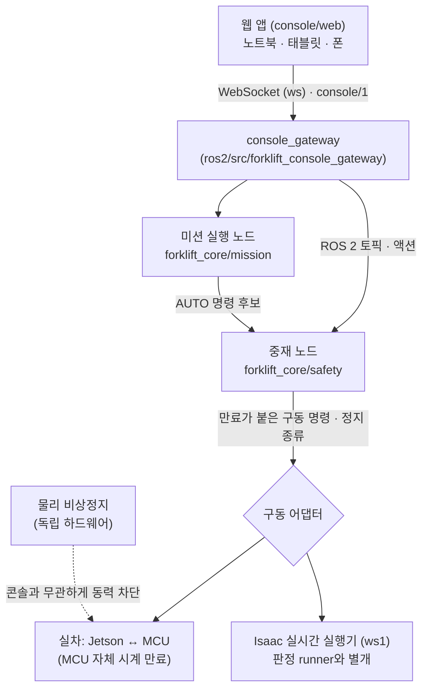

# 개별 지게차 운용 콘솔 설계

작성: 2026-10-13 · 상태: **설계, 계약 9절은 메인 개발과 합의(2026-10-13). 차량 쪽 구현 없음** · 계기: [6주차 피드백 5절](../references/week6_feedback.md)(무선 통신 미고려)

이 문서는 지게차 한 대를 무선으로 감시·지시·조종하는 콘솔의 구조와 안전 경계를 정한다. 메시지 단위의 계약은 [콘솔 인터페이스 계약 초안](../interfaces/2026-10-13-operator-console-contract-draft.md)에 따로 둔다. 미션 실행부 분리, 중재기 구현, Isaac 실시간 실행기, 구동 어댑터는 이 문서의 구현 범위가 아니다(6절). 화면 목업(모의 데이터, 저장소 밖)은 요구를 정리하는 데만 썼다.

## 1. 목적과 범위

**목적.** 개발·시연·현장 운용에서 지게차 한 대를 다음 세 가지로 다룬다.

1. 상태 감시: 지도·LiDAR·전방 카메라·작업 단계·주행 허가·통신 상태
2. 작업 지시: 팔레트와 하역 위치 선택, 시작·일시정지·재개·취소
3. 수동 조종: 지게차를 눈으로 보며 하는 조종(육안)과 영상만 보고 하는 조종(영상) 모두

**같은 콘솔을 세 대상에 쓴다.** 실차, ws1의 Isaac Sim 지게차, 개발용 가짜 차량이다. 대상마다 지원 기능이 다를 수 있으므로 차량이 지원 범위(capabilities)를 알리고, 콘솔은 지원하지 않는 요청을 보내지 않는다. 차량은 그런 요청을 받으면 명시적으로 거부한다.

**장치.** 팀 노트북, 태블릿·폰(설치 없이 브라우저), 게임패드. 모바일에서 게임패드를 쓸 수 없으면 터치 조종으로 대신한다.

**범위 밖.**

| 항목 | 이유 · 담당 |
|---|---|
| 다중 지게차 오케스트레이션 콘솔 | 사용자 결정으로 별도 프로젝트. 이 문서는 API를 그쪽이 그대로 중계할 수 있게만 둔다 |
| 물리 비상정지 | 콘솔·Wi-Fi와 독립된 하드웨어 경로(로드맵 44·92행). 콘솔의 STOP은 편의 정지이며 비상정지를 대신하지 않는다. 실물 운용의 **선행 의존성**이다 |
| 미션 실행부 분리, 중재기, Isaac 실시간 실행기, 구동 어댑터 | 메인 개발 담당(6절). 이 문서는 콘솔이 그 경계에 요구하는 것만 적는다 |
| `sim/isaac/run_transport.py`와 판정 배치 | 판정 경로는 sim 시각 기준 최대 속도로 돌고 S4 판정이 거기에 기댄다. 콘솔은 붙지 않는다 |

## 2. 결정과 근거

| 결정 | 근거 · 기각한 대안 |
|---|---|
| **로봇 쪽 전용 게이트웨이 + 웹 앱** (A안) | 브라우저가 ROS 토픽 이름을 모르는 작업 단위 API를 둘 수 있고, 나중의 중앙 서버가 같은 API를 중계하면 된다. rosbridge(B)는 publish 허용 목록으로 권한을 좁힐 수 있지만 브라우저가 ROS 토픽 구조에 묶인다. Foxglove(C)는 개발자 감시와 텔레옵 패널이 있지만 폰 현장 작업 UI로 맞지 않는다. C는 개발자 디버그 도구로만 선택적으로 쓴다 |
| **웹(브라우저) 클라이언트** | 폰·태블릿에는 ROS를 설치할 수 없다. 게임패드는 브라우저 Gamepad API로 읽는다 |
| **망: 1단계는 Jetson AP 1:1, 여러 대가 되면 중앙 서버 경유** | 사용자 결정. 공용 Wi-Fi는 기기 간 통신·멀티캐스트 차단으로 장소마다 동작이 달라질 수 있다. Jetson의 무선 모듈이 AP 모드와 센서 처리 동시 부하를 버티는지는 실물 시험 항목이다(9절) |
| **실차와 Isaac이 같은 ROS 2 로봇 스택을 쓰고, 아래 하드웨어만 바꾼다** | 콘솔이 그 스택에만 붙으므로 대상과 무관하게 같은 의미가 된다. 로드맵 M4 완료 조건("실제 구동 어댑터와 같은 의미의 명령/피드백으로 Isaac을 시험")과도 맞는다. Isaac 전용 대화형 진입점에 콘솔을 따로 붙이는 안은 미션 루프를 복제하게 되어 접었다 |
| **HTTPS·인증·보안은 1단계에서 하지 않는다** | 사용자 결정(2026-10-13). 웹 앱은 `http://`로 제공한다. 결과와 한계는 7.1·7.4에 적는다 |
| **AUTO 중 통신이 끊겨도 작업을 계속한다** | 사용자 결정(2026-10-13). 자율 주행의 안전은 차량 쪽 이동 금지(4.4)가 맡고, 끊긴 동안 콘솔의 STOP은 닿지 않는다. 그동안 멈출 수단은 차량 자체 판단과 물리 비상정지뿐이다. 그래서 **실차 AUTO 전에 콘솔·Wi-Fi와 독립된 물리 비상정지가 있어야 하고**(2026-10-12 기준 미확인), 로드맵 130행의 구역 차단·감시자·저속 시작 조건도 그대로 둔다. 미션 실행부는 콘솔 연결을 안전 입력으로 쓰지 않는다 |
| **움직임의 최종 판단은 차량 쪽** | 게이트웨이는 형식 검증·전달만 한다(인증은 나중 단계, 7.4). 조종 권한·만료·모드·정지는 차량 쪽 중재기가, 마지막 방어선은 구동 어댑터(MCU)의 자체 시계 명령 만료가 맡는다 |

## 3. 구조

ROS 2 msg/action 패키지와 노드는 실제로 쓸 때 만든다. 빈 scaffold는 만들지 않는다(CONTRIBUTING 1절).

**계층별 책임.** 로드맵 44행의 정지 소유권 계층을 콘솔까지 늘린 것이다. 한 계층이 다른 계층의 판단을 대신하지 않는다.

| 계층 | 맡는 것 | 맡지 않는 것 |
|---|---|---|
| 웹 앱 | 입력 수집(터치·키보드·게임패드), 입력 유효성(눌림·포커스·가시성·패드 연결), 표시, 영상 표시 진행 보고 | 움직임 허가 판단. 화면이 허가해 보여도 차량이 거부할 수 있다 |
| 게이트웨이 | 메시지 형식·범위 검증, 큐 상한과 최신값 유지, 미디어 패키징, 연결 상태 보고 | 조종 권한 판정, 명령 만료 판정, 정지 판단 |
| 중재기 (`safety/`) | 조종 권한 lease, session epoch·seq·신선도 검증, 모드 전이, deadman, 만료 뒤 명시적 재무장, 명령 출처 선택, 출처와 무관한 이동 금지 적용(4.4) | 미션 진행(phase·cusp) |
| 미션 실행부 (`mission/`) | AUTO 진행, phase 전이와 부수 작업 요청, 일시정지 중 작업 시간 정지, 재개 절차의 상태 확인 | 수동 명령 생성, 최종 속도 차단 |
| 구동 어댑터 | 자체 시계 명령 만료, 정지 시 출력 기본값, 적용 피드백 | 상위 판단 |
| 물리 비상정지 | 동력 차단 | — |

## 4. 모드·정지·재개

### 4.1 모드

중재기가 소유하는 모드는 네 가지다. 통신 상태(연결·끊김)는 모드와 직교하는 별도 값이다.

| 모드 | 뜻 | 들어가는 조건 |
|---|---|---|
| `PAUSED` | 대기. 차량은 정지를 유지한다 | 시작 상태, 일시정지, 재무장 직후, 수동 조종 끝 |
| `AUTO` | 미션 실행부가 명령 후보를 낸다 | 작업 시작, 또는 재개 절차(4.3) 완료 |
| `TELEOP` | 조종자의 명령이 후보다 | 조종 권한 보유 + 현재 상태가 수동 조종을 허용(4.5) |
| `STOPPED` | 안전 선점 정지. 재무장 전에는 아무 명령도 받지 않는다 | STOP(콘솔·게임패드·키보드), 중재기 내부 고장 판정 |

전이는 조종 권한을 가진 클라이언트의 요청이나 중재기 자체 판정으로 일어난다. 예외는 STOP 하나다. STOP은 권한을 좁히는 방향이라 관찰 클라이언트도 보낼 수 있다. 재무장·재개·모드 진입은 조종 권한 보유자만 한다. `PAUSED`로 가는 요청은 어느 작업 단계(phase)에서나 받는다. 다만 `STOPPED`는 예외다. `STOPPED`에서 나가는 길은 재무장(`rearm`) 하나뿐이고, 그 상태에서 오는 다른 모드 요청은 모두 거부한다. 4.5의 상태 조건은 `TELEOP`으로 들어갈 때만 검사한다. 재접속·재부팅·통신 복구는 전이를 일으키지 않는다(로드맵 92행). 끊김 뒤 다시 움직이려면 조종자가 재개나 조종 준비를 직접 해야 한다.

### 4.2 정지 종류

구동 명령 출력에 정지 종류를 둔다(메인 세션 답).

| 정지 종류 | 언제 | 구동 | 승강 · phase |
|---|---|---|---|
| 없음 | 정상 | 명령대로 | 진행 |
| 제어 감속 | 일시정지 | 감속 한계 안에서 멈춤, 조향 유지 | **승강과 phase 전이도 멈춤** |
| 안전 선점 | STOP, 명령 만료, 이동 금지 판정 | 속도 상한 즉시 0, 조향 유지 | 멈춤 |

구동 속도만 막으면 승강 목표와 phase 전이는 계속 진행되므로 셋을 함께 멈춘다. 정지 시점에 밀린 명령은 버린다. 실측 정지가 끝나기 전에는 모드를 넘기거나 재개하지 않는다.

**시간.** 일시정지 동안 작업 진행 시간(phase 한도)만 멈춘다. 신선도 검사와 watchdog(장애물 격자 FREE 증거 나이, 센서 침묵, SLAM 보정, 근접 관측 나이)은 계속 흐른다. 그래서 오래 멈춘 뒤 재개하면 증거가 낡아 재관측이 필요할 수 있다. 화면은 두 시간을 구분해 보여 준다.

### 4.3 재개 절차

재개는 버튼 한 번이 아니라 차례로 확인하는 절차다. 콘솔은 각 단계의 진행·실패 사유를 표시한다.

1. `stop_confirmed` 정지 확인: 실측 속도가 정한 문턱 이하로 정한 시간 동안 유지된다(로드맵 114행. 정확한 0 비교나 경과 시간으로 대신하지 않는다)
2. `state_verified` 실제 상태 확인: 자세, 적재, 삽입, 승강 상태
3. `frame_reexpressed` 보정 반영: SLAM 보정이 바뀌었으면 목표와 격자를 다시 표현한다
4. `path_rechecked` 경로 재검사: 남은 경로를 다시 검사하고, 필요하면 재계획한다

단계 이름과 실패 사유는 계약 6절에 있다. 잠정 합의이며 M-a 설계 때 실제 분기와 맞춰 확정한다.

1단계에는 바퀴 속도 피드백이 필요하다. 지금 구현의 SLAM 오도메트리, 정지 감지, 추종기 정지 판정, 근접 추적의 운반 추정도 모두 바퀴·조향 피드백에서 나온다. 그래서 지금 구현을 실차에 쓰려면 검증된 바퀴·조향 피드백이 필요하다. 수단이 엔코더 하나라는 뜻은 아니며, H1/H3에서 확인한다. 피드백이 없는 차량은 지원 범위에서 그 사실을 알리고, 재무장과 재개를 받지 않는다. 피드백을 무시하고 재무장하는 우회 모드는 두지 않는다. 스캔 정합이나 영상 정지 감지 같은 다른 정지 확인 수단은 H1/H3 결과를 보고 검증 대상으로만 둔다(합의).

### 4.4 출처와 무관한 이동 금지

다음 금지는 AUTO와 TELEOP 모두에 똑같이 적용된다. 수동 조종이 이 금지를 우회하는 길은 없다.

- `drive_permission` 장애물 제한: 정지 호(arc)와 앞 경로의 FREE 증거, 증거 나이, 센서 침묵
- 근접 구간의 포켓 관측 유효성 보호: 관측 소실·불일치·불확실성이면 정지

콘솔은 막힌 이유(허가 결과의 reason)를 그대로 보여 준다. 허가는 차체 전체 footprint가 지나는 셀을 검사하므로, 회전할 때 차체 뒤쪽이 바깥으로 쓸고 지나가는 범위도 같은 규칙으로 막힌다. 이 차체는 앞바퀴로 조향한다(`AckermannCommand`의 FL·FR).

**TELEOP의 허가 입력(합의, 계약 9절 2).** 지금의 `DrivePermission.allowed_speed`는 앞 경로 검사(`path_check`)가 없으면 0을 낸다(`drive_permission.py:478`). 수동 조종에는 계획 경로가 없다. 그렇다고 AUTO가 남긴 경로를 다시 쓰면 실제 명령과 다른 경로를 검사하게 된다. 합의한 방식은 다음과 같다.

- 앞 경로: 명령 곡률의 원호를 쓴다. `check_path`는 결과만 돌려주고 허가 상태를 바꾸지 않는다. 그래서 매 제어 주기 같은 snapshot과 현재 자세로 원호를 `update()`에 넣어 설치한 뒤 `allowed_speed`를 읽는다.
- 방향: 명령 부호가 아니라 **실제 이동 방향**이다. 남은 속도의 부호가 요청과 다르면(전진 중 후진 요청 등) 정지가 확인될 때까지 실제 이동 방향의 정지 호와 앞 경로를 계속 검사한다.
- 길이와 검사 속도: 새 요청값이 아니라 **남은 속도와 직전 적용 명령을 모두 덮는 값(최댓값)**으로 잡는다.
- 정지 호: 실측 조향으로 계산한다(지금과 같음).
- footprint: 적재 상태면 장애물 층의 적재 footprint(`footprints(loaded=True)`)를 쓴다. 목표 삽입 깊이와 팔레트 치수로 만든 계산값이다.
- 적용 순서: 비율 → 모드 상한을 곱한 물리량 → 곡률 제한 → 가감속 제한(slew) → **최종 허가 상한**(넘으면 계단식으로 자름) → 안전 선점이면 0. slew를 허가 상한 뒤에 두면 감속 중인 출력이 새 상한을 넘는다. 예를 들어 0.5 m/s에서 상한이 0.1 m/s로 내려가면, 감속 0.3 m/s²·주기 1/120 s의 slew 출력은 0.4975 m/s다. 이 순서는 배치 runner(`run_transport.py:7747-7752`)와 같다.

**보장 범위(밝혀 둘 한계).** 검사가 보장하는 것은 검사에 넣은 고정 곡률 원호와, 현재 조향을 유지한 정지 footprint까지다. 다음은 인증하지 않는다.

- 조향이 바뀌는 동안의 궤적
- 조향 응답의 지연과 오차
- 다음 입력으로 바뀐 궤적

이 편차는 M-b 계약에서 둘 중 하나로 덮는다. 조향 전환 구간의 swept envelope 검사, 또는 검증된 여유와 운용 제한(수동 조종 속도 상한, 곡률 변화율 제한)이다.

### 4.5 수동 조종을 허용하는 상태

근접 계약은 임의의 텔레옵 궤적을 인증하지 않는다(메인 세션 답). 그래서 상태별로 허용 범위를 둔다.

| 상태 | 수동 조종 | 대신 주는 동작 |
|---|---|---|
| 빈 차체, 근접 구간 밖 (관찰, 먼 접근, 복귀) | 허용 | — |
| 근접 구간 진입 뒤 ~ 삽입 중, 포크가 포켓 안 | **거부** | 검증된 복구 동작만: 축을 따라 똑바로 빼기 |
| 적재 중, 포크가 포켓에서 빠진 뒤 (운반) | **허용** (사용자 결정) | 허가 검사는 포크 밖으로 나온 화물을 포함한 적재 footprint로 하고, 속도·곡률 상한은 적재용 잠정값을 쓴다. 시뮬레이션·가짜 차량에서는 잠정값임을 표시하고 쓴다. **실차에서 켜는 조건**은 잠정값 표시가 아니라 로드맵 148행이 요구하는 검증이다. 적재 상태의 정지 거리, 급정지 안정성(미끄러짐·전도 없음, 지지 유지), 갱신된 제한이 그것이다. 지금은 적재에 따라 바뀌는 제동 모델이 없다(제동 모델이 하나뿐이다) |
| 들기·내리기 중, 또는 포크가 아직 포켓 안 | 거부 | 일시정지·STOP, 포켓 안이면 축을 따라 똑바로 빼기 |
| 후퇴 중 (포크가 아직 포켓 안) | 거부 | 축을 따라 똑바로 빼기 |

복구는 상태별로 정한다. 포크가 들어갔거나 팔레트를 들었으면 빈 차체의 관찰 접근으로 돌아가는 선택지를 주지 않는다.

**매 주기 판정(합의).** 이 표의 조건은 TELEOP에 들어갈 때 한 번만 보는 것이 아니다. 중재기는 제어 주기마다 현재 상태로 **주행 허가와 승강 허가를 따로** 판정한다(계약 6절 `drive_allowed`·`lift_allowed`). 진입한 뒤에 승강과 주행을 함께 요청해서 들기·내리기 중에 주행하는 길을 막기 위해서다. 수동 승강을 지원할지는 주행 금지와 별개로 정한다.

## 5. 수동 조종 안전

### 5.1 무장 단계

1. 조종 권한 받기 → 2. 수동 조종 모드 진입 → 3. **조종 준비**(무장) → 4. **누르고 있기**(deadman)를 누르는 동안만 움직인다.

누르고 있기를 떼면 0 명령이 되고 무장은 유지된다. 다음 경우에는 무장이 풀리고 조종자가 다시 조종 준비를 눌러야 한다.

- 명령 만료, 통신 끊김
- 탭이 가려짐(Page Visibility), 창 포커스 잃음, 게임패드 분리
- 영상 조종 중 영상 신선도 실패(5.3)
- 모드 전이, STOP

### 5.2 연결 신호와 입력 유효성은 따로 본다

연결이 살아 있어도 입력 처리가 멈출 수 있다. 백그라운드 탭에서는 입력 polling이 멈추고 연결만 유지된다. 그래서 웹 앱은 텔레옵 명령을 **같은 주기 안에서 입력 장치로부터 읽은 값**으로만 만들고, 입력 갱신이 멈추면 명령도 보내지 않는다. 연결 heartbeat로 텔레옵을 연장하지 않는다. 이것은 지원 클라이언트의 구현 규칙이다. 차량은 이를 검증할 수 없다(아래 보장 범위).

**명령 신선도는 차량 시계로만 판정한다.** 브라우저·게이트웨이·차량의 시계를 서로 빼지 않는다(CONTRIBUTING 5절). 방식은 계약 4절의 회신 토큰이다.

- 차량은 짧은 `tick`마다 예측할 수 없는 토큰을 붙이고, 보낸 시각을 차량 단조 시계로 기억한다.
- 텔레옵 명령은 마지막으로 받은 토큰을 되돌려 보낸다.
- 차량은 그 토큰의 송출 시각에 유효기한을 더해 **절대 만료 시각**을 정한다. 받은 시각에서 다시 세지 않는다.
- 제어 주기마다 그 시각을 검사한다. 그래서 새 패킷이 오지 않아도 정지가 일어난다.

시계 동기화 없이 왕복 지연까지 포함한 나이를 차량 시계 하나로 잴 수 있다. 시뮬레이터가 계획 중 sim 시각을 멈춰도 만료는 차량 호스트의 단조 시계로 진행한다.

**보장 범위.** 이 규칙이 보장하는 것은 명령이 최근에 차량이 보낸 tick을 받은 **뒤에** 만들어졌다는 것까지다. 입력 자체의 신선도는 위의 클라이언트 구현 규칙과 입력 상태 보고(계약 4.3)에 기댄다. 버그가 있는 클라이언트가 오래된 입력에 새 토큰을 붙이면 막지 못한다. 그래서 웹 앱의 이 부분은 시험(9절)으로 검증한다.

**세대.** 차량 세션(`session_epoch`), 조종 권한(`lease_id`), 정지 경계(`control_gen`), 무장(`arm_gen`)을 따로 센다(계약 1절). 이전 세대의 명령과 요청은 버린다. `control_gen`은 STOP·만료·끊김·일시정지·재무장 때마다 바뀐다. 그래서 정지 전에 보냈지만 늦게 도착한 재개·무장 요청이 정지 뒤에 실행되지 않는다. 거부된 요청을 웹 앱이 현재 세대로 자동 재전송하지 않는다. 만료로 정지한 뒤 늦게 도착한 명령으로는 다시 움직이지 않는다. 재무장으로 새 `arm_gen`을 받아야 한다.

### 5.3 영상 조종

영상 조종은 육안 조종보다 조건이 하나 더 붙는다. 표시 중인 영상이 최신이어야 한다.

- 차량은 촬영마다 고유 `frame_id`와, 그 촬영을 카메라 드라이버(또는 렌더러)에서 받은 차량 단조 시각을 기록한다. 같은 촬영을 다시 보내도 둘은 바뀌지 않는다.
- 웹 앱은 프레임을 그린 뒤 **다음 표시 콜백**(`requestAnimationFrame`, 동영상 요소라면 `requestVideoFrameCallback`)이 호출됐을 때만 그 `frame_id`를 표시한 것으로 보고 명령에 싣는다. 수신이나 디코딩, 그리기 호출만으로는 갱신하지 않는다.
- 차량은 그 촬영의 수신 이후 경과에 촬영 지연 상한(`camera_latency_bound_s`)을 더한 값이 `video_max_age_s`를 넘으면 영상 조종 명령을 버리고 무장을 푼다. 받아들인 명령의 만료 시각은 명령 만료와 영상 만료 가운데 이른 쪽이고, 제어 주기마다 검사한다(계약 4.2).

카메라나 렌더가 멈추면 새 촬영이 없으므로 나이가 계속 커진다. sim 시각이 멈춘 경우도 같다. sim 시각으로 재면 오래된 영상의 나이가 0으로 남을 수 있어서 차량 단조 시계로 잰다. 이 판정은 지원 클라이언트의 표시 보고를 믿는다는 전제 위에 있다. 브라우저 합성 이후 실제 화면 출력까지는 증명하지 못한다.

육안 조종 모드는 영상 조건만 빼고 나머지(4.4의 이동 금지, 만료, 상태 조건)는 똑같이 적용한다. 시스템은 조종자가 정말 차량을 보고 있는지 확인할 수 없다. 그래서 영상 신선도 실패로 무장이 풀린 직후에 육안 조종으로 바꾸려면 화면에서 "차량이 직접 보인다"를 따로 확인해야 하고, 그 전환을 이벤트로 남긴다. 두 모드의 속도 상한은 따로 두고, 육안 조종의 상한이 영상 조종보다 높지 않은 것으로 시작한다.

### 5.4 수치는 규칙에서 나온다

명령 유효기한과 텔레옵 속도 상한은 상수로 박지 않는다. 만료 판정, 하위 전달, 구동 반응, 제동을 합친 **실측 정지 거리**에서 정한다(`drive_permission.StoppingModel`의 지연·감속·여유와 같은 틀). H3 벤치 시험 전의 값은 모두 잠정값이며 화면에 그렇게 표시한다. 목업의 300 ms, 전진 0.5 · 후진 0.25 m/s도 잠정값이다.

회신 나이에는 tick 대기(최대 한 주기), 왕복 지연, 클라이언트 입력 주기가 함께 들어간다. 정하는 방법은 다음과 같다(합의).

- `command_max_age_s` ≥ tick 주기 + 왕복 지연 p99 + 클라이언트 입력 주기 + 여유
- tick 주기 ≤ `command_max_age_s` / 4
- 텔레옵 속도 상한: 실측 정지 거리(H3: 만료 판정 + 하위 전달 + 구동 반응 + 제동)가 허가가 보증하는 거리 안에 들어오게 정한다.
- `lease_timeout_s`: AUTO에는 영향이 없으므로(사용자 결정) 권한 정리용으로 `command_max_age_s` 이상이면 된다.
- `grace_s`: 정책값이다.
- `camera_latency_bound_s`: 촬영부터 드라이버·렌더 수신까지 걸리는 시간의 상한이며, 차량 단조 시계로 잰다. Isaac은 M-c의 실시간 실행·미디어 부하 조건에서, 실차는 H2에서 따로 잰다. D8b의 정렬 지연(91.7 ms, 표본 범위 상단 98.9 ms)은 영상을 끈 상태의 표본 범위이고 렌더 시각 기준으로 정렬한 값이다. 그래서 안전 상한의 근거로 옮기지 않는다. 예산보다 작게 잡으면 정상 조종 중에도 만료로 자주 멈춘다.

명령의 의미는 코어 계약을 따른다. 속도와 곡률은 **뒤 차축 중심** 기준이다(`AckermannCommand`). 실측 모델(축간 0.66 m, 윤거 0.53 m)은 한쪽 바퀴에서 잰 15°를 **두 바퀴 모두의 한계로 놓은 가정**이다(`sim/models/dls08_measured/README.md`). 이 가정에서 최대 곡률은 tan 15° / (0.66 + tan 15° × 0.265) ≈ 0.3665 m⁻¹이고, 뒤 차축 기준 최소 회전 반경은 약 2.73 m다. 15°가 바깥 바퀴였다면 2.20 m이고, 자전거 근사로는 2.46 m다. 회전 원을 실측하기 전까지는 미확정이므로 화면에는 "모델 계산값"으로 표시한다. 이 값은 모델의 조향 한계이고, 실측 모델 설정(`config/isaac_transport_measured.yaml`)의 추종기는 그 98 %인 0.36 m⁻¹, 계획기는 79 %인 0.29 m⁻¹(약 3.45 m)를 쓴다. 수동 조종의 곡률 상한도 차체 한계가 아니라 차량 설정에서 받는다.

### 5.5 입력 장치

| 장치 | 누르고 있기 | 주행 | 포크 | 정지 |
|---|---|---|---|---|
| 터치 (폰·태블릿) | 화면 버튼을 누르는 동안 | 가상 조이스틱 | 누르는 동안 올리기·내리기 | 하단 고정 STOP |
| 키보드 | Space | W/S 속도, A/D 조향 | R/F | Esc |
| 게임패드 | RB (또는 RT) | 왼쪽 스틱 속도, 오른쪽 스틱 조향 | 십자키 위·아래 | B |

터치 버튼과 조이스틱은 누르기 시작한 손가락을 끝까지 붙잡는다(pointer capture). 그래서 시선을 돌리는 사이에 손가락이 버튼 경계를 조금 벗어나도 풀리지 않는다. 손을 떼거나 터치가 취소될 때만 풀린다. 실차의 영상 조종에서도 터치를 주 수단으로 허용한다(사용자 결정). 평면 화면은 손끝 감각이 없으므로, 버튼과 조이스틱을 크게 두고 누르기 시작한 영역을 눈으로 확인하지 않아도 되게 배치한다.

브라우저의 Gamepad API는 보안 컨텍스트를 요구할 수 있다. 1단계는 HTTPS를 쓰지 않으므로 `http://<Jetson 주소>`에서는 브라우저에 따라 게임패드가 막힌다. 브라우저는 `localhost`를 보안 컨텍스트로 취급한다. 그래서 노트북에서 게임패드를 쓰려면 `ssh -L`로 게이트웨이 포트를 `localhost`로 가져와 접속한다(Isaac은 원래 이 경로다). 폰·태블릿은 터치를 쓴다. 지원 조합(OS · 브라우저 · 패드 · 접속 경로)은 시험으로 확인해 목록으로 남긴다.

## 6. 의존 작업과 순서

| 단계 | 내용 | 담당 | 선행 |
|---|---|---|---|
| C0 | 이 설계와 계약 초안 | 콘솔 | — |
| M-a | 미션 실행부를 `forklift_core/mission/`으로 분리. 외부 명령(일시정지·정지·재개) 입력 경계를 둔다. 동등성은 같은 입력을 재생해 명령·전이·hold/release·재계획 순서를 대조한다 | 메인 | S4 확인 배치 결과 |
| M-b | 중재기 `forklift_core/safety/` (4.1–4.5, 5.1–5.2). 시계와 토큰 난수원은 주입받는다. 결과 저장 상한에 닿으면 `busy`로 받고, STOP은 캐시 없이 항상 실행한다(계약 1절) | 메인 로드맵 | M-a |
| I-1 | `docs/interfaces/` 계약 합의 | 메인 + 콘솔 | C0 |
| C1 | 웹 앱 `console/web/` + 가짜 차량 백엔드(같은 API). **가짜 차량으로 동작(2026-10-13, `feat/console-c1`)**, 확인 범위는 `console/README.md` | 콘솔 | I-1 초안 (합의 전에도 가짜 백엔드로 시작 가능) |
| M-c | Isaac 실시간 실행기: 로봇 쪽 단조 시계 lease·watchdog, sim 관측 시각과 벽시계 구분, reset 때 epoch 무효화, 늦은 응답·밀린 명령 폐기, 페이싱 초과 처리. 판정 runner와 별개 | 메인 | M-a, M-b |
| C2 | 게이트웨이 노드 | 콘솔 | I-1 합의, 사용할 msg/action이 생긴 뒤 |
| C3 | Isaac 연결 시험 | 콘솔 + 메인 | M-c, C1, C2 |
| C4 | 실차 연결 | 콘솔 + 메인 | H3 구동 어댑터, 물리 비상정지 |

**작업 규칙.**

- 공유 작업 트리가 아니라 별도 브랜치·worktree에서 하고 PR로 합친다.
- 웹 앱 폴더를 만드는 변경에 `CONTRIBUTING.md` 1절 갱신을 같이 넣는다.
- 게이트웨이·웹 앱은 runner의 `source_sha256` 범위 밖이므로 자체 provenance(커밋, 빌드 해시)를 남긴다.
- `forklift_core`나 `sim/isaac`에 새 모듈이 들어가면 전체 소스 사전을 비교하는 측정·보정 도구(`tools/s4_drive_terms.py`, `tools/d8b_calibration.py`)의 이전 측정과 섞을 수 없다. 측정이 필요하면 다시 잰다.
- ws1 GPU는 판정 배치와 동시에 쓰지 않는다. 동시 실행으로 근접 카메라 렌더가 늦어져 판정이 실패한 사례가 있다. Isaac 콘솔 세션은 판정 배치가 없을 때만 띄운다.

## 7. 통신과 배포

### 7.1 실차 (1단계: Jetson AP 1:1)

- Jetson이 WPA2/WPA3 AP를 띄우고, 게이트웨이가 같은 호스트에서 웹 앱 정적 파일(`http`)과 WebSocket(`ws`)을 제공한다.
- 접속은 `http://<Jetson AP 주소>`(IP 주소)로 한다. HTTPS는 쓰지 않는다(사용자 결정). 게임패드 제약은 5.5에 적었다.
- **인터넷 없는 AP에서의 모바일 동작은 시험 항목이다.** 폰은 인터넷이 없는 Wi-Fi를 감지하면 모바일 데이터로 넘어가거나 연결을 끊을 수 있다. 운영체제의 인터넷 확인 요청에 응답하는 것과, 접속 절차(모바일 데이터 끄기 등)를 문서로 두는 것을 함께 검토한다. 지원 기기·설정 조합은 시험으로 정한다.

### 7.2 Isaac (ws1)

- Slurm GPU 잡으로 Isaac 실시간 실행기(M-c)와 ROS 2 스택, 게이트웨이를 띄운다.
- 잡이 게이트웨이를 띄운 노드와 포트를 파일로 남기고, 노트북 쪽 스크립트가 그 값으로 터널을 만든다. 여러 사용자가 같은 서버를 쓰므로 포트를 고정하지 않는다.
- 노트북은 `ssh -L`로 게이트웨이의 TCP 포트에 붙는다. `ssh -L`은 TCP만 전달하므로 영상도 WebSocket(TCP)으로 보낸다. WebRTC는 쓰지 않는다.
- 1단계에서 폰은 Isaac 대상에 직접 붙지 않는다.
- Isaac 실행기가 실시간 배속을 유지하지 못하면(기준은 M-c) 상태에 그 사실을 싣고, 차량 쪽이 수동 조종을 막는다. 만료 판정의 시계를 sim 시각으로 바꾸지 않는다.
- 터널이 Slurm 실행 노드(와 컨테이너)까지 닿는지 확인해야 한다. 잡이 끝나거나 다시 시작되면 새 session epoch가 되어 조종 권한이 풀려야 한다.

### 7.3 영상과 대역

- **제어와 미디어는 WebSocket 연결을 따로 쓴다**(계약 1절). TCP 하나 안에서는 이미 송신 큐에 들어간 영상 바이트를 버릴 수 없어서, 그 뒤의 정지·회신이 늦어지기 때문이다. 서버는 미디어 연결의 송신 버퍼가 상한을 넘으면 새 프레임을 버린다.
- 영상은 JPEG 프레임으로 싣고, 큐에는 최신 프레임만 둔다. 해상도와 FPS는 구독할 때 상한을 정한다. 같은 설정이면 한 번 인코딩해 모든 클라이언트에 같은 바이트를 보낸다. 관찰 클라이언트에는 더 낮은 상한을 둘 수 있다.
- Orin Nano에는 하드웨어 영상 인코더(NVENC)가 없다. H.264나 WebRTC는 CPU 부하를 재 본 뒤에만 검토한다.
- 미디어 인코딩·송출은 제어 처리와 다른 실행 흐름(프로세스 또는 CPU 할당을 나눈 스레드)에 둔다. 실행 흐름만 나눠서는 무선 구간의 지연 독립성까지 보장되지 않는다. 그래서 위의 연결 분리와 송신 버퍼 상한을 같이 둔다.
- 늦을 때 버리는 것은 렌더·송출 프레임이다. physics step을 건너뛰거나 재개 직후 몰아서 실행하지 않는다(M-c 소관).

### 7.4 나중: 인증·보안

1단계는 인증·Origin 검증·암호화를 하지 않는다(사용자 결정). 그래서 AP 비밀번호가 유일한 접근 장벽이다. AP에 붙은 기기는 누구나 관찰하고, 조종 권한을 요청하고, STOP을 보낼 수 있다. `client_id`는 자기 신고 값이라, 다른 기기가 같은 값을 대면 재연결 유예 중인 조종 권한을 가져가거나 저장된 요청 결과를 조회할 수 있다(계약 2절). 결과 조회는 재실행하지 않으므로 차량을 움직이지는 않는다. AP 안의 아무 기기나 STOP을 반복해 작업을 멈출 수 있는데, 이것은 안전한 쪽의 고장이다. 더 큰 한계는 인증 없는 기기가 조종 권한을 얻어 재무장·작업 지시·조종까지 할 수 있다는 점이고, 이 한계는 그대로 남는다. 조종 권한(lease)은 동시 조종을 막는 조정 장치이지 보안 장치가 아니다. 계약은 나중에 인증을 끼울 자리(`hello`의 인증 필드, 조종 권한과 관찰 권한의 구분)를 남겨 둔다. 공용망이나 중앙 서버 단계로 가기 전에 이 절을 다시 연다.

### 7.5 나중: 중앙 서버

여러 대가 되면 중앙 서버가 차량별 게이트웨이 API를 중계·집계한다. 조종 권한과 명령 신선도는 **종단 간**으로 유지한다. 클라이언트가 끊겼는데 중앙 서버가 대신 lease를 갱신하거나 명령을 재전송하면 안 된다.

## 8. 웹 앱 화면 요구

목업을 바탕으로 한 요구다. 배치는 넓은 화면 기준이며, 폰에서는 카메라 → 수동 조종 → 지도 → 작업 지시 순서로 세로로 쌓고 STOP을 하단에 고정한다.

- **상단**: 연결 대상(실차 / Isaac / 가짜 차량), 모드, 정지 종류, 조종 권한, STOP(문구: "편의 정지 · 비상정지 아님"), 재무장
- **작업 지시**: 팔레트·하역 위치 선택, 요청 번호와 상태(수락·실행·일시정지·보류·완료·실패·취소와 사유), phase 진행, 재개 절차 체크리스트(4.3), 상태별 복구 동작(4.5)
- **차량 상태**: 속도(뒤 차축 기준), 조향, 포크 높이, 자세와 보정 버전, 적재, 주행 허가와 사유, 작업 시간과 신선도 시간의 구분(4.2). 측정 수단이 없는 값(배터리 등)은 "측정 장치 없음"으로 표시하고 지어내지 않는다
- **지도**: 점유 격자, LiDAR 점, 계획 경로(후진 구간 구분), 팔레트·하역 위치, 수동 조종 예상 궤적(차체 전체 footprint가 쓸고 지나가는 범위)
- **전방 카메라**: 포켓 검출 오버레이, 수동 조종 예상 궤적의 바닥 투영, 영상 나이(차량 시계 기준)와 정지 표시. 오버레이는 차량이 보낸 검출 결과·카메라 모델(계약 3·7절)로 화면이 그리며, 표시용일 뿐 안전 판단에 쓰지 않는다
- **수동 조종**: 무장 상태, 누르고 있기, 조이스틱, 포크, 명령 막대, 거부 사유, 허용되지 않는 상태에서는 비활성과 그 이유(4.5), 입력 장치 상태
- **통신**: 접속 대상과 경로, 왕복 지연, 끊김 시 정책, 접속 기기(조종·관찰)
- **이벤트 기록**: 모드 전이, 거부, 만료, 끊김, 재무장

## 9. 검증 계획

증거의 경계를 섞지 않는다. 같은 중재기 시험은 공통 정책의 증거일 뿐이고, MCU 자체 만료, 실제 제동, 물리 비상정지는 각각 따로 증거가 필요하다.

| 대상 | 시험 | 증거 종류 |
|---|---|---|
| 중재기 (M-b) | 모드 전이표, 만료·재무장, 역순·중복 명령, 상태 회신 번호 상한, 정지 종류별 출력 | 단위시험 |
| 웹 앱 (C1) | 가시성·포커스·패드 분리 시 무장 해제, 입력 정지 시 명령 정지, 거부 사유 표시, 폰 폭 배치 | 브라우저 자동 시험 + 가짜 백엔드 |
| 게이트웨이 (C2) | 형식·범위 검증, 큐 상한과 최신값 유지, 미디어 폭주 시 제어 지연 | 단위·통합시험 |
| Isaac 연결 (C3) | 끊김·재연결·잡 재시작(epoch), 영상 정지 시 영상 조종 해제, 계획 중 정지 반영, 1배속 초과 처리 | 시뮬레이션 기능 회귀 (안전 검증 아님) |
| 실차 (C4) | 텔레옵 중 콘솔 단절 시 실제 정지 시간과 거리, AUTO 중 콘솔 단절 시 작업 계속과 이동 금지 유지, 차량 상위 프로세스 종료 시 하위 만료 정지, 재연결 뒤 자동 재개 없음 | H3 벤치 + 실물 (물체로 시험, 사람 보호 성능으로 표시하지 않음) |
| 망·장치 | Jetson AP 모드·동시 부하, 폰의 인터넷 없는 SSID 유지, 게임패드 지원 조합 | 실물 확인 기록 |

## 10. 결정된 것과 열린 질문

**사용자 결정 (2026-10-13).**

| 질문 | 결정 | 반영 |
|---|---|---|
| AUTO 중 통신이 끊기면 | 계속한다 | 2절, 4.1, 4.2, 계약 2절 |
| 적재 중 수동 조종 | 허용 (운반 구간. 들기·내리기 중과 포크가 포켓 안일 때는 제외) | 4.5 |
| HTTPS | 하지 않는다 | 5.5, 7.1 |
| 인증·보안 | 나중 단계 | 7.4, 계약 2절 |
| 실차 영상 조종에서 터치를 주 수단으로 | 허용 | 5.5 |

**열린 질문.**

| 질문 | 초안의 기본값 | 정할 사람 |
|---|---|---|
| 텔레옵 속도 상한·명령 유효기한·영상 나이 상한 | 잠정값, H3 실측 뒤 확정 | 메인 (H3) |
| 관찰 클라이언트 수 상한 | 미정 | 콘솔 |
| Jetson 무선 모듈의 AP 지원 | 미확인 (Jetson 미구매) | 실물 시험 |
| 바퀴 속도 피드백이 없을 때의 정지 확인 | 재무장·재개 금지 | 메인 (H1/H3, 엔코더 장착 가능 여부) |
| 끊긴 조종자의 재연결 유예 시간 `grace_s` | 미정 (수 초) | 콘솔 + 메인 |

## 11. 자체 검토 기록

계획 단계의 독립 검토를 세 번 거쳤다. 지적과 처리를 남긴다.

**① 원자료 재계산 (작성자).**

- 최소 회전 반경: 목업에는 자전거 근사 2.46 m를 썼다. 모델의 안쪽 바퀴 한계로 다시 계산하면 2.73 m이고, `config/isaac_transport_measured.yaml`의 0.3665 m⁻¹와 일치한다. 2.73 m로 고쳤다.
- 인용한 경로와 행(로드맵 44·92·114·132행, `drive_permission.py`, `tools/s4_drive_terms.py`, `tools/d8b_calibration.py`, CONTRIBUTING 1·5절)이 실제로 있는지 확인했다.

**② Codex 적대적 검토 1차 (P1 3, P2 7, P3 1).** 모두 원자료로 확인하고 반영했다.

- P1 무수신 만료: 받은 시점이 아니라 토큰 송출 시각 기준의 절대 만료 시각으로 바꾸고, 제어 주기마다 검사하도록 했다. lease 만료 규칙도 추가했다.
- P1 재송출로 영상 나이 초기화: 송출 시각 대신 촬영 단위 `frame_id`와 수신 시각, 촬영 지연 상한으로 바꿨다.
- P1 세대 혼동: `session_epoch`, `lease_id`, `arm_gen`을 나누고, 번호 재사용을 금지했다.
- P2 회신 규칙의 보장 범위: 범위를 줄여 적었다. 토큰을 예측할 수 없게 하고, 시간 기준 창을 두었다.
- P2 표시 판정 시점: 표시 콜백으로 정했다.
- P2 단일 연결의 송신 큐: 제어와 미디어의 연결을 나누고, 송신 버퍼 상한을 두었다.
- P2 STOP 예외·PAUSED 전이 모순: 4.1과 계약 5절에서 정리했다.
- P2 TELEOP의 허가 경로: 4.4에 제안을 넣고 합의 항목으로 올렸다.
- P2 회전 반경이 모델 가정이라는 점: 5.4에 밝혔다.
- P2 대상 목록·revision·오버레이 데이터: 계약 3·5.1·7절에 넣었다.
- P3 정지 확인 문턱: 4.3에 반영했다.

**③ 다른 관점의 독립 검토 (agy, Gemini 3.8 Flash High).** ②의 결론을 보여 주지 않고 "적히지 않은 전제"만 물었다. 12건 가운데 채택은 아래와 같다.

- 단일 TCP의 머리 막힘(②와 같은 결론)
- 인터넷 없는 AP에서 폰의 동작(7.1 시험 항목)
- 회신 나이의 주기 예산(5.4)
- 바퀴 속도 피드백 의존(4.3, 10절)
- 터치의 손가락 이탈(5.5)
- 육안 조종 전환 남용(5.3)
- 관찰자 인코딩 부하(7.3)
- lease 재연결 유예(계약 2절)
- Slurm 포트(7.2)
- 회전 시 차체 뒤쪽 쓸림(4.4. 이 차체는 앞바퀴 조향이지만 차체가 쓸고 지나가는 범위는 허가가 footprint 전체로 검사한다)

기각은 두 건이다.

- "Jetson RTC 부재로 TLS 인증서 검증 실패": 인증서 유효기간은 서버가 아니라 브라우저가 자기 시계로 검사한다.
- "Isaac에서는 만료를 sim 시각으로 판정": 계획 중 sim 시각이 멈추면 만료가 일어나지 않는다(이전 Codex P1). 대신 배속 유지 실패 시 수동 조종을 막는 것으로 반영했다(7.2).

**Codex 재검토 2차 (새 P1 4).** 원자료로 확인하고 반영했다.

- `PAUSED` 요청으로 `STOPPED` 잠금을 우회할 수 있었다: `STOPPED`에서 나가는 길을 `rearm` 하나로 묶었다(`stopped_locked`).
- 재연결 유예 중에 처리되지 않은 이전 요청이 다시 유효해졌다: 권한을 돌려줄 때 `lease_id`를 새로 발급한다.
- 영상 만료가 명령의 지속시간에 반영되지 않았다: 영상 조종의 만료 시각을 두 시각 중 이른 쪽으로 정했다.
- slew가 허가 상한을 다시 넘겼다: 순서를 slew → 최종 허가 상한 → 안전 선점으로 고쳤다. 배치 runner의 순서와 같다.

**Codex 재검토 3차 (새 P1 1).** 접속이 유지된 채 STOP → 재무장을 거치면, 그 전에 보내 늦게 도착한 `mission_resume`가 세대 검사를 통과했다. 정지 경계마다 바뀌는 `control_gen`을 조종 권한이 필요한 모든 요청에 붙이고, 거부된 요청을 자동 재전송하지 않게 했다.

**Codex 재검토 4차 (새 P2 1).** `control_gen` 반영은 이전 P1을 닫았고, 정상 흐름(STOP → 재무장, 일시정지 → 재개)도 막지 않는다고 확인받았다. 새 지적은 세대 검사와 멱등 결과 반환의 순서였다. 처리에 성공했지만 응답이 유실되어 재전송하면, 세대가 이미 올라가 있어 거부된다. 그래서 계약 1절에 순서를 정했다. 이미 처리한 `request_id`는 세대 검사 없이 저장된 원래 결과를 돌려주고, 처음 받은 요청에만 세대 검사를 한다.

**Codex 재검토 5차: 새 P1/P2 없음(수렴).** 문서 규칙을 대입한 반례 10건에서 모순이 없었다. P3 1건("아직 처리되지 않은" 이전 세대 요청으로 문장 범위를 좁힘)은 반영했다. 이 판정은 설계·계약 수준이며, 구현과 실차 검증은 아니다.

**사용자 결정 반영 (2026-10-13).** AUTO 중 끊김은 계속, 적재 중(운반) 수동 조종 허용, HTTPS 없음, 인증·보안은 나중, 실차 영상 조종에서 터치 허용. 바뀐 문장은 2·4.1·4.2·4.5·5.5·7.1·7.4·10절과 계약 1·2·5절이다. **Codex 일관성 검토 1차 (새 P2 2건, P1 없음).** 지적은 두 가지였다. 하나는 AUTO 계속 결정과 "제어 연결 끊김 = 정지" 문장, 그리고 실차 시험 기대값이 서로 맞지 않는 점이었다. 다른 하나는 인증이 없을 때 `client_id` 사칭이 낳는 결과를 밝히지 않은 점이었다. 처리는 다음과 같다. 콘솔 단절(TELEOP은 정지, AUTO는 계속)과 차량 제어 프로세스 고장(하위 만료로 정지)을 구분해 적었다. AUTO 중 lease가 만료되면 권한 세대만 바뀐다고 명시했다. 사칭의 구체적 결과는 계약 2절과 설계 7.4에 적었다. **Codex 일관성 검토 2차: 새 P1/P2 없음(수렴).**

**메인 개발과의 합의 반영 (2026-10-13).** 계약 9절 일곱 항목의 답을 반영했다.

- STOP은 결과 캐시 없이 항상 실행한다. 앞서 Codex 지적에 따라 STOP도 캐시를 먼저 보게 했던 규칙을 메인 개발 안으로 바꿨다. 늦은 중복 STOP이 차를 다시 세우는 것은 안전한 쪽이고, 캐시가 가득 차도 STOP이 막히지 않는다.
- 결과 저장 상한에 닿으면 `busy`로 받는다.
- 수동 조종 허가의 설치 방식, 실제 이동 방향, 경로 길이를 합의대로 정하고 보장 범위의 한계를 적었다. 적재 footprint와 `command`·`applied`도 정의했다.
- 주행·승강 허가를 매 주기 따로 판정하게 했다. 실차에서 적재 수동 조종을 켜는 조건과, 실차 AUTO 전에 물리 비상정지가 있어야 한다는 선행 조건을 적었다.
- 재개 단계 이름·사유와 수치 예산 방법을 적었다. D8b 지연 값은 근거로 쓰지 않는다.

**Codex 합의 반영 검토: STOP 예외 변경을 포함해 새 P1/P2 없음(수렴).** 앞선 '캐시 먼저' 지적은 당시 계약에 대한 것이었다는 확인을 받았다.
