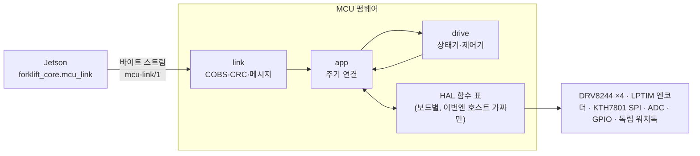
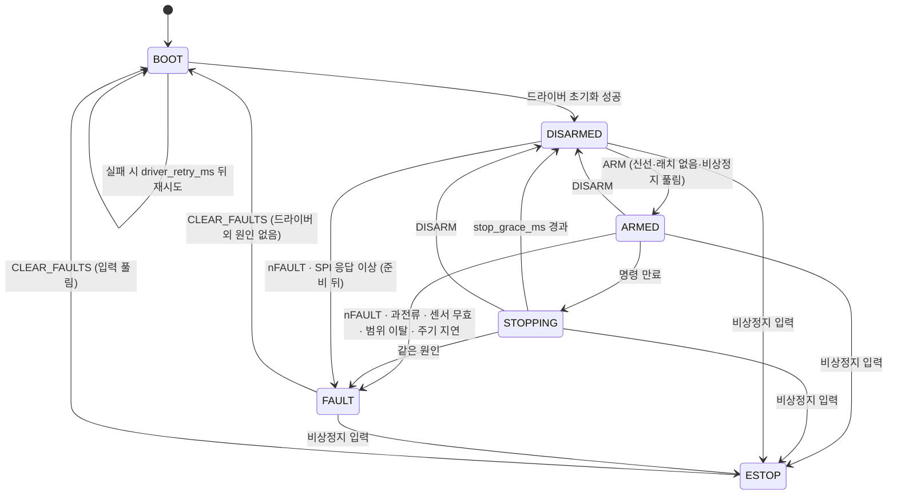

# MCU 펌웨어 코어 설계

작성일: 2026-10-22 · 상태: **설계 초안, 실기기 없음** · 관련: [핀맵 초안 검토](2026-10-22-h743-pinmap-draft-review.md), [링크 계약 mcu-link/1](../interfaces/2026-10-22-mcu-link-contract.md), [구현 계획](../plans/2026-10-22-mcu-firmware-core.md)

## 1. 목적과 범위

로드맵 H3(하위 제어: 속도·조향·승강 제어, feedback·sequence·heartbeat·명령 만료)와 운용 콘솔 설계의 "마지막 방어선은 구동 어댑터(MCU)의 자체 시계 명령 만료"를 맡을 MCU 펌웨어를, **실기기 없이 미리 만들 수 있는 부분만** 만든다.

| 이번에 만든다 | 이번에 만들지 않는다 |
|---|---|
| 하드웨어와 무관한 C 코어: 엔코더 해석·속도 추정, 바퀴 속도 PI, 조향·승강 위치 제어, 명령 만료·비상정지·결함 처리 상태기, DRV8244·KTH7801 프레임 해석, 링크 프레임·CRC | STM32 HAL 구현, CubeMX 프로젝트, 링커 스크립트, 보드 설정값 |
| 코어가 부를 얇은 HAL 경계(함수 표)와 그 계약, 호스트용 가짜 HAL | ARM 툴체인 고정(CONTRIBUTING 4절: MCU 미정 상태에서 컴파일러를 고정하지 않는다) |
| 호스트 단위시험(CMake + 자체 단언 헤더), pytest 에서 빌드·실행 | 실제 게인 튜닝, 모터 모형, 실차 정지 거리 |
| Jetson 쪽 프로토콜 대응(파이썬, ROS·시리얼 비의존)과 C↔파이썬 교차 시험 | 시리얼 포트·ROS 노드 어댑터, Ackermann 명령 → 실차 관절 명령 변환(조향 기구가 아직 모형화되지 않음), 실행 중 설정 바꾸기 메시지 |

MCU 는 STM32H743VIT6(WeAct)가 유력하지만 미확정이다. 코어는 C11 과 `float`(Cortex-M7 단정밀 FPU)만 쓰고, 동적 할당·전역 가변 상태·OS 를 쓰지 않아 다른 MCU 로 바뀌어도 그대로 간다.

## 2. 층 구조

- **코어(`firmware/core/`)**: 순수 함수와 호출자가 소유한 구조체만. 시각·입력은 인자로 받는다. 호스트에서 빌드·시험한다.
- **app(`fw_app`)**: 한 주기에 HAL 이 모아 둔 입력 스냅숏을 읽어 코어에 넘기고, 코어 출력을 HAL 에 넘기고, 링크 바이트를 주고받는다. HAL 은 함수 포인터 표(`fw_hal`)로 받아 호스트에서는 가짜 HAL·간단한 모터 모형으로 돌린다.
- **보드 HAL(`firmware/boards/<board>/`)**: 핀맵·보드가 확정된 뒤 만든다. 이번에는 폴더를 만들지 않는다(CONTRIBUTING 1절).

## 3. HAL 계약

코어 시험이 실기에서도 의미가 있으려면 HAL 이 다음을 지켜야 한다. 보드 HAL 을 만들 때 이 절이 요구사항이다.

- **비차단**: `fw_app_tick` 안에서 부르는 HAL 함수는 기다리지 않는다. SPI·ADC·UART 는 DMA·인터럽트가 배경에서 버퍼를 채우고, 주기 함수는 **스냅숏**만 읽고 쓴다.
- **링크 송신은 프레임 단위**: `link_write_frame` 은 프레임 전체를 송신 버퍼에 넣거나 전혀 넣지 않는다(앞부분만 넣으면 남은 바이트를 버릴 수 없어 다음 프레임까지 깨진다). 넣지 못한 `STATE` 는 통째로 버린다.
- **표본마다 신선도**: 입력 스냅숏의 절대각 프레임·ADC 값마다 "이번 주기에 새로 받았다" 플래그가 있다. 새 표본이 없으면 코어는 그 주기를 실패한 표본으로 센다 — 묵은 정상 값을 다시 넘겨 무효 판정을 막지 않는다. 절대각은 `invalid_limit`, 전류는 `adc_invalid_limit` 번 연속 실패하면 무효(`*_sensor_invalid`, `current_sense_invalid`)이고, 무효인 동안 `ARM` 을 거부하며 `ARMED`·`STOPPING` 이면 결함으로 래치한다 — 전류를 못 읽는 채로 과전류 보호가 조용히 꺼지지 않게.
- **드라이버 SPI 거래**: 한 번에 하나만 진행하고, 거래마다 코어가 정한 32비트 **태그**를 HAL 이 응답과 함께 돌려준다. 태그는 실제로 시작된 거래에서만 오른다(옛 거래가 버스를 잡고 있는 동안 HAL 이 시작을 거절하므로 그 태그가 다시 돌아오지 않는다). 태그가 지금 거래와 다르면(제한 시간으로 포기한 거래, 재초기화로 버린 순서의 거래) 그 응답은 버린다 — 늦게 온 옛 응답이 새 순서의 첫 응답으로 오인되지 않게. 코어가 낸 프레임을 HAL 이 시작하지 못하면(`drv_spi_start` 거절) app 이 들고 있다가 다음 주기에 다시 시도한다. `spi_timeout_us` 는 **거래 유실 감지용**이다 — 16비트 프레임은 10 MHz 에서 약 1.6 µs 라 지연 응답과 정상 응답을 구별할 이유가 없다. 그래서 app 은 주기 머리에서 응답을 먼저 수거해 넘기고, 코어는 그 뒤에 "시작(또는 시작 대기)한 지 `spi_timeout_us` 가 지났는데 응답이 없다"를 판정한다. 시작 거절이 계속돼도 같은 기한이 걸린다. 설정 검증은 `spi_timeout_us ≥ 2 × period_us` 를 요구한다(정상 응답이 다음 주기 머리에 수거되기 전에 기한이 지나지 않게). 기한을 넘기면 그 초기화는 실패로 끝나고 `driver_retry_ms` 뒤 처음부터 다시 하며, 다시 시작하기 전에 남은 응답을 비운다.
- **시각**: HAL 은 32비트 µs 시계를 주고, 코어는 주기마다 차분을 더해 **64비트** MCU 시각으로 넓혀 쓴다(주기 간격은 2³¹ µs 보다 훨씬 짧다). 마감·대기·echo 비교는 모두 64비트라 넘어감이 없다. `STATE.mcu_time_us` 도 이 64비트 값이다. 초기화 중이 아니면 네 채널의 `FAULT_SUMMARY` 를 돌아가며 읽어 `driver_status` 를 갱신한다. 이때 응답 상위 비트가 `11` 이 아니거나 응답 제한 시간을 넘기면 그 채널의 드라이버 결함으로 본다. 출력(DRVOFF)은 주기마다 SPI 시작보다 먼저 쓴다 — 재초기화의 `CLR_FLT` 가 나갈 때 DRVOFF 는 이미 high 다.
- **LPTIM 카운터**: HAL 이 두 번 연달아 읽어 같은 값만 넘긴다(RM0433 43.4).
- **주기 지연**: app 은 주기 시작 시각 간격을 재서 `2 × period_us` 를 넘으면 `cycle_overruns` 를 세고, `ARMED` 중 연속 `overrun_limit` 번이면 `cycle_overrun` 결함으로 래치한다. 속도 추정은 표본마다 찍힌 시각으로 계산하므로 주기 하나가 밀려도 속도가 배로 뛰지 않는다.
- **독립 워치독**: app 은 주기를 끝까지 돌았을 때만 HAL 의 `watchdog_kick` 을 부른다. MCU 가 멈추면 독립 워치독이 리셋하고, 리셋 동안 핀이 뜨면 DRV8244 의 DRVOFF 내부 풀업이 출력을 끈다(Hi-Z — 승강은 4절 전제 참조). 워치독 시간은 보드 HAL 설정이다.

## 4. 안전 상태기

- **주기 순서**: ① 입력 스냅숏 ② 센서 해석 ③ **만료 판정**(메시지보다 먼저 — 마감 뒤에 도착한 `DRIVE` 가 마감을 덮어써 만료를 놓치지 않게) ④ 비상정지·결함 판정 ⑤ 들어온 메시지 처리 ⑥ 제어기 ⑦ 출력 ⑧ `STATE` 송신 ⑨ 워치독.
- **신선도**: `ARM`·`DRIVE` 는 부팅 ID(u32)·무장 세대(u16)·MCU 시각(u64) 되돌려받기로 나이를 MCU 시계로 잰다(계약 2절). 받은 시각만 쓰면 전송로에 묶였던 명령이나 MCU 재부팅 전 명령 묶음이 늦게 와도 살아나기 때문이다. 유효 시간도 echo 기준(`deadline = echo + min(valid_after_echo_ms, command_timeout_ms)`)이라 전송 지연만큼 늘어나지 않고 오히려 짧아진다. 받을 때 이미 마감이 지났으면 거부한다. MCU 시각을 64비트로 둔 것은 32비트 µs 가 71.6 분마다 돌아와, 같은 무장 구간에서 그만큼 지난 명령이 다시 "신선"해 보이기 때문이다.
- **무장 자체의 마감**: `ARM` 도 `echo + command_timeout_ms` 를 마감으로 건다. 무장 뒤 `DRIVE` 가 오지 않으면 `STOPPING` 을 거쳐 `DISARMED` 로 돌아간다(무장한 채 조향·승강을 무한정 붙잡지 않게).
- **명령 만료**: `ARMED` 에서 마감이 지나면 `STOPPING` — **출력을 켠 채** 바퀴 목표 0·조향/승강은 그 순간 측정값 유지로 `stop_grace_ms` 동안 제어해 세우고, `DISARMED` 로 내려간다. 바로 끊으면 바퀴가 관성으로 굴러가기 때문이다. `STOPPING` 중 `DRIVE`·`ARM` 은 거부하고, 비상정지·결함은 즉시 이긴다. `stop_grace_ms = 0` 이면 바로 내려간다. 어느 쪽이 실차에서 짧게 서는지는 실측으로 정한다.
- **무장**: `DISARMED` 에서만, 그리고 조향·승강 측정이 유효하고 범위 안이며 전류 측정이 유효할 때만(목표로 복사할 측정이 믿을 만해야 하므로). 거부 이유의 우선순위는 계약 3.2. 무장하면 바퀴 목표 0, 조향·승강 목표 = 지금 측정값, 적분 초기화, 마감 = `echo + command_timeout_ms`. 두 바퀴 0 인 `DRIVE` 를 먼저 받아야 바퀴를 움직인다. 조향·승강 목표는 설정한 최대 변화율로만 따라가므로 첫 명령의 목표가 멀어도 한 번에 튀지 않는다.
- **과전류**: 출력이 켜진 `ARMED`·`STOPPING` 에서만 판정한다. DRV8244 는 고압측 과전류(접지 단락) 뒤 출력을 끈 채로도 IPROPI 를 클램프 전압에 붙여 두므로(SLVSG24C 8.3.4.1), 출력을 끈 상태에서 IPROPI 를 전류로 읽으면 없는 과전류가 계속 보인다.
- **래치와 재시작**: `FAULT`·`ESTOP` 은 `CLEAR_FAULTS` 전까지 남는다. 재연결·재부팅·비상정지 해제만으로 달리지 않는다(로드맵 H3). `CLEAR_FAULTS` 의 조건은 비상정지 입력 풀림과 센서(절대각·전류) 유효뿐이고, 받아들이면 드라이버를 다시 초기화하는 `BOOT` 로 간다. 드라이버 결함과 과전류를 해제 조건에 넣지 않는 이유: 래치형 드라이버 결함은 `CLR_FLT` 를 보내기 전까지 nFAULT 가 low 로 남고, 과전류 뒤 IPROPI 는 위처럼 높게 남는다 — 둘 다 해제 조건에 걸면 영원히 풀 수 없다. 그래서 드라이버는 다시 초기화한 결과(nFAULT 회복)로 판정하고, 단락이 그대로면 다음 무장 뒤 다시 과전류·드라이버 결함으로 잡힌다. `CLR_FLT` 는 출력을 다시 켜므로 모든 DRVOFF 를 세운 다음에 보낸다.
- **부팅·전원 순서**: `BOOT` 는 드라이버 초기화가 실패하면(모터 전원 VM 이 아직 없어 응답이 이상하거나 VMUV 등) `driver_retry_ms` 마다 다시 시도한다. MCU 를 USB 로 먼저 켜고 배터리를 나중에 켜도 리셋 없이 올라온다.
- **채널별 정지 출력**: `ARMED`·`STOPPING` 이 아닌 상태에서 각 채널은 설정 `safe_brake[ch]` 에 따라 **차단**(DRVOFF high, Hi-Z) 또는 **전기 제동**(DRVOFF low, EN/IN1 = 0 → PH/EN 모드에서 OUT1 = OUT2 = H, SLVSG24C 표 8-4) 중 하나다. 단, `BOOT`(드라이버 미준비)와 그 채널 자신의 드라이버 결함에서는 언제나 차단이다. 전기 제동은 움직이는 축을 늦추지만 **멈춘 축의 중력 하중을 붙잡아 두지 못한다**.
- **비상정지**: 입력은 HAL 이 주는 논리값이다. 하드웨어 차단 경로(DRVOFF 직결 등)가 따로 있더라도 펌웨어도 같은 입력을 보고 래치한다. 하드웨어 경로는 미정(핀맵 검토 B8).

**승강 하중 전제(펌웨어로 풀 수 없음).** 위 정지 출력은 모두 승강 축이 **모터 토크 없이 하중을 버틴다**(웜기어·리드스크루 같은 자잠김 또는 기계식 브레이크)는 전제에 기댄다. 역구동되는 기구라면 DISARM·ESTOP·결함·만료·MCU 리셋 모두에서 포크가 내려간다. 이 펌웨어로 짐을 든 채 운용하기 전에 승강 기구의 자잠김(또는 브레이크)을 실물로 확인해야 하고, 확인 전에는 승강을 빈 포크로만 시험한다.

## 5. 센서 해석

**바퀴 엔코더.** 하드웨어 카운터는 16비트(LPTIM 이면 ARR = 0xFFFF)로 가정하고, 주기마다 16비트 모듈러 차분을 32비트 모듈러 누적에 더한다. 한 주기 차분이 ±32,767 카운트 안이어야 하므로(4,096 카운트/회전 기준 8 바퀴) 실제 최대 읽기 간격이 이보다 훨씬 짧아야 한다 — 1 ms 주기면 8,000 회전/초까지다. 누적값은 32비트에서 넘어가며(5,215 카운트/초 = 8 rad/s 기준 약 114 시간) 호스트가 2³² 를 법으로 차이를 구한다. 각속도는 표본마다 찍은 MCU 시각으로 구한다: `rate = Δcount × 2π / counts_per_rev / Δt`, `Δt` 는 창의 처음과 끝 표본 시각 차이. 창이 길수록 분해능이 좋고 늦다 — 20 ms 창이면 0.0767 rad/s(바퀴 반지름 0.125 m 실측 기준 0.0096 m/s), 지연 약 10 ms. 창 길이는 설정이다. 엔코더 단선·역배선 감지는 다루지 않는다(8절).

**KTH7801.** C 판 SPI 프레임은 각도 12비트 + CRC-4 4비트다. 데이터시트는 CRC 를 「CRC-4/ITU, 다항식 x⁴+x+1, 초기값 0, 최종 XOR 0, 입력·출력 반사」로 적고 예를 하나(각도 `0x0FF` → CRC `0x2`) 든다. **이 예 하나로는 12비트를 어떤 순서로 넣는지가 정해지지 않는다** — 각도를 2바이트(상위 4비트 바이트, 하위 8비트 바이트)로 나눠 표준 CRC-4/G-704 로 계산하는 방식과, 12비트를 상위 비트부터 반사형 레지스터에 넣는 방식이 둘 다 `0x2` 를 낸다. 그래서 방식은 설정(`kth_crc_variant`)으로 두고 첫 실기 연결 때 실제 프레임으로 정한다. CRC 가 틀린 프레임·새로 받지 못한 주기는 실패 표본이고, `invalid_limit` 번 연속 실패하면 그 축을 무효로 한다(정상 표본 하나로 회복).

환산은 `joint = sign × wrap(raw × 2π/4096 − zero_offset) / sensor_per_joint` 이고 `wrap` 은 `(−π, π]` 다. 이 절단점을 동작 범위가 지나가면 각도가 ±π 에서 뛰므로, **설정 검증이 `[min_joint, max_joint] × sensor_per_joint` 가 `(−π, π)` 안에 들도록 강제**한다. 측정이 `[min_joint, max_joint]` 밖이면 `*_out_of_range` 결함이다(센서 무효와 다른 사유). KTH7801 은 한 바퀴 절대각이라 센서 축이 한 바퀴를 넘게 돌면 같은 값이 겹쳐 측정만으로 알 수 없다 — **센서 축이 동작 범위에서 한 바퀴 미만을 돈다는 것은 기구 전제**다(9절 질문).

**전류.** `I = V_adc / R_IPROPI × A_IPROPI`, `V_adc = raw / full_scale × V_ref`. 메인보드 부품(VQFN-HR)의 `A_IPROPI` 대표값은 4,750(SLVSG24C 7.5.8). `R_IPROPI`(회로도 3.6 kΩ, 재선정 예정 1.5 kΩ), ADC 분해능, 기준 전압은 설정이다. 과전류는 `overcurrent_a` 를 `overcurrent_hold_ms` 넘게 넘으면 결함으로 래치한다. 드라이버 자체 OCP 와는 별개의 느린 보호다. ADC 입력 보호는 하드웨어 몫이다(핀맵 검토 A6).

## 6. 제어기와 드라이버

- **바퀴 속도**: `duty = kff × target + kp × e + i`, `i += ki × e × dt`. 출력이 `±out_max` 에 걸린 채 오차가 같은 쪽이면 적분을 멈춘다(조건부 적분).
- **조향·승강 위치**: 목표를 `[min, max]` 로 자르고(`limited`), 설정한 최대 변화율로 움직이는 내부 목표를 따라 같은 PI 를 위치 오차에 쓴다. `|e| < deadband` 면 출력 0·적분 유지.
- **출력 매핑**: 코어는 채널별 부호 있는 듀티 `[-1, 1]` 와 DRVOFF 를 낸다. 채널 극성(`duty_sign`)은 설정이다. HAL 은 `|duty|` 를 PWM 비교값으로, 부호를 방향 핀으로 바꾼다(PH/EN 모드: EN/IN1 = PWM, PH/IN2 = 방향).
- **DRV8244 SPI**: 16비트 프레임, 쓰기 `0 0 A5..A0 D7..D0`, 읽기 `0 1 A5..A0 x…` — 읽기 응답의 둘째 바이트가 그 레지스터 값이다. 응답 첫 바이트 상위 두 비트는 항상 `11`(배선 점검), 하위 6비트는 `FAULT VMOV VMUV OCP TSD SPI_ERR`. SPI 모드 1, 최대 10 MHz. 깨운 뒤 `tREADY`(최대 1 ms) 이후 통신한다.
- **드라이버 초기화 순서**(모든 DRVOFF high 상태에서): 대기 → `COMMAND` 로 설정 잠금 풀기(MCU 만 재부팅하면 드라이버는 이전 실행에서 잠긴 채 남아 있기 때문) → `CONFIG3`·`CONFIG4` 쓰기 → 각각 읽어 같은지 확인 → `CLR_FLT` → 설정 잠금 → `FAULT_SUMMARY` 읽기. 응답이 `11` 로 시작하지 않거나 읽은 값이 다르면 실패. 설정 검증은 `CONFIG3.S_MODE = 00b`(PH/EN)를 강제한다 — 출력 매핑이 이 모드를 전제하기 때문이다. 이 순서는 "다음에 보낼 프레임"을 내는 순수 상태기로 만들어 호스트에서 시험한다.
- **nFAULT**: 깨운 직후 nFAULT low 는 정상(통신 가능 표시)이다. 초기화가 끝난 뒤 low 가 되면 결함이다.

## 7. 설정

모든 하드웨어 값은 `drive_config` 구조체로 받고, 보드별 설정은 보드 HAL 과 함께 **빌드에 넣는다**(실행 중 링크로 바꾸는 메시지는 두지 않는다 — 잘못된 게인이 링크로 들어오는 경로를 만들지 않기 위해서다. 튜닝 때마다 다시 굽는 비용은 SWD 로 몇 초다). 그럴듯한 기본값은 없고 검증 함수가 거부한다: 0·음수·NaN, `period_us` 0, 창 길이 범위, `duty_sign`·센서 `sign` 이 ±1 이 아님, 위치 한계가 `(−π, π)` 절단점 조건을 어김, `CONFIG3.S_MODE ≠ 00b`, 시간 값이 2³¹ µs 이상, `command_timeout_ms` 가 65,535 를 넘음(`valid_after_echo_ms` 와 같은 폭), 연속 실패 문턱 0. 바퀴 속도 계산 주기는 `period_us` 하나에서 나온다(두 곳에 따로 두지 않는다).

## 8. 다루지 않는 것과 한계

- 엔코더 단선·역배선 감지(듀티를 내는데 카운트가 없는 경우 등)는 실차 데이터 없이 문턱을 정할 수 없어 뒤로 미룬다.
- 시험은 합성 설정을 쓰고 그렇다고 밝힌다.
- 호스트 시험은 C 코드의 논리만 증명한다. 실제 정지 거리·주기 지터·ISR 우선순위·DMA 경합·SPI 타이밍·LPTIM 읽기 글리치는 실기 검증 대상이다(콘솔 설계: MCU 자체 만료·실제 제동·물리 비상정지는 각각 따로 증거가 필요하다).

## 9. 정해야 할 것(팀·실기)

1. 전송로: USB CDC 인가 UART 인가(UART 면 460,800 bps 이상, 계약 5절).
2. 승강 기구가 자잠김인가, 브레이크가 있는가(4절 승강 하중 전제). 채널별 `safe_brake` 값.
3. 승강·조향 KTH7801 축이 동작 범위에서 한 바퀴 미만을 도는가.
4. 비상정지 하드웨어 경로와 MCU 입력 핀.
5. 명령 만료 뒤 감속 후 차단과 즉시 차단 중 무엇이 실차에서 더 짧게 서는가.
6. KTH7801 CRC 비트 순서(첫 연결 때 실제 프레임으로 확인).
7. 하드웨어 난수(RNG) 없이 `boot_id` 를 만들어야 하는 MCU 로 바뀌면 그 대안.
8. **(후보, 2026-10-28 총괄)** 들기 부하·저항 감시. 승강 명령 중 승강 모터 전류(IPROPI)가 짐 없는 들기의 기대 범위를 넘거나, 승강 절대각이 명령을 따라오지 않으면 들기를 멈추고 알린다. 바닥·벽에 고정된 선반처럼 들리지 않는 물체를 들려 할 때의 마지막 방어다. 근거: 다리형 선반은 비전(진입면 증거·옆면 구조 검사)으로 막지 못하는 받아들인 위험이다(`docs/plans/2026-10-27-bottomless-and-bundled-pallets.md` §3.3, `docs/validation/2026-10-27-bottomless-pr3-cpu.md`). 후보일 뿐이다. 선반이 실제로 고정돼 있다는 것, 고정되지 않은 가벼운 선반은 들려 버려 이 감시로 못 잡을 수 있다는 것은 재지 않은 전제다. 문턱·판정 시간·과전류 보호(4절)와의 관계는 실측 뒤 정한다.
