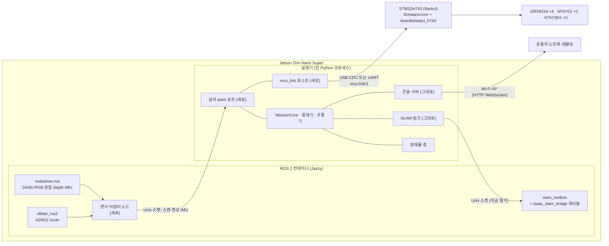

# 실차 이식(sim-to-real) 준비 계획 (2026-11-11)

- 요청(사용자, 총괄 경유): 이 시뮬을 실제 하드웨어에 어떻게 올릴지, 젯슨에 어떤 코드를 넣고 어떻게 실행할지, STM32 를 어떻게 코딩할지 구체적으로 정한다. 주문한 부품(메인보드 PCB·부품, 11-20 발송 예정)이 오면 바로 굴릴 수 있게 하는 것이 목표다.
- 범위: 계획 문서뿐이다. 실제 Jetson·장비 접속, ws1 잡, 코드 변경은 하지 않는다. 명령은 적기만 한다.
- 총괄 결정(2026-11-11): 목차와 큰 결정 K1–K6 은 권고대로 확정. K5(링크 전송로)는 PCB 확인 결과에 따른다. 사용자 답 네 가지(Jetson 보유, 메인 배터리 공유, 비상정지는 MCU 입력만, 승강 위치 측정 미정)를 반영한다.
- 표기: 각 항목을 **있음**(지금 저장소에 있음) / **새로**(새로 만들 것) / **순서**(언제)로 적는다. 하드웨어 값은 출처(실측·카탈로그·회로도·추정)를 붙인다. 측정이 필요한 값에 그럴듯한 기본값을 두지 않는다(CONTRIBUTING 6절).

## 0. 지금 있는 것

| 영역 | 있음 | 없음 |
|---|---|---|
| MCU 펌웨어 | `firmware/core/`: 보드 무관 C11 코어. 링크(COBS·CRC)·바퀴 엔코더·KTH7801·PI·DRV8244 순서기·안전 상태기(BOOT/DISARMED/ARMED/STOPPING/FAULT/ESTOP)·app 주기와 HAL 함수 표 `fw_hal`, 호스트 시험 9 개, `tools/link_tool.c`. 설계 [`docs/design/2026-10-22-mcu-firmware-core.md`](../design/2026-10-22-mcu-firmware-core.md)(3절이 보드 HAL 요구사항), 계획 [`docs/plans/2026-10-22-mcu-firmware-core.md`](2026-10-22-mcu-firmware-core.md) | 보드 HAL, CubeMX 프로젝트, 링커 스크립트, ARM 툴체인 고정, 실기 시험 |
| 링크 | 계약 [mcu-link/1](../interfaces/2026-10-22-mcu-link-contract.md)(DRIVE·ARM·DISARM·CLEAR_FAULTS·STATE, 신선도 boot_id·arm_gen·echo), Python `src/forklift_core/mcu_link/`(framing·messages, 고정 벡터 교차 시험) | 전송로 결정, 호스트 시리얼 어댑터, 속도·곡률 → `Drive` 변환, `STATE` → 오도메트리 |
| 핀맵·보드 | [핀맵 초안 검토](../design/2026-10-22-h743-pinmap-draft-review.md)(10-22 초안 기준). 팀 회로도 V1.0(로컬 전용 `docs/references/team-hardware/2026-10-28/`, 1·2·3·5 쪽): 10-22 검토의 A1(R_ENC_IN1 = PB10)·A3(nFAULT L/R/M/H = PB11/PB12/PB14/PB15)·A5(`MTR_SLEEP` = PB0 한 선)·B1(Wi-Fi 를 PB8·PB9 로 옮기고 PA11·PA12 = `USB_OTG_FS_DM/DP`)가 반영돼 있다. 바퀴 엔코더는 AM26LV32 차동 수신, KTH7801 은 SN65LVDS 를 거쳐 RJ50(5558067-1) 둘 | 회로도 4 쪽, KiCad/EasyEDA 원본, 비상정지 입력·승강 리밋 입력 넷(회로도·BOM 에 없음), `ADC_BAT` 의 MCU 핀(회로도 주석 "MCU ADC pin unassigned") |
| Jetson 쪽 스택 | 라이브 실행기 `run_transport.py --live`(`LiveRuntime` + `MissionCore` + 장애물 층 + 콘솔 서버 `console/live/server.py`) — Isaac 프로세스 안에서 120 Hz 물리 스텝에 맞춰 돈다. SLAM 은 Unix 소켓(`forklift_core.localization.slam_link`: 길이 + JSON 머리 + float32 거리)으로 slam_toolbox 컨테이너와 주고받고, 지도는 공유 폴더 `latest_map.npz`. 오도메트리 모형 `team_spec_quantized`(뒤 바퀴 증분 4096 + 조향 절대각 양자화) | **구동 명령 경계가 클래스로 분리돼 있지 않다**(`drive()` 안에서 `robot.apply_action` 직접 호출). `MissionCore` 훅 약 80 개 가운데 참값 훅(`truth_rear`·`truth_velocity`·`truth_speed`·`truth_yaw_rate`·`truth_relative_yaw`·`truth_obstacles` 등)이 있다. 벽시계 제어 루프 없음 |
| ROS 2 | `deploy/ros2/Dockerfile`(`ros:jazzy-ros-base-noble` + slam_toolbox), `ros2/src/forklift_ros`(Isaac SLAM 브리지·recorder·replay), `forklift_bringup`(replay launch, slam_toolbox YAML 넷) | **센서 드라이버(librealsense·realsense-ros·sllidar_ros2)**, 실차 launch·노드, 센서 → 실행기 어댑터 |
| 콘솔 | 게이트웨이(`--backend real` 은 관찰 전용), 결정(Jetson AP 1:1·같은 스택·HTTPS 없음·실차 정지 = 주 전원 끄기), F1 차량 측 차단(#360: operator_placed 출발이면 AUTO·미션 거부, 실차 런처는 `allow` 금지) | Jetson AP 실제 구성, 실차 정지 수단 시험 |
| 차체·센서 설정 | `sim/models/dls08_measured/`(실측·추정 구분), `PERCEPTION_MOUNTS["carriage_low_measured"]`, `config/isaac_slam_lidar.yaml`(합성) | 센서 장착 실측(D435i·A2M12, `docs/hardware.md` 미확정), 외부 보정, 엔코더 감속비 G |
| 실차 전 검토 | [`docs/design/real-vehicle-port-review.md`](../design/real-vehicle-port-review.md) 7 항목(조향 응답 0.877, 저상 장애물, D1, 하역 직선, D7 보류, 재출발 N, 꺼내기 허가) | — |
| 플랫폼 | [ADR 0001](../decisions/0001-development-and-deployment-platforms.md): Orin Nano Super 8GB, JetPack 7.2.1, Ubuntu 24.04, Jazzy(센서 실기 검증 전 동결 안 함). **사용자: Jetson Orin Nano Super 보유**(2026-11-11) | 저장장치 확인, 센서 실기 검증 기록 |

## 1. 전체 구조 — 같은 스택에서 plant 만 바꾼다

**K1(확정)**: 미션 코어·장애물 층·SLAM 링크·콘솔 서버·mcu_link 호스트를 **한 Python 프로세스**(이하 '실행기')로 둔다. Isaac 과 실차는 같은 **plant 포트** 인터페이스의 두 구현이다. ROS 2 는 컨테이너 안에서 센서 드라이버와 slam_toolbox 만 돌린다.



### 1.1 Isaac ↔ 실차 대응표 (plant 포트 단위)

| 인터페이스 | Isaac 쪽 지금 | 실차 쪽 | 비고 |
|---|---|---|---|
| 구동 명령 | 추종기·중재기의 속도·곡률 → `ackermann_command`(앞 조향 둘 + 네 바퀴) → `robot.apply_action` | 속도·곡률 → **변환 모듈**(K6) → 뒤 두 바퀴 rad/s + 조향 기구각 하나 + 승강 목표 → `mcu_link.Drive` | 실차는 뒤 L·R 구동, 앞바퀴 조향만(사용자 확인). Isaac 은 네 바퀴 구동 그대로(plant 구조는 따로 결정) |
| 바퀴·조향·승강 측정 | `TeamEncoderModel.read`(Isaac 관절각 → 양자화, **바퀴 한 바퀴 4,096 카운트** 전제) | `STATE` 의 `wheel_count_*`(32비트 모듈러, **모터 축 카운트**)·`steering_rad`·`lift_m` | ① 바퀴 엔코더(MT6701)는 **모터 축**에 있고 감속비 G ≈ 80(사용자 추정, 실측 아님) → 바퀴 한 바퀴 4,096 × G ≈ 327,680 카운트. 시뮬 모형보다 양자화가 약 80 배 곱다(양자화 쪽에서 시뮬은 보수적). 대신 **기어 백래시**(방향 바꿀 때 바퀴가 덜 도는 구간)와 바퀴 미끄럼은 엔코더가 보지 못하는데, 시뮬 모형에는 백래시가 없다. ② 시뮬 모형은 앞 조향 관절 둘을 읽는다. 실차는 KTH7801 하나(조향 기구각) → 실차판 오도메트리 변환 필요. 시뮬 모형을 실차 구성(모터 축 카운트·백래시)에 맞게 바꿀지는 이 계획 밖의 후속 결정이다 |
| LiDAR | `planar_lidar.cast_scan_flags`(1600 빔·10 Hz, 합성) | sllidar_ros2 `/scan` → 어댑터 → 실행기 | 실기 빔 수·주기는 A2M12 설정과 회전 속도에서 정해진다(각 분해능은 회전 속도 의존, `docs/hardware.md`) |
| RGB-D | Isaac 카메라 `get_current_frame`(원거리 인식·포켓 카메라) | realsense-ros 정합 color + aligned depth + CameraInfo → 어댑터 → 실행기 인식 입력 | 해상도·내부 파라미터·depth 단위는 장치가 준 값을 그대로 기록(CONTRIBUTING 5절) |
| IMU(자이로) | `localization/gyro.py` 모형(`--odometry-heading gyro`) | D435i 내장 IMU(사용자 결정 2026-10-22, MCU 별도 IMU 는 위치·모델 미정) | 기본 운영은 지금 기본(관절각 오도메트리)과 같게 두고, 자이로는 실측 뒤 결정 |
| SLAM | 실행기 → 브리지 컨테이너 Unix 소켓(`Scan`: scan_id·stamp·odom_from_base·ranges / `Reply`: map_from_odom) | 같은 소켓·같은 형식. 스캔은 실기 원시 스캔(실행기 gate 뒤), odom 은 실차 오도메트리 | 브리지는 지금 `/clock` 을 스캔 시각으로 낸다 — 실차 모드에서는 `/clock` 을 내지 않고 원래 ROS stamp 를 쓴다(2.5 시간 규칙) |
| 시간 | 물리 스텝(1/120 s) × 배속, `Pacer` | **벽시계 제어 루프**(새로) | 2.2 |
| 참값 훅 | `truth_rear` 등(판정·대체 경로) | 제어용은 측정으로 바꾸고, 평가용은 '판정 불가', 감사표 밖 호출은 **fail-closed** | 2.3 |
| 장면 판정 | `judge_delivery`·`scene_damaged`·미끄럼 판정 등(참값 기반) | 대응 없음 → 끔(기록만 '판정 불가') | 실차 성공 판정은 사람 확인·외부 측정(5절) |
| 정지 | `zero_wheels`·`hold_lift` 훅 | `DRIVE` 바퀴 0(제어 감속), MCU 자체 만료(`STOPPING`), `DISARM`(출력 즉시 끔 — 제어 감속이 아니다) | 3.4 |

## 2. Jetson 쪽

### 2.1 프로세스 구성

| 프로세스 | 있음 | 새로 | 순서 |
|---|---|---|---|
| ROS 2 컨테이너: realsense-ros, sllidar_ros2 | 이미지 바탕(`deploy/ros2`) | 드라이버 추가 이미지 `deploy/ros2-real/`(ARM64), launch `forklift_bringup/launch/real_sensors.launch.py` | 3절 P0(도착 전) |
| ROS 2 컨테이너: slam_toolbox + 브리지 | `isaac_slam_bridge`·`slam_toolbox` YAML | 실차 모드(2.5 시간 규칙, 토픽 분리), 장비 YAML | P1 |
| 센서 어댑터 노드 | — | `forklift_ros/real_sensor_adapter`: 원시 스캔·color·aligned depth·CameraInfo·IMU 를 실행기 Unix 소켓으로(장치 시각, ROS 시각, 수신 단조 시각을 모두 실음) | P1 |
| 실행기 | `run_transport.py --live` | 실차 진입점(Isaac 없이 조립), 실차 plant 포트, mcu_link 호스트, 벽시계 루프, 참값 훅 처리(2.3) | P1–P3 |
| 콘솔 | `console/live/server.py`, 웹 | 실차 정지 안내, 실차 상태 표시(전원·MCU 모드·결함 비트), 영상 시각을 D435i 취득 시각으로 | P3 |

K2(확정): **센서는 ROS 컨테이너 안의 어댑터가 Unix 소켓으로 실행기에 넘긴다.** 실행기 쪽 코어는 rclpy·RealSense SDK·시리얼을 import 하지 않는다(CONTRIBUTING 2절). 실행기 → slam_toolbox 소켓 **형식**은 그대로 쓴다. 다만 브리지가 `Scan.stamp_s` 를 그대로 ROS stamp 로 쓰는 부분(`isaac_slam_bridge.py` 416 행)과 `/scan`·TF 발행은 실차 모드에서 바뀐다(2.5).

**토픽과 TF 소유(새로 정함).**
- 드라이버의 원시 토픽은 `/sensors/lidar/scan_raw`, `/sensors/camera/...` 로 remap 한다.
- slam_toolbox 가 받는 `/scan` 은 **브리지만** 발행한다. 실행기의 키프레임 gate 를 거친 스캔이다.
- 원시 스캔이 slam_toolbox 로 바로 가거나, 브리지가 다시 낸 `/scan` 이 어댑터로 되들어가는 경로를 없앤다(Codex P2).
- `odom→base_link` 는 브리지(실행기 오도메트리), `base_link→laser` 는 `config/real/sensors.yaml` 의 값을 브리지가 `/tf_static` 으로 낸다. `base_link→camera_link` 는 카메라가 고정 장착이면 `/tf_static`, 캐리지 장착(승강에 따라 움직임)이면 승강 측정으로 갱신하는 `/tf` 다(2.3b). realsense 내부 광학 프레임 TF 는 드라이버 것을 쓴다.

### 2.2 실차 진입점, plant 포트, 벽시계 루프 (K1 의 핵심 새 일)

- **범위(Codex P2)**: `drive()` 의 I/O 를 옮기는 것만으로 끝나지 않는다. 지금 `main()` 은 무조건 `SimulationApp` 을 만들고(`sim/isaac/run_transport.py` 11862 행), `run()` 이 Isaac 장면과 초기 상태를 꾸민다. 그래서 두 가지가 필요하다.
  - **공통 조립 경로(새로)**: 미션 코어·장애물 층·SLAM 링크·콘솔 서버를 Isaac 과 무관하게 조립하는 함수.
  - **실차 설정(새로)**: 지도(조사 번들)·구역·팔레트·하역 칸·출발 위치를 장면 파일 대신 실차 설정에서 읽는다.
- **포트 정의(새로)**: `forklift_core/plant/port.py`.
  - 명령 `command(cmd: PlantCommand)`. `PlantCommand` 는 속도·곡률·승강과 함께 **결정 시각, 절대 만료(단조 시각), 명령 세대**를 싣는다.
  - 측정 `read() -> PlantSample`(바퀴 카운트·조향·승강·시각·유효성·MCU 모드·결함).
  - 센서 `scan()`·`rgbd()`·`imu()`, 상태 `health()`.
- **Isaac 포트(새로, 재구성)**: `drive()` 안의 Isaac 직접 호출(`apply_action`·관절 읽기·카메라·레이캐스트)을 포트 뒤로 옮긴다. 단계로 나눈다 — ① 구동 명령 출구 ② 엔코더·관절 읽기 ③ LiDAR·카메라 입력 ④ 참값 훅 분리(2.3) ⑤ 공통 조립 경로.
  - 단계마다 **재생 게이트 runs29 29/29** 와 전체 pytest.
  - 한계: 재생 도구는 `run()` 초기화를 거치지 않고 기록된 setup 으로 `drive()` 를 부른다(`tools/boundary_replay.py` 392 행). 그래서 게이트 29/29 만으로는 ⑤ 를 증명하지 못한다. 추가로 **Isaac 포트 실제 실행 smoke**(라이브 한 세션)와 **Isaac 이 없는 환경에서 실차 가짜 포트로 기동하는 시험**을 둔다.
- **실차 포트(새로)**: `forklift_core/plant/real.py`(코어, 시리얼 없음) + 실차 진입점의 어댑터(`tools/real_plant_io.py` 등)가 시리얼·소켓을 연다.
- **벽시계 루프(새로)**: Isaac 의 120 Hz 스텝과 `Pacer` 대신 단조 시계 주기(제안 50 Hz = 20 ms)로 돈다. 늦은 주기는 세고(`overrun`) 따라잡지 않는다. 지금 비동기 작업자를 **그대로 쓰면 안 되는 곳**(Codex P2):
  - 장애물 층 작업자의 설치·barrier 가 제어 스레드에서 완료를 기다린다(`sim/isaac/layer_worker.py` 180–187 행 `install_now`). 20 ms 주기를 넘을 수 있다.
  - 지연 상수가 `(k−1)/120` 으로 120 Hz 에 묶여 있다. 정지 판정의 표본 수, 작업 설치 시각, SLAM 대기열·관측 나이, 카메라 주기를 50 Hz 기준으로 다시 정한다.
  - SLAM 비동기 링크는 긴 poll 공백 뒤 도착한 응답도 받아들인다(시뮬 정책, `slam_link.py` `AsyncSlamLink` 설명, 콘솔 U20). 벽시계에서는 **입력 나이 상한**(스캔·SLAM 보정·인식·MCU STATE 각각)을 두고, 넘으면 정지한다.
  - 합격 조건: 지연 주입 시험(각 입력을 늦추거나 끊었을 때 정해진 시간 안에 정지)을 HIL(P0-9)에서 통과.
- **명령 만료의 연결(Codex P1)**: MCU 마감은 **원래 명령의 절대 만료를 넘지 않는다.**
  - 실행기는 20 ms 마다 `DRIVE` 를 보낸다.
  - 결정마다 원래 절대 만료 D(호스트 단조 시각)를 고정한다. 보낼 때 `valid_after_echo_ms` = min(상한_ms, ⌊1000 × (D − 그 echo 를 담은 `STATE` 의 호스트 수신 시각)⌋)이다(계약 2절 식). 결과가 1 ms 미만이거나 D 가 이미 지났으면 보내지 않는다. 송신 순간의 현재 시각을 빼지 않는다 — `STATE` 수신 뒤 지난 시간을 두 번 빼서 MCU 마감이 너무 일찍 잡힌다(Codex 2라운드).
  - 같은 결정을 다시 보내면 echo 만 새것으로 바꾸고 D 는 그대로다. 그래서 MCU 마감은 언제나 D 를 넘지 않는다. 오래된 제어 결정이 신선해 보이지 않게 하기 위해서다.
  - 상한(제안 150 ms)과 원래 명령의 수명은 4절 실측(정지 거리·지연, RTT) 뒤 정한다. TELEOP 은 이미 절대 마감을 가진다(`safety/arbiter.py` 546 행 `command_max_age_s`).
- **MCU 상태를 중재기로(Codex P1)**:
  - MCU 의 `STOPPING`(만료)·`FAULT`·`ESTOP`·`boot_id` 변경·링크 끊김은 중재기 입력이 된다. 미션은 일시정지, 콘솔에 표시한다.
  - 실행기는 **자동으로 `CLEAR_FAULTS`·`ARM` 을 보내지 않는다.** 재무장은 운용자 요청으로만 한다.
  - 계약상 재무장은 `ARM` 이 맡는다. `CLEAR_FAULTS` 는 `FAULT`·`ESTOP` 해제용이고, 정상 재부팅 뒤에는 필요 없다.
- **끊김의 종류(사용자 결정과 정합)**: 콘솔 끊김 중 AUTO 는 **계속**한다(콘솔 결정 2026-10-13). 그와 별개로 다음은 정지한다.
  - 실행기 정지·멈춤: MCU 만료로 선다.
  - 센서 유효성 상실: 입력 나이 상한을 넘으면 중재기가 정지한다.
  - MCU 링크 끊김: MCU 만료로 서고, 실행기는 일시정지한다.

### 2.3 참값 훅 처리 (fail-closed, 기능 이식 포함)

- 감사표(새로): `MissionCore` 훅 전체와 Isaac 전용 판정을 셋으로 나눈다.
  - ① **제어용 측정으로 바꿀 것**: `permission()` 이 무조건 읽는 `truth_speed`·`truth_rear`(`core.py` 1419 행 근처) → 오도메트리 속도·SLAM 자세. `truth_velocity` 대체 경로(1598 행) → 정지 판정은 오도메트리 기준으로.
  - ② **사람 확인이 필요한 전환**: 승강·하역 전환이 4.5 s 뒤 `pallet_z()` 를 요구한다(664 행 근처). 실차는 측정(승강 높이 + 센서)이나 운용자 확인으로 넘긴다.
  - ③ **실차에서 부르지 않을 평가**: `judge_delivery`·`scene_damaged`·미끄럼·forbidden contact·`insertion_measured` → 실차에서는 `None`(판정 불가)으로 기록하고, 완료 경로가 `judge_delivery=None` 을 받아들이게 고친다.
- 규칙: 실차 포트 세션에서 감사표에 없는 참값 훅이 불리면 세션을 끝낸다(fail-closed). 조용히 대체값을 쓰지 않는다.
- 합격 시험(Codex P2: 예외 시험만으로는 이식을 증명하지 못한다):
  - 실차 가짜 포트(참값 없음)로 **정상 미션 하나가 끝까지** 간다(접근 → 삽입 → 들기 → 운반 → 하역 → 복귀).
  - ③ 의 호출이 기록에 '판정 불가'로 남는다.
  - 감사표 밖 훅이 불리면 세션이 끝난다.

### 2.3a 실제 스캔 → 장애물 층 (Codex P2)

- 지금 장애물 층 입력(`add_scans`, `sim/isaac/obstacle_layer.py` 392 행)은 합성 레이캐스트의 `distances·hits·own`, 고정 빔 각도, 합성 잡음 경로를 받는다.
- 새로 할 일:
  - 실제 `LaserScan` 을 이 계약으로 바꾼다. 빔 각도와 유효성은 스캔마다 다를 수 있고, 무효 거리(0·inf)는 NaN(모름)으로 넣는다. 빈 공간으로 넣지 않는다(CONTRIBUTING 5절).
  - 자기 차체·적재물 가림 마스크를 실측 장착에서 만든다.
  - 합성 잡음을 다시 넣지 않는다.
  - 스캔 시각에 맞는 오도메트리 자세를 쓴다.
- 합격 시험: 같은 실제 스캔이 SLAM 과 장애물 층에 함께 들어가는 통합 시험(기록 bag 재생).

### 2.3b 인식·영상 경로 (Codex P2)

- 원거리 인식은 주행 프레임에 Isaac semantic `instance_ids` 가 없으면 `semantic_not_ready` 로 건너뛴다(`sim/isaac/far_recognition_runtime.py` 296 행). 실물에는 이 ID 가 없다.
  - 새로: 실제 proposer 경로(학습 ONNX, YOLO11s)를 기본으로 바꾼다.
  - ONNX 해시·문턱을 고정하고, ARM64 실행 환경(onnxruntime CPU 또는 GPU provider, 쓰면 TensorRT)과 실제로 켜진 provider 를 기동 때 확인한다.
  - GPU 를 쓰면 JetPack·CUDA 호환과 지연을 P0 에서 잰다.
- RGB 와 depth 의 동기·정합·단위(aligned depth, mm 정수 → m)를 어댑터가 맞추고 기록한다.
- 캐리지 장착(`carriage_low_measured`)이면 승강에 따라 카메라 외부 변환이 바뀐다. 승강 측정으로 변환을 갱신하거나, 인식은 승강 0 에서만 한다(지금 시뮬 전제).
- 콘솔 영상의 픽셀 시각은 지금 시뮬 스텝 이력에서 찾는다(`sim/isaac/live_runtime.py` 725 행 근처 `step_start`). D435i 취득 시각으로 바꾼다.

### 2.4 실행 방식 (K3 확정: Docker + systemd)

- **이미지**: `deploy/ros2-real/Dockerfile`(ARM64, `ros:jazzy-ros-base-noble` 다이제스트 고정 + librealsense·realsense-ros·sllidar_ros2 버전 고정). 실행기는 같은 이미지 안의 venv 또는 호스트 venv 중 하나 — 제안: **실행기도 컨테이너**(Isaac 이 없으므로 의존성이 가볍고, ws1 과 같은 고정 방식을 쓸 수 있다). `--network host`(콘솔·AP), `--device /dev/ttyACM0`(USB CDC) 또는 `/dev/ttyTHS*`(UART), D435i USB(udev 규칙), `/dev/ttyUSB*`(A2M12 USB-UART).
- **부팅 순서(systemd 유닛 하나, `deploy/jetson/forklift.service`)**: 전원 → JetPack 부팅 → AP(hostapd/NetworkManager 핫스팟) → 장치 대기(udev 심볼릭 링크 `/dev/forklift-mcu`·`/dev/forklift-lidar`) → 컨테이너 기동(센서 → SLAM → 어댑터 → 실행기) → 콘솔 접속 대기. 실행기는 **DISARMED 로 시작**하고 운용자의 lease·ARM 전에는 바퀴를 움직이지 않는다.
- **명령(적기만)**:
  ```bash
  # 이미지 빌드(Jetson 에서)
  docker build -f deploy/ros2-real/Dockerfile -t forklift/real:<sha> .
  # 수동 기동(시험)
  docker compose -f deploy/jetson/compose.yaml up sensors slam adapter runner
  # 부팅 기동
  sudo systemctl enable --now forklift.service
  # 콘솔: 노트북을 AP 에 붙이고 http://<jetson-ap-ip>:8798/
  ```
- **JetPack**: ADR 0001 의 7.2.1(Ubuntu 24.04) 그대로 두되, Orin Nano Super 에서 그 판과 librealsense 동작은 3절 P0 에서 실기로 확인하고 결과를 `docs/validation/` 에 남긴 뒤 동결한다.

### 2.5 설정·보정값 위치, 시간 동기, 기록

- **설정**: 차체는 `sim/models/dls08_measured/`(실측·추정 구분 그대로)를 정본으로 둔다. 실차 전용 값은 새 파일 `config/real/` 아래에 둔다.
  - `vehicle.yaml`: 엔코더 감속비 G, 조향 링크 보정표, 바퀴 반경 실효값.
  - `sensors.yaml`: 장착 외부 보정 `base_link_from_camera`·`base_link_from_laser`, 측정 날짜와 방법.
  - MCU 게인·한계는 펌웨어 `drive_config` 로 빌드에 넣는다(설계 7절: 링크로 바꾸지 않음).
  - 값마다 출처(실측·추정)와 날짜를 적고, 추정값은 '실측 대기' 꼬리표를 단다.
- **시간 규칙(Codex P2: ROS 시각과 단조 시각 분리)**:
  - 제어·만료·입력 나이 판단은 Jetson 의 **단조 시계**(`CLOCK_MONOTONIC`)로만 한다.
  - ROS 메시지 stamp 는 ROS 시스템 시각(`use_sim_time:=false`)이다. 드라이버가 찍은 stamp 를 바꾸지 않는다.
  - 어댑터는 메시지마다 (ROS stamp, 수신 단조 시각)을 함께 넘긴다. 실행기는 그 짝으로 변환한다(시스템 시각 − 단조 시각의 차이를 주기적으로 재서 기록하고, 크게 뛰면 경고·정지).
  - 브리지는 실차 모드에서 `/clock` 을 내지 않는다. slam_toolbox 로 가는 스캔·TF stamp 는 원래 ROS stamp 를 쓴다. 지금처럼 `Scan.stamp_s` 를 그대로 쓰지 않는다.
  - D435i 는 장치 시각도 함께 기록한다(realsense-ros 의 global time 설정 확인).
  - MCU 는 `mcu_time_us`(호스트 시계와 섞지 않음, 계약 4절). 명령 신선도는 echo 로만 판단한다.
  - 노트북·태블릿은 콘솔 표시용이라 동기하지 않는다.
  - 서로 다른 시계를 빼려면 변환을 적는다(CONTRIBUTING 5절).
- **기록**:
  - rosbag2(MCAP): 원시 스캔, 브리지 `/scan`, color·depth(압축), CameraInfo, IMU, `/tf`·`/tf_static`.
  - 실행기의 `live_log`·spool·`result.json`(지금 형식).
  - mcu_link 원시 바이트 로그: 수신 시각 + 프레임. 재생과 링크 진단에 쓴다.
  - **재생 게이트(새로)**: 실차 기록(bag + mcu 로그)을 실행기에 다시 넣어 같은 결정이 나오는지 보는 도구. 지금 `slam_replay`(Isaac 기록 → bag)의 반대 방향이다. P3 뒤.

## 3. STM32 펌웨어

### 3.1 툴체인·빌드·플래시·디버그 (K4 확정, 2026-11-11 개정)

**K4 개정**(총괄 결정 2026-11-11 Q1·Q5, 사용자 결정 2026-11-12). 세부는 보드 설계 [`docs/design/2026-11-12-weact-h743-board-firmware.md`](../design/2026-11-12-weact-h743-board-firmware.md) 2절·8절이다.
- **CubeMX 를 쓰지 않는다.** 무인 환경에서 재현되는 헤드리스 빌드로 간다. CMSIS Core·CMSIS 장치 H7·LL 을 고정 태그로 `firmware/third_party/` 에 들여오고, 출처·라이선스·해시를 기록한다. 초기화 코드는 손으로 쓴다. `.ioc` 는 참고용으로만 둔다.
- **빠른 경로는 LL·레지스터다.** LPTIM 카운터 두 번 읽기, SPI 는 인터럽트 거래와 태그, ADC 는 주입 변환, 링크는 송신 링 버퍼로 한다. DMA 는 쓰지 않는다.
- **빌드**: CMake + Arm GNU Toolchain **13.3.rel1** 공식 tarball(버전을 CMake 가 검사)로 한다. 코어는 그대로 링크한다(호스트 시험과 같은 소스).
- **플래시는 USB-C ROM DFU 만 쓴다**(사용자 결정 2026-11-12). BOOT0 + 하드웨어 리셋으로 들어가고, WeAct 를 메인보드에서 뺀 상태에서 한다. ST-LINK(SWD)는 쓰지 않는다. 보유 NUCLEO 의 ST-LINK 를 개조해 쓰는 경로는 보드 설계 8.1 의 보류된 선택지로 남긴다.
- 명령(적기만):
  ```bash
  cmake -S firmware -B build/mcu -DFW_BOARD=weact_h743 -DARM_GNU_TOOLCHAIN_DIR=<설치 경로> \
        -DCMAKE_TOOLCHAIN_FILE=$PWD/firmware/boards/weact_h743/arm-gnu-13.3.cmake   # 절대 경로
  cmake --build build/mcu -j
  STM32_Programmer_CLI -c port=usb1 -w build/mcu/fw.elf -v   # BOOT0 로 들어간 DFU, 열거된 번호 확인
  ```

### 3.2 주변장치 대응 (회로도 V1.0 기준)

| 기능 | 핀(회로도 2 쪽) | 주변장치 | HAL 계약(설계 3절) |
|---|---|---|---|
| 모터 PWM L/R/M/H | PE9/PE11/PE13/PE14 (`x_IN1`) | TIM1 CH1–4, 같은 주기 | 듀티 부호 → `x_IN2`(PE2/PE6/PE4/PE5) 방향 |
| DRVOFF L/R/M/H | PD9/PD10/PD13/PD14 | GPIO 출력(기본 high = 끔) | 주기마다 SPI 전에 씀 |
| nSLEEP(공통) | PB0 `MTR_SLEEP` | GPIO | 드라이버 재시작 경로(핀맵 검토 A5 해결) |
| nFAULT L/R/M/H | PB11/PB12/PB14/PB15 | GPIO 입력(EXTI 선택) | 입력 스냅숏 |
| DRV8244 SPI | PA5/PA7/PB4, nCS PA0–PA3 | SPI1 모드 1, EOT 인터럽트(DMA 없음, K4 개정) | 거래 하나씩, 32비트 태그 |
| IPROPI L/R/M/H | PA6/PC4/PB1/PC0, R_IPROPI 1 kΩ(회로도 R5·R6·R15·R12) → 3.3 V 전 범위 약 15.7 A(A_IPROPI 4,750 대표값) | ADC1 주입 변환(소프트웨어 시작, DMA 없음. PWM 중앙 동기는 출력을 여는 PR 에서) | 표본마다 신선도 플래그. ADC 핀 과전압 보호는 핀맵 A6 확인 항목 |
| 바퀴 엔코더 L | PD12(A)/PE1(B), Z = PC6 | LPTIM1 엔코더, ARR 0xFFFF(16비트) | 두 번 읽기, 코어가 32비트 모듈러로 누적 |
| 바퀴 엔코더 R | PB10(A)/PD11(B), Z = PC7 | LPTIM2 엔코더 | 두 번 읽기 |
| KTH7801 조향(M)·승강(H) | SCK PB13, MOSI PC1, MISO PC2_C, CS1 PD0, CS2 PD1 | SPI2 모드 3 ≤ 10 MHz(LVDS 경유 최대 클럭은 실측) | PC2_C 아날로그 스위치 닫기(핀맵 B2) |
| 링크 | USB: PA11/PA12 `USB_OTG_FS` / UART 후보 | USB CDC 또는 UART | 프레임 단위 송신 |
| 상태 LED | PE3 `BOARD_LED` | GPIO | — |
| Wi-Fi | PB8/PB9(UART), PA10 RST | 범위 밖(용도 미정) | — |
| 배터리 전압 | `ADC_BAT = VCC/11`(회로도 3 쪽), **MCU 핀 미배정** | — | 사용자 질문(7절) |
| 비상정지 입력 | **회로도 넷 없음** | — | 사용자 질문(7절), 6절 위험 R1 |
| 승강 리밋 | **회로도 넷 없음** | — | 3.5, 사용자 질문 |
| 독립 워치독 | — | IWDG | 주기를 끝까지 돌았을 때만 kick |

### 3.3 제어 루프와 주기 (제안, 실측 뒤 확정)

**엔코더 카운트 규모(모터 축, G ≈ 80 가정).** 바퀴 한 바퀴 = 4,096 × 80 = 327,680 카운트. 시뮬의 바퀴 상한 8 rad/s(설정값, 실측 아님)에서 바퀴 1.27 회전/s → 약 417,000 카운트/s, 모터 약 102 회전/s.
- **타이머**: 회로도 V1.0 의 핀은 LPTIM1·LPTIM2(16비트)에만 맞는다(32비트 TIM2/TIM5 로 바꾸려면 배선 변경). 1 ms 주기에서 한 주기 차분은 약 417 카운트로 16비트 차분 한계(±32,767)보다 훨씬 작다. 읽기 공백이 약 78 ms(32,767 ÷ 417,000)를 넘으면 넘김을 놓친다.
  - 지금 코어의 `overrun` 판정은 **연속으로 늦은 주기 수**만 센다(`drive.c` 332 행). 한 번의 긴 공백 뒤 정상 주기가 오면 결함이 안 걸리고, 센서 갱신이 결함 판정보다 먼저다(Codex P2).
  - **새로**: 엔코더 읽기 사이 단조 시간(`DWT` 또는 1 MHz 타이머)을 재서, 한 번의 공백이 상한(제안 20 ms, 78 ms 의 1/4)을 넘으면 그 표본의 카운트 차분을 **무효**로 하고 `FAULT`(이유 `encoder_gap`)로 간다. 호스트 시험으로 고정한다.
  - IWDG 최악 시간(설정 시간 + LSI 오차)이 이 상한보다 길면 그 사이에 넘김이 생길 수 있다. 리셋 뒤에는 카운트 기준을 새로 잡고 `boot_id` 가 바뀌므로 호스트가 이어 붙이지 않는다(계약 3.3).
  - 8 rad/s 는 시뮬 명령 상한이지 실제 축의 최대 속도가 아니다. S3 에서 무부하 최대 듀티의 실제 바퀴 속도를 재서 위 계산을 다시 한다.
- **LPTIM 입력 주파수**: A·B 각 채널은 모터 한 바퀴에 1,024 주기(4체배 4,096) → 약 104 kHz. LPTIM 엔코더 모드는 입력이 커널 클록의 1/4 이하여야 하므로(RM0433 43.4.15) 커널 클록을 그보다 충분히 높게 둔다(디지털 필터 `CKFLT` 와 함께 실기 확인).
- **32비트 누적**: 417,000 카운트/s 에서 2³² 전체 순환은 약 172 분, 부호 경계(2³¹)까지는 약 86 분이다. 호스트는 2³² 법 차분(부호 있는 32비트로 해석)을 쓰므로 두 표본 사이 차분이 2³¹ 보다 작으면 문제없다(계약 3.3).
- **속도 분해능**: 창 길이 T 에서 1 카운트 = 2π / (327,680 × T) rad/s. 20 ms 창이면 0.00096 rad/s(바퀴 반경 0.125 m 기준 0.12 mm/s), 2 ms 창이면 0.0096 rad/s. 4,096 카운트/바퀴 가정보다 80 배 곱기 때문에 창을 2–5 ms 로 줄여 지연을 낮출 수 있다(시작 제안 5 ms).
- **확인 항목**: MT6701 의 ABZ 해상도 프로그래밍 값(4체배 4,096/회전이 되려면 1,024 펄스/회전 설정). 출고값과 팀이 쓴 값을 S2 에서 확인한다.
- **엔코더 고장 검출(새로, Codex P1)**: 지금 `wheel_enc` 는 멈춘 카운터를 '정상 0' 으로 본다. 엔코더 선이 빠지거나 극성이 뒤집히면 PI 가 듀티를 끝까지 올린다. 바닥 주행 전에 다음을 펌웨어에 넣는다.
  - 듀티–카운트 불일치: 듀티 절댓값이 문턱(제안 S3 실측 정지 마찰 듀티의 2 배) 이상으로 일정 시간(제안 200 ms) 지속되는데 카운트 변화가 문턱 미만이면 `FAULT`(`encoder_stuck`).
  - 극성 반대: 감속·방향 전환 중에는 듀티 부호와 회전 방향이 정상적으로 반대일 수 있다(PI 가 목표 0·측정 양수에서 음의 듀티를 냄). 그래서 **듀티 절댓값이 문턱 이상이고 카운트 변화가 그 듀티 반대 방향으로 커지는**(가속되는) 상태가 일정 시간 이어질 때만 `FAULT`(`encoder_polarity`)로 본다. 비교는 `duty_sign` 을 적용하기 전의 제어 좌표에서 한다. 정상 제동·잔류 회전에서 걸리지 않는 시험과 역배선(A/B 바꿈)에서 걸리는 시험을 둘 다 둔다.
  - 불가능한 증분: 한 주기 차분이 **허용 운용 범위**의 최대 속도의 1.5 배를 넘으면 `FAULT`(`encoder_jump`). 시운전 듀티 상한(15 %)에서 잰 속도는 운용 최대가 아니므로 그대로 쓰지 않는다. 운용 범위를 단계적으로 넓히고(S4·S6·S10), 각 단계의 속도 상한 밖 명령은 MCU 가 클립·거부하며, 그 단계의 상한으로 문턱을 정한다.
  - 문턱의 숫자는 S3·S4 실측으로 채우고, 그 전에는 빌드 상수에 '실측 대기' 꼬리표를 단다.
- **계약 변경 묶음(Codex 2라운드)**: `encoder_gap`·`encoder_stuck`·`encoder_polarity`·`encoder_jump` 은 지금 `fault_flags`(비트 0–16) 에 없고, 받는 쪽은 미정의 비트를 오류로 처리한다(계약 3절, `messages.py` `_FAULT_MASK`). 이 네 결함은 실행기가 원인을 보여야 하므로 **wire 에 싣는다**: 비트 17–20 을 정의하고 `version` 을 2 로 올린다. 시운전 메시지 종류, 승강 안 A 의 원점 상태 비트·`not_homed` 도 같은 버전에 묶는다. C 코어·Python `mcu_link`·고정 시험 벡터를 함께 바꾼다(계약 7절).
  - 합격: 호스트 시험 + HIL 고장 주입(카운트 정지·부호 반전·튐)에서 정해진 시간 안에 `FAULT`, 바퀴 띄운 상태에서 엔코더 커넥터를 뽑는 실기 주입(S4).

- 제어 주기 `period_us` = 1,000(1 kHz): 엔코더 읽기, PI, PWM 갱신, 만료 판정.
- 바퀴 속도 창 5 ms(위 분해능 계산: 0.0038 rad/s, 지연 약 2.5 ms. 설계 5절의 0.0767 rad/s 는 바퀴 4,096 카운트 가정이라 실차에는 해당하지 않는다).
- `STATE` 10 ms(100 Hz, 링크 대역은 계약 5절).
- 조향·승강 위치 PI 는 같은 1 kHz 루프. 목표 변화율 제한.
- **바퀴 듀티 변화율 제한(새로, Codex P2)**: 지금 코어에는 바퀴 듀티의 slew 제한이 없다(`drive.c` 595 행 근처의 출력 계산). 기동 돌입 전류와 전원 강하(R2)를 줄이려고 주기당 듀티 변화 상한을 더한다. 값은 S1·S3 의 강하 측정으로 정한다.
- 게인은 4절 축별 단계에서 정한다. 설계 7절대로 빌드에 넣고, 시작 게인은 낮게(개루프 응답에서 대략 계산).

### 3.4 안전 동작 (펌웨어 몫)

- 이미 코어에 있는 것: 명령 만료 → `STOPPING`(바퀴 0, 조향·승강 유지) → `DISARMED`, 비상정지 입력 → `ESTOP` 래치, nFAULT·과전류·센서 무효·범위 이탈·주기 지연 → `FAULT` 래치, 재연결·재부팅만으로 달리지 않음(새 `ARM` 필요, 래치된 `FAULT`·`ESTOP` 은 먼저 `CLEAR_FAULTS`), 무장 직후 두 바퀴 0 먼저.
- 보드에서 할 것:
  - IWDG 시간 설정(제안 50 ms, 주기 1 ms 의 큰 배수, LSI 오차 포함 최악값을 기록).
  - 리셋 동안 DRVOFF 내부 풀업으로 출력 Hi-Z 확인.
  - 부팅 직후 모든 DRVOFF high.
  - 브라운아웃 리셋 수준(BOR) 설정.
- **정지 수치(새로, Codex P2)**: '서지 않음·늦게 섬'을 숫자로 정한다.
  - 코어에 이미 있는 `stop_grace_ms`(만료 뒤 `STOPPING` 에서 `DISARMED` 까지 출력을 켠 채 세우는 시간)와 채널별 `safe_brake`(브레이크·코스트, `drive.h` 65·79 행)의 보드 값을 S4 전에 정하고 '실측 대기' 꼬리표를 단다.
  - 측정을 셋으로 나눈다. 시작 사건은 경우마다 정한다 — 링크 끊김은 마지막 `DRIVE` 송신, `DISARM` 은 명령 송신, IWDG 는 **제어 주기가 멈춘 순간**(시험 빌드에서 주기를 일부러 멈춤)이다. 리셋 순간부터 재지 않는다.
    - **출력 반응 시간**: 시작 사건 → 채널이 정지 상태가 됨. 정지 상태는 채널별 `safe_brake` 를 따른다. `safe_brake=true` 채널은 `DISARMED` 에서도 DRVOFF low 로 제동한다(`drive.c` 606 행 근처). 그래서 'DRVOFF high' 가 아니라 '그 채널의 설정된 정지 상태'로 판정한다. 리셋 중에는 모든 채널이 DRVOFF high(풀업)다.
    - **바퀴 정지 시간**·**정지 거리**: 시작 사건 → 바퀴 엔코더가 멈춤, 그동안 차체 이동 거리.
  - 문턱(제안, 텔레옵 저속 0.2 m/s 빈 차):
    - `DISARM`·IWDG: 출력 반응 0.1 s 이내.
    - `DISARM`: 바퀴 정지 0.5 s·0.10 m 이내(링크 끊김과 같은 값, 0.2 m/s 빈 차·바닥 — 총괄 결정 2026-11-12). **잠정**이며 S5 실측 뒤 다시 본다. 측정에 맞춰 늦추지 않는다. 코스트 바퀴(`safe_brake=false`)가 이 값을 못 넘으면 바퀴 채널을 `safe_brake=true` 로 정하는 근거로 쓴다. `DISARM` 은 유효시간 대기를 건너뛰지만 코스트 경로 실측 전이라 더 조이지 않는다(0.35 s·0.07 m 안은 채택하지 않음).
    - 받침대(바퀴 띄움) 값: 차체 관성·바닥 저항이 없어 바닥 정지와 물리가 다르다. 도구는 받침대의 정지 시간·거리를 문턱 대비 **참고(받침대)**로만 보이고, 합격·불합격은 바닥 S5 의 외부 측정으로만 낸다. 받침대에서 문턱을 넘으면 문턱을 늦추지 말고 원인(코스트·`safe_brake`)부터 보고한다. 출력 반응은 받침대에서도 판정한다.
    - 시운전 빌드의 시간 상한 `STOPPING` 중 `DISARM`(bring-up 도구 ② `limit_disarm`·`hold_disarm`, 설계 `docs/design/2026-11-12-bringup-commission-tool.md` 10절): 일반 `DISARM` 의 문턱을 그대로 **잠정** 적용한다. 시운전은 저듀티라 일반 `DISARM` 보다 느슨할 이유가 없다. S5 실측 뒤 다시 본다(총괄 결정 2026-11-12). 두 시나리오는 받침대 시험이므로 정지 시간·거리는 참고(받침대)다.
    - 링크 끊김: 출력 반응 0.1 s 를 적용하지 않는다. 시간 예산은 만료 대기(마지막 `DRIVE` 의 유효시간, 상한 150 ms) + `STOPPING`(`stop_grace_ms`, 출력을 켠 채 감속) + 최종 정지 상태다. 바퀴 정지 0.5 s·0.10 m 이내를 문턱으로 두므로 `stop_grace_ms` 는 그 안에 들게(예: 300 ms 이하) 정한다(`drive.c` 361 행 근처 만료 처리).
    - S5 의 링크 끊김 시험은 **남은 유효시간이 최대인 `DRIVE`(새 `STATE` 직후, 상한 150 ms) 바로 뒤에 끊는 경우**를 반드시 넣는다. 아무 때나 끊으면 우연히 짧은 마감에서 통과할 수 있다. 이 숫자는 아직 운용 공간의 허용 이동 거리에서 나온 것이 아니다. **S5 전에 시험장 배치(사람·장애물과의 최소 거리)에서 허용 정지 거리를 먼저 정하고, 측정값에 맞춰 문턱을 늦추지 않는다.** 넘으면 속도 상한을 낮추거나 설계를 고친다. 자율 속도에서 다시 잰 뒤 S10 을 연다.
  - `DISARM` 은 출력을 바로 정지 상태로 두는 것이지 제어 감속이 아니다. 감속 정지는 `DRIVE` 바퀴 0 이나 만료 경로(`STOPPING`)다.
- **시운전 모드(새로, Codex P2)**: S3 의 축별 개루프 시험은 정상 펌웨어로 할 수 없다(DRIVE 는 속도 목표만 받는다). 별도 빌드 `FW_COMMISSION` 을 둔다.
  - 링크 명령으로 축 하나에 듀티를 직접 준다. 듀티 상한(제안 15 %)·시간 상한(제안 2 s)·전류 제한은 빌드 상수로 고정한다.
  - 같은 안전 상태기(만료·nFAULT·과전류·ESTOP)를 그대로 쓴다.
  - 지금 `STATE` 에는 빌드 종류를 알릴 필드가 없다. `FW_COMMISSION` 빌드는 **실행기에 붙이지 않고 시운전 도구로만 쓴다.** 시운전 명령은 정상 `DRIVE` 와 다른 메시지 종류(새 `type`)로 두고, 시운전 빌드는 정상 `DRIVE` 를 받으면 거부한다(단위가 다른 명령을 섞어 해석하지 않게). 새 메시지 종류는 mcu-link 계약 변경이다(아래 계약 변경 묶음).
  - 출력이 잠긴 `FW_HIL_PLANT` 빌드는 정상 메시지만 쓰므로 HIL 실행기(P0-9)에 붙인다.
- **HIL 빌드 출력 잠금**: `FW_HIL_PLANT` 빌드는 TIM1 PWM 출력을 초기화하지 않고 DRVOFF 를 high 로 고정한다. 모터 드라이버가 실린 보드에 올려도 바퀴가 돌 수 없게 한다(Codex P2).
- **승강 하중 전제**: 정지 출력은 승강이 모터 토크 없이 버틴다는 전제에 기댄다. 확인 전에는 빈 포크로만 시험한다(설계 4절).

### 3.5 승강 위치 측정 — 두 안 (미정, 팀 확인)

| 안 | 내용 | 펌웨어 코어 영향 | 하드웨어 영향 |
|---|---|---|---|
| A. 리밋 스위치 원점 + KTH7801 다회전 누적 | 부팅마다 승강을 아래 리밋까지 천천히 내려 원점을 잡고, KTH7801 각을 회전 수와 함께 누적해 높이로 바꾼다 | `abs_axis` 의 '한 바퀴 미만' 전제를 승강 축에서 버린다. **새로**: 다회전 누적(각 차분 펼치기), 원점 잡기 상태(`HOMING`: 운용자의 별도 명령으로만 시작, 승강 축만 낮은 듀티·시간 상한으로 움직이고 바퀴·조향 출력은 끔, 만료·ESTOP 은 그대로 적용), 원점 전 승강 명령 거부, 리밋 입력의 신선도·고장 처리. 상태기와 계약(`STATE` 에 원점 상태 비트, 거부 이유 `not_homed`)이 바뀐다 → mcu-link 버전 올림(계약 7절) | 리밋 스위치와 MCU 입력 핀(회로도에 없음). 원점 동작 중 하중·충돌 |
| B. 리니어 엔코더(절대 위치) | 켜자마자 포크 높이를 직접 읽는다(9주차 피드백) | 승강 축 입력을 KTH7801 에서 새 센서로 바꾼다. 절대값이면 '한 바퀴 미만' 문제가 없어지고 원점 잡기가 필요 없다. **새로**: 센서 해석 모듈(인터페이스는 센서에 따라 SPI·아날로그·SSI), 신선도·범위 이탈 규칙은 `abs_axis` 와 같은 틀 | 센서 선정·장착·배선(규격 변경은 아니지만 부품 추가 — 사용자 결정) |

- 공통: 결정 전에는 승강을 **빈 포크로, 한 바퀴 미만 범위에서만** 시험한다. 4절 들기 단계는 이 결정 뒤에 둔다.

### 3.6 시험

- 호스트 단위 시험: 지금 9 개 + 보드 HAL 가짜를 쓰는 app 시험(있음). 승강 안 A 를 택하면 다회전·원점 시험을 더한다.
- **HIL(새로)**:
  - 펌웨어 빌드 선택 `FW_HIL_PLANT` — 보드 HAL 의 입력 스냅숏을 MCU 안의 간단한 모터·엔코더 모형이 채운다. 지금 호스트 가짜 HAL 의 모형을 옮긴다. PWM 출력은 잠근다(3.4).
  - 고장 주입: 엔코더 정지·부호 반전·튐, 링크 끊김, 명령 지연, KTH 무효.
  - 그 상태로 Jetson(또는 노트북)의 mcu_link 호스트와 실차 plant 포트가 링크·만료·정지·재무장을 끝까지 돌린다.
  - 모터 없이 할 수 있다.
- 실기 시험: 4절 단계표.

## 4. 부품 도착 전 (지금 → 11-20)

| 번호 | 할 일 | 필요한 것 | 합격 조건 |
|---|---|---|---|
| P0-1 | **Jetson 기본 구성**: JetPack 7.2.1 설치, 저장장치 확인(확인 항목), Docker·nvidia-container, AP 구성 | Jetson 보유(사용자) | 부팅 재현 3 회, AP 로 노트북 접속, `docs/validation/` 기록 |
| P0-2 | **센서 드라이버 실기**: ARM64 librealsense + realsense-ros, sllidar_ros2(A2M12) | D435i·A2M12 보유 | `docs/hardware.md` '버전 고정 전 검증' 1–5 를 기록으로 채운다(D435i RGB·depth·IMU 지속 스트리밍, CameraInfo·TF, A2M12 스캔 안정성, 동시 동작, 온도·전력·재부팅 재현). JetPack 7 커널에서 librealsense 백엔드(RSUSB 또는 커널 패치)를 기록하고, **RGB + depth + IMU 동시 30 분 스트리밍**에서 프레임 끊김·장치 재열거가 없을 것(agy) |
| P0-3 | **실데이터 기록과 시뮬 계약 대조**: 책상·복도에서 rosbag 기록 | P0-2 | 형식(단위·좌표·시각 도메인·depth 단위), 주기(LiDAR 회전 속도·빔 수, 카메라 fps), 좌표(REP-103/105, 광학 프레임)를 시뮬 입력과 표로 대조. 다른 점은 어댑터가 맞출지 실행기 계약을 바꿀지 정한다 |
| P0-4 | **실행기 plant 포트 재구성(Isaac 포트)**: 2.2 의 ①–⑤ | 저장소·ws1 | 단계마다 재생 게이트 29/29·전체 pytest. ⑤ 뒤 Isaac 라이브 smoke 한 세션, Isaac 없는 환경에서 가짜 실차 포트로 기동하는 시험 |
| P0-5 | **참값 훅 감사표와 기능 이식** (2.3) | 저장소 | 분류표 PR, 가짜 실차 포트(참값 없음)로 정상 미션 완주, 평가 호출 '판정 불가' 기록, 표 밖 호출 fail-closed |
| P0-5a | **실제 스캔 → 장애물 층·SLAM** (2.3a) | P0-3 기록 bag | bag 재생으로 같은 스캔이 SLAM 과 장애물 층에 함께 들어가고, 텔레옵 허가(`live_permit`: 장애물 층 snapshot·스캔 신선도·차체 자세, `run_transport.py` 8527 행)가 실제 스캔으로 열림 |
| P0-5b | **인식·영상 경로** (2.3b) | P0-3 기록 bag | proposer 인식이 bag 에서 동작(ARM64 provider 확인), 영상 시각이 D435i 취득 시각 |
| P0-6 | **변환 모듈** (K6): 속도·곡률 → 뒤 두 바퀴 rad/s(전자 차동: 안·바깥 바퀴 속도비 = 회전 반경 ± 윤거/2) + 조향 기구각(앞바퀴 각 ↔ KTH 축각 보정표 자리), `STATE` → 오도메트리(실차판 team_spec 모형: 조향 측정 하나, 모터 카운트 ÷ (4,096 × G)). G 는 `config/real/vehicle.yaml` **한 곳**에 두고(지금 값 80, '사용자 추정, 실측 대기' 꼬리표), 펌웨어 보드 설정 헤더는 빌드 때 그 파일에서 만든다(손으로 두 군데 적지 않음) | 저장소 | 호스트 시험(대칭·직진·최대 조향·후진, 모듈러 카운트 넘김), Isaac 쪽 같은 모형과의 대조 시험. **관절 포화(Codex P2)**: ① 곡률이 조향 각 상한으로 실현 불가능하면 감속으로 풀리지 않으므로 명령을 **거부하고 정지**, 추종기·계획기에 알려 재계획한다. ② 실현 가능한 곡률에서 바깥 바퀴가 속도 상한을 넘으면 두 바퀴를 같은 비율로 줄인다(곡률 유지). 실제 적용된 바퀴 속도·조향을 돌려줘 추종기와 기록이 그 값을 쓴다. 최대 속도 × 최대 곡률 × 후진 조합 시험 |
| P0-7 | **mcu_link 호스트 어댑터**: 시리얼 열기·재연결·`STATE` 신선도·`valid_after_echo_ms` 계산(원래 명령의 절대 만료를 넘지 않음, 2.2)·MCU 모드·결함을 중재기로·로그 | 저장소 | 프레이밍은 `link_tool` 과 고정 벡터로 교차 시험. 만료·거부·재무장은 `link_tool` 이 아니라 **펌웨어 코어를 호스트에서 돌린 MCU 모형 끝점**(pty 건너편에서 `fw/app` 을 실행하는 작은 프로그램, 새로)과 시험한다(Codex P2). 자동 `ARM`·`CLEAR_FAULTS` 를 보내지 않음을 시험으로 고정 |
| P0-8 | **보드 HAL 골격**(코어 보드만으로): 헤드리스 빌드(CMSIS·LL 고정, K4 개정), 툴체인, 링크(USB CDC/UART), IWDG, LED, `FW_HIL_PLANT` — 보드 설계 `docs/design/2026-11-12-weact-h743-board-firmware.md`, PR B1–B4 | WeAct H743 코어 보드(사용자 보유), USB-C(ROM DFU, 사용자 결정 2026-11-12 — ST-LINK 없음) | 링크 왕복 1 시간 무오류, 만료 정지·재무장·`CLEAR_FAULTS` 시퀀스, 워치독 리셋 시 DRVOFF high(오실로스코프·멀티미터) |
| P0-9 | **Jetson ↔ STM HIL**: P0-7 + P0-8 + 실차 plant 포트를 HIL 모형에 연결 | P0-4 ⑤(실차 진입점·조립), P0-6, P0-7, P0-8 | 실행기에서 텔레옵 명령 → MCU 모형 → `STATE` → 오도메트리가 닫힌다. 링크를 뽑으면 MCU 가 `STOPPING`→`DISARMED`(마감 + `stop_grace_ms` 안). **지연 주입**(스캔·SLAM 보정·MCU STATE 를 늦추거나 끊음)에서 입력 나이 상한 안에 정지. 센서 드라이버·SLAM 이 함께 도는 부하에서 **링크 왕복 p99** 를 재서 기록하고, p99 가 `valid_after_echo` 상한의 1/3 이하일 것(agy; `latency_timer` 는 FTDI 계열 설정이라 USB CDC 에는 해당하지 않는다) |

순서: P0-1 → P0-2 → P0-3 은 Jetson 쪽 한 줄, P0-4·P0-5·P0-6·P0-7 은 저장소 쪽 한 줄로 나란히(P0-5a·P0-5b 는 P0-3 뒤), P0-8 → P0-9 는 코어 보드가 있을 때.
- 11-20 까지 다 끝나지 않는다. 도착 전 꼭 끝낼 것은 P0-1·P0-2·P0-6·P0-7 이다. P0-6 의 '끝'은 코드와 합성 설정 시험까지다. 실제 G·조향 보정표·한계는 S2–S4 뒤에 채운다.
- S6 텔레옵 전까지: P0-4·P0-5·P0-5a, 그리고 S7 가운데 LiDAR 장착 보정(텔레옵 허가가 실제 스캔의 장애물 층을 쓰기 때문).
- S10 전까지: P0-5b, S7 의 카메라 보정.

## 5. 도착 뒤 첫 주행까지

단계마다 **합격 조건**을 채워야 다음으로 간다. **멈춤 조건**이 생기면 그 단계에서 멈추고 원인을 기록한다. 모든 주행 단계는 차체를 들어 바퀴를 띄운 상태(받침대)부터 시작한다.

**모터 통전 전 선행 조건(Codex P1)**: IPROPI 는 1 kΩ·10 nF 를 거쳐 ADC 핀(PA6·PC4·PB1·PC0)에 바로 이어져 있고, 회로도 V1.0 에서 보호 분압·클램프가 보이지 않는다. DRV8244 의 IPROPI 는 과전류·단락 때 4.5–5.5 V 까지 올라갈 수 있어(데이터시트) 3.3 V 계열 MCU 핀을 넘는다(핀맵 검토 A6). MCU 가 손상되면 MCU 입력뿐인 비상정지도 함께 잃는다. 그래서 **보호 회로(직렬 저항 + 클램프 다이오드 등)가 실장됐거나 수정된 최종 회로를 확인하기 전에는 모터 전원을 넣지 않는다.** S1 은 모터 전원 경로를 뺀 상태로 하고, 모터 쪽 측정은 S3 뒤로 옮긴다.

| 단계 | 할 일 | 합격 조건 | 멈춤 조건 |
|---|---|---|---|
| S1 전원·배선(모터 없이) | 배터리 → F1(50 A) → 입력 보호(LM74801) → VCC, 5 V(LMR60440), Jetson 19 V(LM5122 + U22 보호 소자 — 회로도는 TPS26630, BOM 변경표는 대체품 권고, **실장품 확인**) 무부하·부하 측정. 커넥터 극성, 엔코더·KTH 케이블. **USB·SWD 역전원**: WeAct USB-C VBUS·ST-LINK 3.3 V 가 보드 레일로 되먹임되는지 | 5 V·3.3 V·19 V 가 정격 안(정격 = 각 레일 공칭 ±5 %, 실장 부품 데이터시트로 확정). **Jetson 을 19 V 출력으로 켜서 최대 부하(MAXN SUPER) 10 분 안정**. USB·SWD 를 꽂은 채 주 전원을 끄고 켤 때 레일에 역전류가 없음(없으면 VBUS 를 끊은 케이블 또는 UART 를 쓴다) | 어느 레일이든 정격 밖, 발열, 역전원 |
| S2 링크·센서 정지 확인 | **VM 투입(사용자 결정 2026-11-11, 보호 확인 전에도 이 순서로만)**: ① 출력 잠금 빌드(`outputs_locked`) ② 모터 분리 ③ 전류 제한 벤치 전원 ④ MCU 를 꽂기 전에 핀 전압부터 측정. 그다음 MCU 부팅, 링크, `STATE` 의 엔코더·KTH 값(손으로 돌려), DRV8244 SPI 초기화(`drivers_ready`, 모터 전원 없이 가능한 범위) | **감속비 G 실측**: 바퀴를 손으로 N 바퀴(≥ 10) 돌려 카운트 ÷ (4,096 × N) — `config/real/vehicle.yaml` 한 곳에 기록. MT6701 ABZ 해상도 확인. KTH 각이 손 회전을 따라감, KTH CRC 변형 확정(설계 5절). **조향 KTH 범위·영점**: 조향 끝에서 끝까지 KTH 축각이 한 바퀴 안에 들고 넘김 지점이 범위 밖에 있음, 직진 영점 기록(agy) | SPI 응답 상위 비트가 11 이 아님, 센서 무효, 카운트가 바퀴 회전과 비례하지 않음 |
| S3 축별 개루프(`FW_COMMISSION`) | 모터 통전 선행 조건(위) 확인 뒤, **그리고 `STATE.flags.outputs_locked`(bit6) 해제 뒤 — 사용자 결정: IPROPI 보호 확인 후 `FW_MOTOR_OUTPUT` 을 켠 빌드**(mcu-link/2), 바퀴 띄우고 L·R·조향·승강을 낮은 듀티로 하나씩 | 방향·극성(`duty_sign`) 확정, 전류 측정 정상, 조향·승강 범위 끝을 기구 한계 전에 측정, 무부하 최대 바퀴 속도. **전원 강하**: 모터 기동·역전·멈춤 전류에서 VCC 강하를 오실로스코프로 재서 LM74801 UVLO(꺼짐 10.41 V, 회로도 주석)·19 V 쪽 UVLO 에 걸리지 않음. **회생 과전압**: 급감속·역전 때 VCC 상승이 레일 부품 정격 안 | 의도와 다른 방향, 과전류, 기구 한계 접촉, 모터 동작에서 Jetson·MCU 리셋 |
| S4 축별 폐루프 | 바퀴 속도 PI, 조향 위치 PI(승강은 3.5 결정 전 빈 포크·제한 범위). 엔코더 고장 주입(커넥터 뽑기·A/B 바꾸기) | 계단 응답(상승 시간·오버슈트) 기록, 조향 추종 정상 오차·지연 측정(port-review '조향 응답' 항목 자료), 고장 주입마다 정해진 시간 안 `FAULT` | 발진, 과전류 래치 반복, 고장 주입에서 `FAULT` 가 안 걸림 |
| S5 안전 동작 실측 | 링크 끊김 → `STOPPING`, `DISARM`, 비상정지 입력(있는 경로), MCU 리셋(IWDG 강제) → 출력 차단, Jetson 강제 재부팅 → MCU 만료 정지, 주 전원 스위치 | **각 경우 바퀴가 서는 시간·거리를 받침대와 바닥에서 측정**하고 3.4 의 세 측정(출력 반응·바퀴 정지 시간·정지 거리)을 경우마다 기록해 문턱과 비교(링크 끊김은 최대 유효시간 `DRIVE` 직후 끊는 경우 포함), 브라운아웃(Jetson 재부팅) 때 MCU 가 만료로 섬. 바닥 시험 전 비상정지 입력이 실제로 배선돼 있고 주 전원 스위치가 차체 밖에서 손이 닿음 | 어느 경우든 문턱 안에 서지 않음 → 자율 단계 금지 |
| S6 텔레옵 | (선행: P0-5a, LiDAR 장착 보정 — S7 의 그 부분을 먼저 한다; **현재 승강 축 센서(KTH7801)가 한 바퀴 미만 범위에서 유효하게 읽힐 것**(일반 펌웨어의 `ARM` 이 조향·승강 센서와 전류 측정이 모두 유효해야 받으므로. 3.5 의 A/B 결정 자체는 S6 조건이 아니다 — 텔레옵 다리는 승강을 `lift_hold` 로 고정한다. A/B 는 사용자·팀 결정으로 따로 대기 중. 센서 유효성을 꾸미거나 시운전 빌드로 우회하지 않는다, 총괄 결정 2026-11-12); `outputs_locked`(bit6)·`estop_unwired`(bit7) 해제 — bit6 은 사용자 결정(IPROPI 보호 확인 후 `FW_MOTOR_OUTPUT`), bit7 은 비상정지 입력 배선. 실행기는 둘 중 하나라도 켜져 있으면 텔레옵을 거부한다, mcu-link/2) 바닥에서 콘솔 텔레옵(저속) | 직진·좌우 회전·후진, 정지 응답, 콘솔 lease·STOP·재무장 | 의도와 다른 움직임, 정지 지연 |
| S7 센서 외부 보정 | D435i·A2M12 장착 위치·자세 측정(`base_link_from_*`), 보정 검증(알려진 표적). **LiDAR 가림 측정**: 마스트·차체·적재 팔레트가 가리는 각도 구간(특히 뒤쪽) | 보정값과 방법을 `config/real/sensors.yaml` 에 기록, 재투영·스캔 정합 오차 기록(허용값은 시뮬 계약의 인식 오차 예산으로, 수치는 P0-3 대조표에서 정함). 가림 마스크 기록. 뒤쪽이 가려지면 사례 D(뒤 장애물)를 지도만으로 할지 정한다 — 뒤 센서 추가는 센서 규격 변경이라 별도 승인 항목(agy) | 장착이 흔들림, 오차가 허용 밖 |
| S8 실측 | 회전 반경(최소), 조향 추종(곡률 응답 계수, 전진·후진, 적재 전후), 바퀴 실효 반경, **기어 백래시**(방향 전환 때 모터 카운트는 도는데 바퀴가 안 도는 구간, 바퀴 띄우고·바닥에서), 오도메트리 표류(직선·원·재접근 길이, 적재 전후), IMU, SLAM 오차, port-review 7 항목 | 값마다 측정 방법·반복 수·날짜 기록. 백래시·미끄럼 실측값으로 시뮬 오도메트리 모형을 바꿀지는 후속 결정으로 넘긴다 | — |
| S9a 적재 상태 짧은 확인 | 팔레트를 운반 높이로 들고, 정지·저속 직진·완만한 곡선에서 차체 기울기(IMU)와 하중 흔들림을 본다. 아직 적재 운반 단계가 아니다 | 기울기·흔들림 값을 기록하고, 승강 높이별 한계를 다시 정하는 자료로 총괄에 올린다 | 기울기 급증, 하중 미끄러짐 |
| S9 실측 반영 | `config/real/vehicle.yaml`, `CurvatureResponse`, D1·재출발 N·D7 보류 문턱 등(port-review 표) | 반영값으로 Isaac 쪽 회귀(바뀐 기본값은 각 규칙의 승격 절차대로) | — |
| S10 자율 A | 정렬된 팔레트 직진 삽입(브리프 사례 A), 사람 감시·주 전원 손 닿는 곳 | 3 회 연속 성공, 금지 접촉 0(사람 판정) | 예상 밖 동작 한 번이라도 |
| S11 자율 B·C·D | 측면 오프셋 곡선 접근(B), 후진 뒤 삽입(C), 뒤 장애물(D) | 사례마다 3 회 연속 | 위와 같음 |

**참값 없는 실차의 감시 제한(총괄 결정 2026-11-11, 감사표 `docs/design/2026-11-11-p05-truth-audit.md` 3a)**:
- 시뮬은 장면 손상 판정(기울기·미끄럼·금지 접촉)을 참값으로 해서 사실상 안전 감시로 썼다. 실차에서 이를 대신할 감시(IMU 기울기·모터 전류·명령 대비 바퀴·IMU 불일치·카메라 적재 확인)는 4e-2 에서 정한다.
- 그때까지 모든 실차 단계는 **사람 감시·저속·빈 포크**로 한다.
- 자율은 SLAM 이 없거나 무효면 정지하고 자동 재개하지 않는다.
- 텔레옵은 SLAM 없이도 열되, 엔코더로 잰 속도의 저속 상한(`vehicle.yaml` 잠정값, S5 로 확정) 아래로 한다. MCU 만료 정지·비상정지 입력이 살아 있고 사람이 보고 있을 때만이다.
- 예외: 현장 복구 대기 중에는 텔레옵을 포함한 모든 구동·승강을 막는다. 팔레트를 실은 상태의 텔레옵도 막는다(아래, 감사 4-3·4-4).

**텔레옵 다리의 잠정값(총괄 결정 2026-11-12, 설계 `docs/design/2026-11-12-teleop-bridge.md` 2·3절)** — 확정 전까지 이 목록에 남긴다:

| 값 | 잠정 | 출처 | 확정 |
|---|---|---|---|
| 텔레옵 명령 상한 | 약 0.15 m/s(안전 경계 0.2 에서 가속 여유·양자화를 뺀 계산값) | 안전 상한 0.2(`vehicle.yaml` `teleop_speed_limit`, 계획 3.4 저속 텔레옵 수치)과 아래 두 값으로 계산 | S5 |
| 엔코더 경계의 가속 상한 `a_bound` | 0.8 m/s² | 텔레옵 가속 `TeleopLimits.accel_mps2` 와 같은 값(측정 아님) | S5 |
| 바퀴 반지름 | 차체 모델 공칭값(`vehicle.yaml` `wheel_radius` null) | `sim/models/dls08_measured` 의 공칭 반지름 | S8 실측(바퀴 실효 반경, `vehicle.yaml` provenance `until: S8`) |

- 안전 상한 0.2 m/s 자체는 엔코더 경계의 문턱이며 허용 오차를 덧붙이지 않는다. ⑦(실제 스캔 → 장애물 층) 전에는 텔레옵 허가가 0 이라 실차 바퀴의 비영 주행이 없다.

**현장 복구 절차(총괄 결정 2026-11-11, 감사 4-3 결정 1)**: 실차는 포켓 안 자동 복구를 하지 않는다. 포크가 빠졌다고 확인되기 전에 미션이 끝나거나 취소되면 '현장 복구 대기'가 된다. 운용자는 다음 순서를 따른다.
1. DISARM 한다.
2. 모터 출력을 끈다(감속비가 약 80:1 이라 바퀴를 손으로 돌리기 어렵다).
3. 차체를 들어 옮기거나 팔레트를 빼낸다.
4. 포크가 빠졌는지 눈으로 확인한다.
5. 콘솔에서 '복구 끝'을 확인한다. 차량 쪽이 DISARM 과 미해결 명령 없음을 다시 확인한 뒤에만 받는다.
6. 재위치 확인을 한다(차체를 옮겼을 수 있다). 그 전에는 새 미션을 받지 않는다.
7. 운용자가 다시 시작한다. 자동 재개는 없다.
- 그 팔레트는 '위치 모름'이 된다. 선택할 수 없고, 마지막 자세는 장애물(보수적 금지 구역)로 남는다. 다시 관측하거나 운용자가 '치웠음'으로 지우면 풀린다.
- core 보조 수동 복구(A)는 실차의 적재 자율 삽입(S10 이후) 전에 S5·S8 실측으로 정한다.

**승강 높이와 한계(총괄 결정 2026-11-11)**: 지금 실차 한계(`config/real/vehicle.yaml` 의 곡률·조향 속도·바퀴 속도)는 승강 높이와 무관한 정적 값이다.
- 승강 높이별 한계 축소는 후속 결정으로 미룬다. 그때까지 모든 실차 단계는 **빈 포크, 저속, 승강은 바닥에서 운반 높이까지만** 허용한다.
- 다시 정하는 때는 **실차에서 처음 적재 운반(팔레트를 들고 주행)을 하기 전**이다. 그 전에 S5 의 정지 거리, S8 의 조향 응답, S9a 의 적재 상태 기울기·흔들림을 재고, 그 값으로 다시 정한다.
- S10·S11 의 '삽입 → 들기'는 운반 높이까지 들고 그 자리에서 멈추는 데까지만 한다. 들고 주행하는 일은 재결정 뒤다.

선행 조건(자율 S10 전):
- 사용자 답 3: **S5 의 안전 대책 실측이 통과해야 한다.** 독립 워치독 → 출력 차단, 링크 만료 정지, 주 전원 스위치 접근성.
- port-review 7 항목마다 실측값으로 해결했거나, 해결 전 제한 운용(속도 상한·사례 제한)을 총괄이 승인했을 것(Codex P2).
- 엔코더 고장 검출(3.3)과 입력 나이 정지(2.2)가 들어가 있을 것.

## 6. 위험과 멈춤 규칙

**R1(맨 앞, 사용자 답 3). 비상정지는 MCU 입력뿐이다 — MCU 가 멈추면 비상정지가 듣지 않는다.**
- 지금 회로도에는 비상정지 입력 넷도 없다(7절 질문).
- 대책:
  1. 독립 워치독(IWDG): MCU 가 멈추면 리셋되고, 리셋 동안 DRVOFF 내부 풀업으로 출력이 차단된다.
  2. 링크 만료: Jetson·링크가 멈추면 MCU 가 스스로 선다.
  3. **주 전원 스위치 접근성**: 지금 주 전원 스위치는 메인보드 위의 작은 슬라이드 스위치(MSK12C02, LM74801 EN)다. 차체 밖에서 손이 닿는 위치로 빼는 배선을 권고한다.
- 셋 다 S5 에서 실측하고, 통과 전에는 자율 단계에 들지 않는다.
- 하드웨어 차단 경로(비상정지가 MCU 와 무관하게 DRVOFF 를 high 로 끌어올리는 OR 구조, 또는 모터 전원을 끊는 외부 릴레이)는 **권고**만 한다. PCB 다음 판이나 외부 릴레이 중 무엇으로 할지는 사용자 결정이다(7절).

**R2. 전원 공유와 브라운아웃(사용자 답 2).**
- Jetson 은 메인 12 V 납축 배터리에서 19 V 승압으로 받는다(회로도 5 쪽: LM5122 약 3 A 목표, U22 보호 소자 전류 제한 약 3.2 A — 회로도는 TPS26630, BOM 변경표에 대체 권고가 있어 실장품 확인 전에는 보호 동작을 확정하지 않는다).
- 모터 기동·멈춤(모터당 약 10 A, 사용자 사실 계산)으로 VCC 가 처지면 두 가지가 일어날 수 있다.
  - 입력 보호 LM74801 의 UVLO(꺼짐 10.41 V)가 VCC 전체를 끊는다. MCU 와 Jetson 이 함께 꺼진다.
  - 19 V 승압·보호 쪽 UVLO 로 Jetson 만 재부팅된다.
- 대책:
  - S3 에서 강하와 회생(급감속·역전 때 VCC 상승)을 측정한다.
  - 펌웨어 듀티 변화율 제한과 DRV8244 전류 제한으로 기동 전류를 줄인다.
  - 배터리 상태를 확인한다.
  - Jetson 이 재부팅되면 링크 만료로 MCU 가 서는지 S5 에서 확인한다. MCU 가 함께 꺼지면 DRVOFF 풀업으로 출력이 꺼진다. 단 승강 하중 전제(R4)가 붙는다.
- 배터리 전압 감시(`ADC_BAT`)는 MCU 핀이 배정되지 않았다(7절).

**R1a. ADC 핀 과전압(Codex P1).** IPROPI 가 단락 때 3.3 V 를 넘을 수 있고 보호 회로가 회로도에 보이지 않는다. MCU 가 손상되면 R1 의 비상정지도 잃는다. 보호를 확인하기 전 모터 통전 금지(5절 선행 조건).

**R1b. 엔코더 고장 시 폭주(Codex P1).** 지금 펌웨어는 멈춘 엔코더를 정지로 본다. 고장 검출(3.3)과 고장 주입(S4) 전에는 바닥 주행을 하지 않는다.

**R2a. USB·SWD 역전원(agy, Codex P2).** WeAct USB-C VBUS 나 ST-LINK 전원이 보드 레일로 되먹임되면 주 전원을 꺼도 MCU 가 살아 있거나 레일이 이상한 상태로 남는다. S1 에서 확인하고, 문제가 있으면 VBUS 를 끊은 케이블 또는 UART 링크를 쓴다.

**R3. 승강 위치(3.5).** 결정 전에는 빈 포크·제한 범위만 시험한다.

**R4. 승강 자잠김 미확인.** 역구동 기구면 정지·리셋·전원 차단 때 포크가 내려간다(설계 4절).

**R5. 시뮬 전용 규칙.** port-review 7 항목은 실측 전 임시값이다. S8 전에는 자율에서 그 값을 믿지 않는다(사람 감시 필수).

**R6. 큰 리팩터링(plant 포트).** `drive()` 재구성이 Isaac 결정을 바꿀 수 있다. 재생 게이트 29/29 와 전체 pytest 로 막는다(P0-4).

**R7. 센서 플랫폼 미동결.** JetPack 7.2.1 + ARM64 librealsense 조합은 실기 미검증이다. P0-2 가 실패하면 플랫폼 결정(ADR 0001)을 다시 연다.

멈춤 규칙(공통): 의도와 다른 움직임 한 번, 정지 실패 한 번, 레일 정격 밖, 발열이면 그 단계에서 멈추고 주 전원을 끈 뒤 기록한다.

## 7. 사용자에게 물을 것 (하드웨어 사실·실측·되돌리기 어려운 결정만)

1. **비상정지 경로**: 회로도에 비상정지 입력 넷이 없다. 'MCU 입력'은 어느 핀·어떤 장치(유선 버튼, Wi-Fi 모듈 경유 무선)인가? 하드웨어 차단 경로를 PCB 다음 판이나 외부 릴레이로 추가할지(권고: 추가).
2. **주 전원 스위치**: 메인보드 위 슬라이드 스위치(MSK12C02) 말고, 차체 밖에서 손이 닿는 스위치를 따로 달지(권고: 단다).
3. **링크 전송로(K5)**: 회로도 V1.0 은 PA11·PA12 를 `USB_OTG_FS_DM/DP` 로 두었다(Wi-Fi 는 PB8·PB9). Jetson 과는 WeAct 보드의 USB-C 로 잇는가, 메인보드에 USB 커넥터가 있는가(회로도 4 쪽 미수령)? 권고는 USB CDC. 아니면 UART ≥ 460,800 bps — 회로도 V1.0 에서 비어 있는 후보는 UART7 PE7(RX)·PE8(TX)이다(USART1 은 PA10 이 `WIFI_RST` 라 그대로는 못 쓴다).
4. **승강 위치 측정**: 안 A(리밋 원점 + 다회전 누적) 또는 안 B(리니어 엔코더). 리밋 스위치 입력 핀도 회로도에 없다.
5. **승강 자잠김**: 승강 기구가 모터 토크 없이 하중을 버티는가(웜·리드스크루·브레이크)?
6. **배터리**: 12 V 납축의 용량·상태, 충전 방식. `ADC_BAT`(VCC/11)를 MCU 의 어느 ADC 핀에 이을지(권고: 빈 PC5 `ADC12_INP8` 등, 다음 판 또는 점퍼).
7. ~~엔코더 감속비 G~~ — 사용자 답(2026-11-11): MT6701 은 **모터 축**, 감속비 **약 80:1**(실측 아님). 계획은 G = 80 으로 쓰고 S2 에서 실측한다.
8. **Jetson 저장장치**: NVMe 장착 여부와 용량.
9. **센서 장착 위치**: D435i(마스트·캐리지)와 A2M12(높이·자세). 장착이 검출 근접 한계를 정한다(`docs/hardware.md`).
10. **WeAct H743 코어 보드·ST-LINK 보유 여부**(도착 전 P0-8 가능 여부). 보드 판본과 QSPI·SPI 플래시(W25Q64 두 개) 실장 여부 — 핀맵 검토 B3·B4: PB4 를 SPI 플래시와 같이 쓰므로 DRV8244 SDO 전압(최대 3.8 V 규정)이 플래시 입력 한계를 넘을 수 있다. 플래시를 떼어 낼지, 레벨 변환을 넣을지. 펌웨어는 PB6·PD6(플래시 nCS)을 high 로 고정하고 손대지 않는다. **사용자 결정(2026-11-11)**: DRV8244 SDO 의 high 전압을 실측해 3.6 V 이하면 플래시를 그대로 두고, 넘으면 떼어 낸다.
11. 하드웨어 차단 경로 추가처럼 센서·부품을 늘리는 것은 별도 승인 항목이다. 이 계획은 센서 대수·종류를 바꾸지 않는다(뒤 센서 추가도 S7 결과를 본 뒤 별도 승인).
12. **IPROPI ADC 보호**: 최종 PCB 에 ADC 핀 보호(직렬 저항·클램프)가 있는가? 없으면 모터 통전 전에 어떻게 보완할지(점퍼·외부 저항).
13. **엔코더 장착**: MT6701 자석과 칩의 간격·축 정렬, ABZ 해상도 설정값(1,024 펄스/회전이 맞는지). **조향 KTH7801**: 조향 끝에서 끝까지 축각이 한 바퀴 안에 드는지, 직진 영점을 어떻게 잡을지.
14. **모터 정격과 시험 하중**: 바퀴·조향·승강 모터의 모델(사용자 사실은 12 V·45 W·1.2 Ω, 멈춤 10 A — 축별로 같은지), 시험에 쓸 팔레트 하중.
15. **USB·SWD 전원 경로**: WeAct USB-C 의 VBUS 가 보드 5 V 와 다이오드로 분리돼 있는가, ST-LINK 3.3 V 를 연결할지.
16. **비상정지·리밋 접점**: 상시 닫힘(NC)인지 열림(NO)인지. 권고는 NC(선이 끊어지면 정지로 읽힘).
17. **최종 실장 BOM**: U22 대체 여부, 외부 퓨즈, 하네스(엔코더·KTH 케이블 길이·차폐) 포함 여부.
18. **승강 기구의 높이별 무게중심과 최대 승강 높이**(팀 확인): 포크·캐리지·마스트의 질량 배치와 승강 높이에 따른 무게중심 이동, 기구상 최대 높이와 운반 높이. 승강 높이별 한계를 다시 정할 때 쓴다(총괄 결정 2026-11-11).

권고로 정한 것(묻지 않음): 제어 주기 1 kHz·`STATE` 100 Hz·실행기 50 Hz, Docker + systemd, 헤드리스 CMSIS·LL(K4 개정 2026-11-11), 실행기도 컨테이너, `config/real/` 위치, rosbag2 MCAP, 시운전 빌드·HIL 빌드 분리, 정지 문턱 제안값(S5 에서 확정), 관절 포화 때 곡률 우선.

## 8. 후속 결정 항목 (이 계획 밖)

- 시뮬 오도메트리 모형(`team_spec_quantized`, 바퀴 4,096 카운트 전제)을 실차 구성(모터 축 카운트 × G, 기어 백래시)에 맞게 바꿀지. 실측(S2·S8) 뒤 결정.
- 시뮬 plant 의 구동 방식(네 바퀴 속도 구동 → 뒤 두 바퀴 구동)을 바꿀지(이미 별도 결정 항목, 메모리 2026-10-15).
- 채널별 `safe_brake` 값(3.4, S4 전): 참고 — `STOPPING`(시운전 시간 상한 포함) 중 `DISARM` 이면 `safe_brake=false` 채널은 그 주기부터 코스트다(계약 3.4, 2026-11-12 정정). 정지 시간·거리 측정(S5)이 이 값에 달려 있다.

## 9. 자체 검토

독립 검토 세 번을 서로 결과를 보지 않게 돌렸다. 지적과 처리는 아래와 같다.

**① 원자료·코드 대조(Claude, 회로도 V1.0·BOM·코드 직접 대조)**
- USART1(PA9·PA10)을 UART 후보로 적었으나 PA10 이 `WIFI_RST` 다 → 후보를 UART7 PE7·PE8 로 고침(7절 3).
- 속도 창 수치가 바퀴 4,096 카운트 가정으로 적혀 있었다 → G = 80 으로 다시 계산(5 ms 창 0.0038 rad/s).
- IPROPI 1 kΩ 의 전 범위(약 15.7 A)를 적어 넣음.

**② Codex 적대적 검토(P1 3·P2 12·P3)** — 모두 반영했다.
- P1 ADC 과전압 → 모터 통전 전 선행 조건(5절), R1a, 질문 12.
- P1 엔코더 고장 검출 없음 → 3.3 고장 검출·S4 고장 주입·R1b, 바닥 주행 전 필수.
- P1 명령 만료·MCU 결함 전파 → 2.2: 원래 명령의 절대 만료를 넘지 않는 `valid_after_echo`, MCU 상태를 중재기로, 자동 `ARM`·`CLEAR_FAULTS` 금지, 끊김 종류별 처리(콘솔 끊김 AUTO 계속은 사용자 결정대로 유지).
- P2 시각(ROS stamp vs 단조) → 2.5 시간 규칙, 브리지 실차 모드 변경 명시.
- P2 토픽 remap·TF 소유 → 2.1.
- P2 비동기 작업자·120 Hz 상수·SLAM 늦은 응답 → 2.2 벽시계 루프, 입력 나이 상한, P0-9 지연 주입.
- P2 실제 스캔 → 장애물 층 → 2.3a. 인식·영상 경로 → 2.3b. 참값 훅 분류와 정상 미션 완주 시험 → 2.3.
- P2 실차 진입점·공통 조립·재생 게이트 한계 → 2.2 범위, P0-4 smoke·가짜 포트 기동 시험.
- P2 관절 포화 → P0-6. 시운전 모드·HOMING 허가·HIL 출력 잠금·P0-7 시험 끝점 → 3.4·3.5·P0-7.
- P2 정지 수치·`stop_grace_ms`·`safe_brake`·`DISARM` 의미 → 3.4, S5. port-review 해결 또는 제한 운용 승인 → S10 선행 조건.
- P2 듀티 변화율 제한·회생·역전원·U22 실장품 → 3.3·S1·S3·R2·R2a. 단일 읽기 공백·IWDG 최악 시간·8 rad/s 는 상한이 아님 → 3.3.
- P3 32비트 넘김 시간(172 분 / 부호 경계 86 분)과 `CLEAR_FAULTS`·`ARM` 표현 → 고침.
- 추가 질문 7 개 → 7절 10·12–17.

**② Codex 2라운드(같은 스레드, 새 P1 없음·P2 7·P3 2)** — 모두 반영했다.
- 만료 식에서 빼는 시각을 송신 시각이 아니라 echo 를 담은 `STATE` 의 수신 시각으로 고정(계약 2절 식), 원래 절대 만료 D 는 재전송에도 그대로 → 2.2.
- 정지 측정을 출력 반응·바퀴 정지 시간·정지 거리로 나누고 시작 사건을 정함, `safe_brake` 채널은 DRVOFF low 가 정상 정지 상태, IWDG 는 주기 정지부터, 허용 정지 거리를 시험장 배치에서 먼저 정하고 측정에 맞춰 늦추지 않음 → 3.4·S5.
- 텔레옵 허가가 실제 스캔의 장애물 층을 쓰므로 실제 스캔 경로(P0-5a)와 LiDAR 장착 보정을 S6 전으로, 인식(P0-5b)은 S10 전으로. P0-9 의존 관계, P0-6 완료의 뜻 → 4절.
- 조향각 상한은 감속으로 풀리지 않음 → 실현 불가 곡률은 거부·재계획, 바퀴 속도 포화만 공통 감속 → P0-6.
- 실행기 연결 금지는 `FW_COMMISSION` 에만, 출력 잠긴 HIL 빌드는 실행기에 붙임, 시운전 명령은 별도 메시지 종류 → 3.4.
- 극성 판정이 정상 제동을 고장으로 보지 않게(반대 방향 가속만), `duty_sign` 전 좌표, 운용 범위 단계별 `encoder_jump` 문턱 → 3.3.
- 새 엔코더 결함 네 개를 wire 비트 17–20 으로, mcu-link `version` 2 에 시운전 메시지·원점 비트와 함께 묶음 → 3.3 계약 변경 묶음.
- P3: `CLEAR_FAULTS`/`ARM` 표현 남은 곳, 카메라 TF 고정·갱신 조건부 → 고침.

**② Codex 3라운드(새 P1 없음·P2 1)** — 출력 반응 0.1 s 를 링크 끊김에도 적용하면 유효시간 상한 150 ms 와 충돌 → 0.1 s 는 `DISARM`·IWDG 에만, 링크 끊김은 만료 대기 + `stop_grace_ms` + 정지 상태의 시간 예산, S5 에 최대 유효시간 `DRIVE` 직후 끊기 시험 → 3.4·S5.

**② Codex 4라운드: 새 P1/P2 없음, P3 없음 — 수렴.**

**③ agy '적히지 않은 전제'(①②를 보지 않음)** — 다섯 가지 모두 반영, 한 곳은 고쳐서 반영.
- WeAct USB-C VBUS 역전원 → S1, R2a, 질문 15.
- LiDAR 뒤쪽 가림 → S7 측정, 사례 D 처리 결정(뒤 센서 추가는 별도 승인).
- 조향 KTH 한 바퀴·영점 → S2, 질문 13.
- JetPack 7 의 RealSense 백엔드 → P0-2 30 분 동시 스트리밍.
- 링크 지연 → P0-9 부하 상태 왕복 p99. agy 가 든 `latency_timer` 는 FTDI 계열 설정이라 USB CDC 에는 해당하지 않아 그 부분만 빼고 반영.
