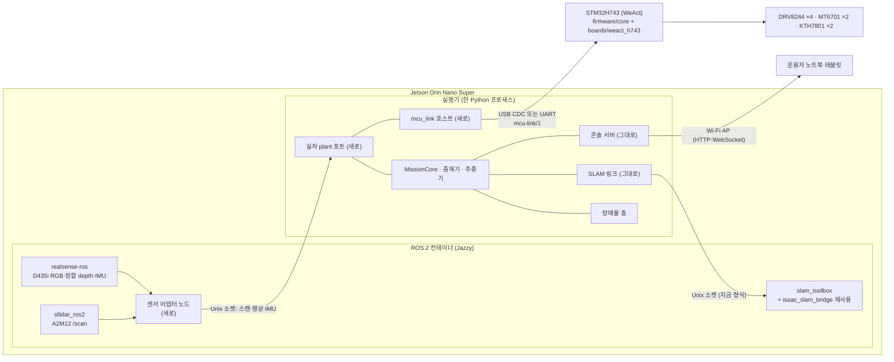

# 실차 이식(sim-to-real) 준비 계획 (2026-11-11, 초안)

- 요청(사용자, 총괄 경유): 이 시뮬을 실제 하드웨어에 어떻게 올릴지, 젯슨에 어떤 코드를 넣고 어떻게 실행할지, STM32 를 어떻게 코딩할지 구체적으로 정한다. 주문한 부품(메인보드 PCB·부품, 11-20 발송 예정)이 오면 바로 굴릴 수 있게 하는 것이 목표다.
- 범위: 계획 문서뿐이다. 실제 Jetson·장비 접속, ws1 잡, 코드 변경은 하지 않는다. 명령은 적기만 한다.
- 총괄 결정(2026-11-11): 목차와 큰 결정 K1–K6 은 권고대로 확정. K5(링크 전송로)는 PCB 확인 결과에 따른다. 사용자 답 네 가지(Jetson 보유, 메인 배터리 공유, 비상정지는 MCU 입력만, 승강 위치 측정 미정)를 반영한다.
- 표기: 각 항목을 **있음**(지금 저장소에 있음) / **새로**(새로 만들 것) / **순서**(언제)로 적는다. 하드웨어 값은 출처(실측·카탈로그·회로도·추정)를 붙인다. 측정이 필요한 값에 그럴듯한 기본값을 두지 않는다(CONTRIBUTING 6절).

## 0. 지금 있는 것

| 영역 | 있음 | 없음 |
|---|---|---|
| MCU 펌웨어 | `firmware/core/`: 보드 무관 C11 코어. 링크(COBS·CRC)·바퀴 엔코더·KTH7801·PI·DRV8244 순서기·안전 상태기(BOOT/DISARMED/ARMED/STOPPING/FAULT/ESTOP)·app 주기와 HAL 함수 표 `fw_hal`, 호스트 시험 9 개, `tools/link_tool.c`. 설계 [`docs/design/2026-10-22-mcu-firmware-core.md`](../design/2026-10-22-mcu-firmware-core.md)(3절이 보드 HAL 요구사항), 계획 [`docs/plans/2026-10-22-mcu-firmware-core.md`](2026-10-22-mcu-firmware-core.md) | 보드 HAL, CubeMX 프로젝트, 링커 스크립트, ARM 툴체인 고정, 실기 시험 |
| 링크 | 계약 [mcu-link/1](../interfaces/2026-10-22-mcu-link-contract.md)(DRIVE·ARM·DISARM·CLEAR_FAULTS·STATE, 신선도 boot_id·arm_gen·echo), Python `src/forklift_core/mcu_link/`(framing·messages, 고정 벡터 교차 시험) | 전송로 결정, 호스트 시리얼 어댑터, 속도·곡률 → `Drive` 변환, `STATE` → 오도메트리 |
| 핀맵·보드 | [핀맵 초안 검토](../design/2026-10-22-h743-pinmap-draft-review.md)(10-22 초안 기준). 팀 회로도 V1.0(로컬 전용 `docs/references/team-hardware/2026-10-28/`, 1·2·3·5 쪽): 10-22 검토의 A1(R_ENC_IN1 = PB10)·A3(nFAULT L/R/M/H = PB11/PB12/PB14/PB15)·A5(`MTR_SLEEP` = PB0 한 선)·B1(Wi-Fi 를 PB8·PB9 로 옮기고 PA11·PA12 = `USB_OTG_FS_DM/DP`)가 반영돼 있다. 바퀴 엔코더는 AM26LV32 차동 수신, KTH7801 은 SN65LVDS 를 거쳐 RJ50(5558067-1) 둘 | 회로도 4 쪽, KiCad/EasyEDA 원본, 비상정지 입력·승강 리밋 입력 넷(회로도·BOM 에 없음), `ADC_BAT` 의 MCU 핀(회로도 주석 "MCU ADC pin unassigned") |
| Jetson 쪽 스택 | 라이브 실행기 `run_transport.py --live`(`LiveRuntime` + `MissionCore` + 장애물 층 + 콘솔 서버 `console/live/server.py`) — Isaac 프로세스 안에서 120 Hz 물리 스텝에 맞춰 돈다. SLAM 은 Unix 소켓(`forklift_core.localization.slam_link`: 길이 + JSON 머리 + float32 거리)으로 slam_toolbox 컨테이너와 주고받고, 지도는 공유 폴더 `latest_map.npz`. 오도메트리 모형 `team_spec_quantized`(뒤 바퀴 증분 4096 + 조향 절대각 양자화) | **구동 명령 경계가 클래스로 분리돼 있지 않다**(`drive()` 안에서 `robot.apply_action` 직접 호출). `MissionCore` 훅 약 80 개 가운데 참값 훅(`truth_rear`·`truth_velocity`·`truth_speed`·`truth_yaw_rate`·`truth_relative_yaw`·`truth_obstacles` 등)이 있다. 벽시계 제어 루프 없음 |
| ROS 2 | `deploy/ros2/Dockerfile`(`ros:jazzy-ros-base-noble` + slam_toolbox), `ros2/src/forklift_ros`(Isaac SLAM 브리지·recorder·replay), `forklift_bringup`(replay launch, slam_toolbox YAML 넷) | **센서 드라이버(librealsense·realsense-ros·sllidar_ros2)**, 실차 launch·노드, 센서 → 실행기 어댑터 |
| 콘솔 | 게이트웨이(`--backend real` 은 관찰 전용), 결정(Jetson AP 1:1·같은 스택·HTTPS 없음·실차 정지 = 주 전원 끄기), F1 차량 측 차단(#360: operator_placed 출발이면 AUTO·미션 거부, 실차 런처는 `allow` 금지) | Jetson AP 실제 구성, 실차 정지 수단 시험 |
| 차체·센서 설정 | `sim/models/dls08_measured/`(실측·추정 구분), `PERCEPTION_MOUNTS["carriage_low_measured"]`, `config/isaac_slam_lidar.yaml`(합성) | 센서 장착 실측(D435i·A2M12, `docs/hardware.md` 미확정), 외부 보정, 엔코더 감속비 G |
| 실차 전 검토 | [`docs/design/real-vehicle-port-review.md`](../design/real-vehicle-port-review.md) 7 항목(조향 응답 0.877, 저상 장애물, D1, 하역 직선, D7 보류, 재출발 N, 꺼내기 허가) | — |
| 플랫폼 | [ADR 0001](../decisions/0001-development-and-deployment-platforms.md): Orin Nano Super 8GB, JetPack 7.2.1, Ubuntu 24.04, Jazzy(센서 실기 검증 전 동결 안 함). **사용자: Jetson Orin Nano Super 보유**(2026-11-11) | 저장장치 확인, 센서 실기 검증 기록 |

## 1. 전체 구조 — 같은 스택에서 plant 만 바꾼다

**K1(확정)**: 미션 코어·장애물 층·SLAM 링크·콘솔 서버·mcu_link 호스트를 **한 Python 프로세스**(이하 '실행기')로 둔다. Isaac 과 실차는 같은 **plant 포트** 인터페이스의 두 구현이다. ROS 2 는 컨테이너 안에서 센서 드라이버와 slam_toolbox 만 돌린다.



### 1.1 Isaac ↔ 실차 대응표 (plant 포트 단위)

| 인터페이스 | Isaac 쪽 지금 | 실차 쪽 | 비고 |
|---|---|---|---|
| 구동 명령 | 추종기·중재기의 속도·곡률 → `ackermann_command`(앞 조향 둘 + 네 바퀴) → `robot.apply_action` | 속도·곡률 → **변환 모듈**(K6) → 뒤 두 바퀴 rad/s + 조향 기구각 하나 + 승강 목표 → `mcu_link.Drive` | 실차는 뒤 L·R 구동, 앞바퀴 조향만(사용자 확인). Isaac 은 네 바퀴 구동 그대로(plant 구조는 따로 결정) |
| 바퀴·조향·승강 측정 | `TeamEncoderModel.read`(Isaac 관절각 → 양자화, **바퀴 한 바퀴 4,096 카운트** 전제) | `STATE` 의 `wheel_count_*`(32비트 모듈러, **모터 축 카운트**)·`steering_rad`·`lift_m` | ① 바퀴 엔코더(MT6701)는 **모터 축**에 있고 감속비 G ≈ 80(사용자 추정, 실측 아님) → 바퀴 한 바퀴 4,096 × G ≈ 327,680 카운트. 시뮬 모형보다 양자화가 약 80 배 곱다(양자화 쪽에서 시뮬은 보수적). 대신 **기어 백래시**(방향 바꿀 때 바퀴가 덜 도는 구간)와 바퀴 미끄럼은 엔코더가 보지 못하는데, 시뮬 모형에는 백래시가 없다. ② 시뮬 모형은 앞 조향 관절 둘을 읽는다. 실차는 KTH7801 하나(조향 기구각) → 실차판 오도메트리 변환 필요. 시뮬 모형을 실차 구성(모터 축 카운트·백래시)에 맞게 바꿀지는 이 계획 밖의 후속 결정이다 |
| LiDAR | `planar_lidar.cast_scan_flags`(1600 빔·10 Hz, 합성) | sllidar_ros2 `/scan` → 어댑터 → 실행기 | 실기 빔 수·주기는 A2M12 설정과 회전 속도에서 정해진다(각 분해능은 회전 속도 의존, `docs/hardware.md`) |
| RGB-D | Isaac 카메라 `get_current_frame`(원거리 인식·포켓 카메라) | realsense-ros 정합 color + aligned depth + CameraInfo → 어댑터 → 실행기 인식 입력 | 해상도·내부 파라미터·depth 단위는 장치가 준 값을 그대로 기록(CONTRIBUTING 5절) |
| IMU(자이로) | `localization/gyro.py` 모형(`--odometry-heading gyro`) | D435i 내장 IMU(사용자 결정 2026-10-22, MCU 별도 IMU 는 위치·모델 미정) | 기본 운영은 지금 기본(관절각 오도메트리)과 같게 두고, 자이로는 실측 뒤 결정 |
| SLAM | 실행기 → 브리지 컨테이너 Unix 소켓(`Scan`: scan_id·stamp·odom_from_base·ranges / `Reply`: map_from_odom) | 같은 소켓·같은 형식. 스캔은 실기 `/scan`, odom 은 실차 오도메트리 | 브리지는 지금 `/clock` 을 스캔 시각으로 낸다 — 실차에서는 벽시계 단조 시각을 쓴다(2.5) |
| 시간 | 물리 스텝(1/120 s) × 배속, `Pacer` | **벽시계 제어 루프**(새로) | 2.2 |
| 참값 훅 | `truth_rear` 등(판정·대체 경로) | **fail-closed**: 실차에서 부르면 예외 또는 기능 끔 | 2.3 |
| 장면 판정 | `judge_delivery`·`scene_damaged`·미끄럼 판정 등(참값 기반) | 대응 없음 → 끔(기록만 '판정 불가') | 실차 성공 판정은 사람 확인·외부 측정(5절) |
| 정지 | `zero_wheels`·`hold_lift` 훅 | `DISARM`(즉시) 또는 `DRIVE` 바퀴 0(감속), MCU 자체 만료 | 4.3 |

## 2. Jetson 쪽

### 2.1 프로세스 구성

| 프로세스 | 있음 | 새로 | 순서 |
|---|---|---|---|
| ROS 2 컨테이너: realsense-ros, sllidar_ros2 | 이미지 바탕(`deploy/ros2`) | 드라이버 추가 이미지 `deploy/ros2-real/`(ARM64), launch `forklift_bringup/launch/real_sensors.launch.py` | 3절 P0(도착 전) |
| ROS 2 컨테이너: slam_toolbox + 브리지 | `isaac_slam_bridge`·`slam_toolbox` YAML | 실차 모드(벽시계 `/clock` 없이 `use_sim_time:=false`), 장비 YAML | P1 |
| 센서 어댑터 노드 | — | `forklift_ros/real_sensor_adapter`: `/scan`·color·aligned depth·CameraInfo·IMU 를 실행기 Unix 소켓으로(장치 시각과 수신 시각을 둘 다 실음) | P1 |
| 실행기 | `run_transport.py --live` | `--plant real`(실차 plant 포트), mcu_link 호스트, 벽시계 루프, 참값 훅 거부 | P1–P3 |
| 콘솔 | `console/live/server.py`, 웹 | 실차 정지 안내·실차 상태 표시(전원·MCU 모드·결함 비트) | P3 |

K2(확정): **센서는 ROS 컨테이너 안의 어댑터가 Unix 소켓으로 실행기에 넘긴다.** 실행기 쪽 코어는 rclpy·RealSense SDK·시리얼을 import 하지 않는다(CONTRIBUTING 2절). 실행기 → slam_toolbox 경로는 지금 소켓 형식 그대로라 SLAM 쪽 실행기 코드는 바꾸지 않는다.

### 2.2 실차 plant 포트와 벽시계 루프 (K1 의 핵심 새 일)

- **포트 정의(새로)**: `forklift_core/plant/port.py` 에 인터페이스를 둔다. 명령 `command(speed_mps, curvature_inv_m, lift)`, `stop(kind)`, 측정 `read() -> PlantSample`(바퀴 카운트·조향·승강·시각·유효성), 센서 `scan()`·`rgbd()`·`imu()`, 상태 `health()`.
- **Isaac 포트(새로, 재구성)**: `drive()` 안의 Isaac 직접 호출(`apply_action`·관절 읽기·카메라·레이캐스트)을 이 포트 뒤로 옮긴다. **동치 확인: 재생 게이트 runs29 29/29**(총괄 결정, 러너 PR 규칙). 큰 리팩터링이므로 단계로 나눈다 — ① 구동 명령 출구 ② 엔코더·관절 읽기 ③ LiDAR·카메라 입력 ④ 참값 훅 목록화. 단계마다 게이트와 전체 pytest.
- **실차 포트(새로)**: `forklift_core/plant/real.py`(코어, 시리얼 없음) + `sim`이 아닌 실행 진입점의 어댑터(`tools/real_plant_io.py` 등)에서 시리얼·소켓을 연다.
- **벽시계 루프(새로)**: Isaac 의 120 Hz 스텝과 `Pacer` 대신, 단조 시계로 정한 주기(제안 50 Hz 제어 = 20 ms, 추종기·중재기 주기)로 돈다. 늦은 주기는 세고(`overrun`) 따라잡지 않는다. 시뮬과 다른 점: 시간이 멈추지 않으므로, 계획·인식이 오래 걸리면 그동안 정지 명령을 유지하는 지금 비동기 작업자 구조(D8·D9)를 그대로 쓴다.
- **명령 주기와 MCU 만료**: 실행기는 20 ms 마다 `DRIVE` 를 보내고 `valid_after_echo_ms` 를 제안 150 ms 로 둔다(계약 2절 식). 그 안에 다음 `DRIVE` 가 없으면 MCU 가 스스로 `STOPPING` 에 든다. 값은 4절 실측(정지 거리·지연) 뒤 정한다.

### 2.3 참값 훅 감사 (fail-closed)

- **새로**: `MissionCore` 훅 전체와 Isaac 전용 판정(`judge_delivery`·`scene_damaged`·미끄럼·forbidden contact·`pallet_z`·`insertion_measured` 등)을 표로 만든다. 각 훅을 ① 실차 대응 있음(측정으로 대체) ② 실차에서 끔(판정 불가 기록) ③ 실차에서 부르면 예외(fail-closed) 로 분류한다.
- 규칙: 실차 포트로 시작한 세션은 ②·③ 분류 훅을 부르는 순간 **기동 거부 또는 세션 종료**다. 조용히 대체값(예: `truth_velocity` 대체 경로, `core.py` 1598 행)을 쓰지 않는다.
- 순서: P1(포트 재구성과 함께). 시험: 실차 포트 가짜 구현으로 각 훅이 예외를 내는지.

### 2.4 실행 방식 (K3 확정: Docker + systemd)

- **이미지**: `deploy/ros2-real/Dockerfile`(ARM64, `ros:jazzy-ros-base-noble` 다이제스트 고정 + librealsense·realsense-ros·sllidar_ros2 버전 고정). 실행기는 같은 이미지 안의 venv 또는 호스트 venv 중 하나 — 제안: **실행기도 컨테이너**(Isaac 이 없으므로 의존성이 가볍고, ws1 과 같은 고정 방식을 쓸 수 있다). `--network host`(콘솔·AP), `--device /dev/ttyACM0`(USB CDC) 또는 `/dev/ttyTHS*`(UART), D435i USB(udev 규칙), `/dev/ttyUSB*`(A2M12 USB-UART).
- **부팅 순서(systemd 유닛 하나, `deploy/jetson/forklift.service`)**: 전원 → JetPack 부팅 → AP(hostapd/NetworkManager 핫스팟) → 장치 대기(udev 심볼릭 링크 `/dev/forklift-mcu`·`/dev/forklift-lidar`) → 컨테이너 기동(센서 → SLAM → 어댑터 → 실행기) → 콘솔 접속 대기. 실행기는 **DISARMED 로 시작**하고 운용자의 lease·ARM 전에는 바퀴를 움직이지 않는다.
- **명령(적기만)**:
  ```bash
  # 이미지 빌드(Jetson 에서)
  docker build -f deploy/ros2-real/Dockerfile -t forklift/real:<sha> .
  # 수동 기동(시험)
  docker compose -f deploy/jetson/compose.yaml up sensors slam adapter runner
  # 부팅 기동
  sudo systemctl enable --now forklift.service
  # 콘솔: 노트북을 AP 에 붙이고 http://<jetson-ap-ip>:8798/
  ```
- **JetPack**: ADR 0001 의 7.2.1(Ubuntu 24.04) 그대로 두되, Orin Nano Super 에서 그 판과 librealsense 동작은 3절 P0 에서 실기로 확인하고 결과를 `docs/validation/` 에 남긴 뒤 동결한다.

### 2.5 설정·보정값 위치, 시간 동기, 기록

- **설정**: 차체는 `sim/models/dls08_measured/`(실측·추정 구분 그대로)를 정본으로 둔다. 실차 전용 값은 새 파일 `config/real/` 아래에 둔다.
  - `vehicle.yaml`: 엔코더 감속비 G, 조향 링크 보정표, 바퀴 반경 실효값.
  - `sensors.yaml`: 장착 외부 보정 `base_link_from_camera`·`base_link_from_laser`, 측정 날짜와 방법.
  - MCU 게인·한계는 펌웨어 `drive_config` 로 빌드에 넣는다(설계 7절: 링크로 바꾸지 않음).
  - 값마다 출처(실측·추정)와 날짜를 적고, 추정값은 '실측 대기' 꼬리표를 단다.
- **시간 동기**: 한 Jetson 안의 단조 시계가 기준이다.
  - D435i 는 장치 시각과 호스트 수신 시각을 둘 다 기록한다(realsense-ros 의 global time 설정 확인).
  - A2M12 는 드라이버가 찍는 호스트 시각.
  - MCU 는 `mcu_time_us`(호스트 시계와 섞지 않음, 계약 4절). 명령 신선도는 echo 로만 판단한다.
  - 노트북·태블릿은 콘솔 표시용이라 동기하지 않는다(chrony 는 필요하면 Jetson 을 기준으로).
  - 서로 다른 시계를 빼려면 변환을 적는다(CONTRIBUTING 5절).
- **기록**:
  - rosbag2(MCAP): `/scan`, color·depth(압축), CameraInfo, IMU, `/tf`·`/tf_static`.
  - 실행기의 `live_log`·spool·`result.json`(지금 형식).
  - mcu_link 원시 바이트 로그: 수신 시각 + 프레임. 재생과 링크 진단에 쓴다.
  - **재생 게이트(새로)**: 실차 기록(bag + mcu 로그)을 실행기에 다시 넣어 같은 결정이 나오는지 보는 도구. 지금 `slam_replay`(Isaac 기록 → bag)의 반대 방향이다. P3 뒤.

## 3. STM32 펌웨어

### 3.1 툴체인·빌드·플래시·디버그 (K4 확정)

- **CubeMX** 로 `firmware/boards/weact_h743/` 에 초기화 코드(클록·GPIO·TIM1·LPTIM1/2·SPI1/2·ADC·USB 또는 UART·IWDG)를 생성한다. `.ioc` 를 커밋하고, 생성 코드는 사용자 코드 구역만 고친다.
- **빠른 경로는 LL**: LPTIM 카운터 두 번 읽기, SPI DMA 거래와 태그, ADC 를 TIM1 트리거에 맞춘 DMA, 링크 송신 링 버퍼.
- **빌드**: CubeMX 의 CMake 생성 + `arm-none-eabi-gcc`(버전 고정, 예: Arm GNU Toolchain 13.x — 설치 전 총괄 확인). 코어는 그대로 링크한다(호스트 시험과 같은 소스).
- **플래시·디버그**: ST-LINK V2/V3(SWD, PA13·PA14) + OpenOCD 또는 STM32CubeProgrammer. USB DFU(BOOT0)는 비상 경로.
- 명령(적기만):
  ```bash
  cmake -S firmware -B build/mcu -DFW_BOARD=weact_h743 -DCMAKE_TOOLCHAIN_FILE=firmware/boards/weact_h743/arm-gcc.cmake
  cmake --build build/mcu -j
  openocd -f interface/stlink.cfg -f target/stm32h7x.cfg -c "program build/mcu/fw.elf verify reset exit"
  ```

### 3.2 주변장치 대응 (회로도 V1.0 기준)

| 기능 | 핀(회로도 2 쪽) | 주변장치 | HAL 계약(설계 3절) |
|---|---|---|---|
| 모터 PWM L/R/M/H | PE9/PE11/PE13/PE14 (`x_IN1`) | TIM1 CH1–4, 같은 주기 | 듀티 부호 → `x_IN2`(PE2/PE6/PE4/PE5) 방향 |
| DRVOFF L/R/M/H | PD9/PD10/PD13/PD14 | GPIO 출력(기본 high = 끔) | 주기마다 SPI 전에 씀 |
| nSLEEP(공통) | PB0 `MTR_SLEEP` | GPIO | 드라이버 재시작 경로(핀맵 검토 A5 해결) |
| nFAULT L/R/M/H | PB11/PB12/PB14/PB15 | GPIO 입력(EXTI 선택) | 입력 스냅숏 |
| DRV8244 SPI | PA5/PA7/PB4, nCS PA0–PA3 | SPI1 모드 1, DMA | 거래 하나씩, 32비트 태그 |
| IPROPI L/R/M/H | PA6/PC4/PB1/PC0, R_IPROPI 1 kΩ(회로도 R5·R6·R15·R12) | ADC1/2, TIM1 트리거 DMA | 표본마다 신선도 플래그. ADC 핀 과전압 보호는 핀맵 A6 확인 항목 |
| 바퀴 엔코더 L | PD12(A)/PE1(B), Z = PC6 | LPTIM1 엔코더, ARR 0xFFFF(16비트) | 두 번 읽기, 코어가 32비트 모듈러로 누적 |
| 바퀴 엔코더 R | PB10(A)/PD11(B), Z = PC7 | LPTIM2 엔코더 | 두 번 읽기 |
| KTH7801 조향(M)·승강(H) | SCK PB13, MOSI PC1, MISO PC2_C, CS1 PD0, CS2 PD1 | SPI2 모드 3 ≤ 10 MHz(LVDS 경유 최대 클럭은 실측) | PC2_C 아날로그 스위치 닫기(핀맵 B2) |
| 링크 | USB: PA11/PA12 `USB_OTG_FS` / UART 후보 | USB CDC 또는 UART | 프레임 단위 송신 |
| 상태 LED | PE3 `BOARD_LED` | GPIO | — |
| Wi-Fi | PB8/PB9(UART), PA10 RST | 범위 밖(용도 미정) | — |
| 배터리 전압 | `ADC_BAT = VCC/11`(회로도 3 쪽), **MCU 핀 미배정** | — | 사용자 질문(7절) |
| 비상정지 입력 | **회로도 넷 없음** | — | 사용자 질문(7절), 6절 위험 R1 |
| 승강 리밋 | **회로도 넷 없음** | — | 3.5, 사용자 질문 |
| 독립 워치독 | — | IWDG | 주기를 끝까지 돌았을 때만 kick |

### 3.3 제어 루프와 주기 (제안, 실측 뒤 확정)

**엔코더 카운트 규모(모터 축, G ≈ 80 가정).** 바퀴 한 바퀴 = 4,096 × 80 = 327,680 카운트. 시뮬의 바퀴 상한 8 rad/s(설정값, 실측 아님)에서 바퀴 1.27 회전/s → 약 417,000 카운트/s, 모터 약 102 회전/s.
- **타이머**: 회로도 V1.0 의 핀은 LPTIM1·LPTIM2(16비트)에만 맞는다(32비트 TIM2/TIM5 로 바꾸려면 배선 변경). 1 ms 주기에서 한 주기 차분은 약 417 카운트로 16비트 차분 한계(±32,767)보다 훨씬 작다. 읽기가 밀려도 약 78 ms(32,767 ÷ 417,000)까지는 넘김을 놓치지 않는다 — 그보다 오래 밀리면 `cycle_overrun` 결함(설계 3절)이 먼저 걸리게 `overrun_limit` 을 정한다.
- **LPTIM 입력 주파수**: A·B 각 채널은 모터 한 바퀴에 1,024 주기(4체배 4,096) → 약 104 kHz. LPTIM 엔코더 모드는 입력이 커널 클록의 1/4 이하여야 하므로(RM0433 43.4.15) 커널 클록을 그보다 충분히 높게 둔다(디지털 필터 `CKFLT` 와 함께 실기 확인).
- **32비트 누적**: 코어의 32비트 모듈러 누적은 417,000 카운트/s 에서 약 86 분마다 넘어간다. 호스트는 2³² 법 차분을 쓰므로 문제없다(계약 3.3).
- **속도 분해능**: 창 길이 T 에서 1 카운트 = 2π / (327,680 × T) rad/s. 20 ms 창이면 0.00096 rad/s(바퀴 반경 0.125 m 기준 0.12 mm/s), 2 ms 창이면 0.0096 rad/s. 4,096 카운트/바퀴 가정보다 80 배 곱기 때문에 창을 2–5 ms 로 줄여 지연을 낮출 수 있다(시작 제안 5 ms).
- **확인 항목**: MT6701 의 ABZ 해상도 프로그래밍 값(4체배 4,096/회전이 되려면 1,024 펄스/회전 설정). 출고값과 팀이 쓴 값을 S2 에서 확인한다.

- 제어 주기 `period_us` = 1,000(1 kHz): 엔코더 읽기, PI, PWM 갱신, 만료 판정.
- 바퀴 속도 창 5 ms(위 분해능 계산: 0.0038 rad/s, 지연 약 2.5 ms. 설계 5절의 0.0767 rad/s 는 바퀴 4,096 카운트 가정이라 실차에는 해당하지 않는다).
- `STATE` 10 ms(100 Hz, 링크 대역은 계약 5절).
- 조향·승강 위치 PI 는 같은 1 kHz 루프. 목표 변화율 제한.
- 게인은 4절 축별 단계에서 정한다. 설계 7절대로 빌드에 넣고, 시작 게인은 낮게(개루프 응답에서 대략 계산).

### 3.4 안전 동작 (펌웨어 몫)

- 이미 코어에 있는 것: 명령 만료 → `STOPPING`(바퀴 0, 조향·승강 유지) → `DISARMED`, 비상정지 입력 → `ESTOP` 래치, nFAULT·과전류·센서 무효·범위 이탈·주기 지연 → `FAULT` 래치, 재연결·재부팅만으로 달리지 않음(`CLEAR_FAULTS` 필요), 무장 직후 두 바퀴 0 먼저.
- 보드에서 할 것:
  - IWDG 시간 설정(제안 50–100 ms, 주기 1 ms 의 큰 배수).
  - 리셋 동안 DRVOFF 내부 풀업으로 출력 Hi-Z 확인.
  - 부팅 직후 모든 DRVOFF high.
  - 브라운아웃 리셋 수준(BOR) 설정.
- **승강 하중 전제**: 정지 출력은 승강이 모터 토크 없이 버틴다는 전제에 기댄다. 확인 전에는 빈 포크로만 시험한다(설계 4절).

### 3.5 승강 위치 측정 — 두 안 (미정, 팀 확인)

| 안 | 내용 | 펌웨어 코어 영향 | 하드웨어 영향 |
|---|---|---|---|
| A. 리밋 스위치 원점 + KTH7801 다회전 누적 | 부팅마다 승강을 아래 리밋까지 천천히 내려 원점을 잡고, KTH7801 각을 회전 수와 함께 누적해 높이로 바꾼다 | `abs_axis` 의 '한 바퀴 미만' 전제를 승강 축에서 버린다. **새로**: 다회전 누적(각 차분 펼치기), 원점 잡기 상태(`HOMING`, 무장 전 필수), 원점 전 승강 명령 거부, 리밋 입력의 신선도·고장 처리. 상태기와 계약(`STATE` 에 원점 상태 비트, 거부 이유 `not_homed`)이 바뀐다 → mcu-link 버전 올림(계약 7절) | 리밋 스위치와 MCU 입력 핀(회로도에 없음). 원점 동작 중 하중·충돌 |
| B. 리니어 엔코더(절대 위치) | 켜자마자 포크 높이를 직접 읽는다(9주차 피드백) | 승강 축 입력을 KTH7801 에서 새 센서로 바꾼다. 절대값이면 '한 바퀴 미만' 문제가 없어지고 원점 잡기가 필요 없다. **새로**: 센서 해석 모듈(인터페이스는 센서에 따라 SPI·아날로그·SSI), 신선도·범위 이탈 규칙은 `abs_axis` 와 같은 틀 | 센서 선정·장착·배선(규격 변경은 아니지만 부품 추가 — 사용자 결정) |

- 공통: 결정 전에는 승강을 **빈 포크로, 한 바퀴 미만 범위에서만** 시험한다. 4절 들기 단계는 이 결정 뒤에 둔다.

### 3.6 시험

- 호스트 단위 시험: 지금 9 개 + 보드 HAL 가짜를 쓰는 app 시험(있음). 승강 안 A 를 택하면 다회전·원점 시험을 더한다.
- **HIL(새로)**:
  - 펌웨어 빌드 선택 `FW_HIL_PLANT` — 보드 HAL 의 입력 스냅숏을 MCU 안의 간단한 모터·엔코더 모형이 채운다. 지금 호스트 가짜 HAL 의 모형을 옮긴다.
  - 그 상태로 Jetson(또는 노트북)의 mcu_link 호스트와 실차 plant 포트가 링크·만료·정지·재무장을 끝까지 돌린다.
  - 모터 없이 할 수 있다.
- 실기 시험: 4절 단계표.

## 4. 부품 도착 전 (지금 → 11-20)

| 번호 | 할 일 | 필요한 것 | 합격 조건 |
|---|---|---|---|
| P0-1 | **Jetson 기본 구성**: JetPack 7.2.1 설치, 저장장치 확인(확인 항목), Docker·nvidia-container, AP 구성 | Jetson 보유(사용자) | 부팅 재현 3 회, AP 로 노트북 접속, `docs/validation/` 기록 |
| P0-2 | **센서 드라이버 실기**: ARM64 librealsense + realsense-ros, sllidar_ros2(A2M12) | D435i·A2M12 보유 | `docs/hardware.md` '버전 고정 전 검증' 1–5 를 기록으로 채운다(D435i RGB·depth·IMU 지속 스트리밍, CameraInfo·TF, A2M12 스캔 안정성, 동시 동작, 온도·전력·재부팅 재현) |
| P0-3 | **실데이터 기록과 시뮬 계약 대조**: 책상·복도에서 rosbag 기록 | P0-2 | 형식(단위·좌표·시각 도메인·depth 단위), 주기(LiDAR 회전 속도·빔 수, 카메라 fps), 좌표(REP-103/105, 광학 프레임)를 시뮬 입력과 표로 대조. 다른 점은 어댑터가 맞출지 실행기 계약을 바꿀지 정한다 |
| P0-4 | **실행기 plant 포트 재구성(Isaac 포트)**: 2.2 의 ①–④ | 저장소·ws1 | 단계마다 재생 게이트 29/29·전체 pytest |
| P0-5 | **참값 훅 감사표** (2.3) | 저장소 | 분류표 PR, 실차 포트 가짜 구현으로 fail-closed 시험 |
| P0-6 | **변환 모듈** (K6): 속도·곡률 → 뒤 두 바퀴 rad/s(전자 차동: 안·바깥 바퀴 속도비 = 회전 반경 ± 윤거/2) + 조향 기구각(앞바퀴 각 ↔ KTH 축각 보정표 자리), `STATE` → 오도메트리(실차판 team_spec 모형: 조향 측정 하나, 모터 카운트 ÷ (4,096 × G)). G 는 `config/real/vehicle.yaml` **한 곳**에 두고(지금 값 80, '사용자 추정, 실측 대기' 꼬리표), 펌웨어 보드 설정 헤더는 빌드 때 그 파일에서 만든다(손으로 두 군데 적지 않음) | 저장소 | 호스트 시험(대칭·직진·최대 조향·후진, 모듈러 카운트 넘김), Isaac 쪽 같은 모형과의 대조 시험 |
| P0-7 | **mcu_link 호스트 어댑터**: 시리얼 열기·재연결·`STATE` 신선도·`valid_after_echo_ms` 계산·로그 | 저장소 | 가짜 시리얼 쌍(pty)으로 C 호스트 빌드(`link_tool`)와 교차 시험 |
| P0-8 | **보드 HAL 골격**(코어 보드만으로): CubeMX 프로젝트, 툴체인, 링크(USB CDC/UART), IWDG, LED, `FW_HIL_PLANT` | WeAct H743 코어 보드(보유 여부 확인 항목), ST-LINK | 링크 왕복 1 시간 무오류, 만료 정지·재무장·`CLEAR_FAULTS` 시퀀스, 워치독 리셋 시 DRVOFF high(오실로스코프·멀티미터) |
| P0-9 | **Jetson ↔ STM HIL**: P0-7 + P0-8 + 실차 plant 포트를 HIL 모형에 연결 | 위 | 실행기에서 텔레옵 명령 → MCU 모형 → `STATE` → 오도메트리가 닫힌다. 링크를 뽑으면 MCU 가 `STOPPING`→`DISARMED`(마감 + `stop_grace_ms` 안) |

순서: P0-1 → P0-2 → P0-3 은 Jetson 쪽 한 줄, P0-4·P0-5·P0-6·P0-7 은 저장소 쪽 한 줄로 나란히, P0-8 → P0-9 는 코어 보드가 있을 때.

## 5. 도착 뒤 첫 주행까지

단계마다 **합격 조건**을 채워야 다음으로 간다. **멈춤 조건**이 생기면 그 단계에서 멈추고 원인을 기록한다. 모든 주행 단계는 차체를 들어 바퀴를 띄운 상태(받침대)부터 시작한다.

| 단계 | 할 일 | 합격 조건 | 멈춤 조건 |
|---|---|---|---|
| S1 전원·배선 | 배터리 → F1(50 A) → 입력 보호(LM74801) → VCC, 5 V(LMR60440), Jetson 19 V(LM5122 + TPS26630) 무부하·부하 측정. 커넥터 극성, 엔코더·KTH 케이블 | 5 V·3.3 V·19 V 가 정격 안. **Jetson 을 19 V 출력으로 켜서 최대 부하(MAXN SUPER) 10 분 안정**. 모터 기동·멈춤 전류에서 VCC 강하를 오실로스코프로 재서 **LM74801 UVLO(꺼짐 10.41 V, 회로도 주석)와 LM5122·TPS26630 UVLO 에 걸리지 않음**. 걸리면 그 상황(멈춤 10 A 등)을 기록 | 어느 레일이든 정격 밖, 발열, 모터 기동에서 Jetson·MCU 리셋 |
| S2 링크·센서 정지 확인 | MCU 부팅, 링크, `STATE` 의 엔코더·KTH 값(손으로 돌려), DRV8244 SPI 초기화(`drivers_ready`) | **감속비 G 실측**: 바퀴를 손으로 N 바퀴(≥ 10) 돌려 카운트 ÷ (4,096 × N) — `config/real/vehicle.yaml` 한 곳에 기록. MT6701 ABZ 해상도 확인. KTH 각이 손 회전을 따라감, KTH CRC 변형 확정(설계 5절), DRV8244 초기화 성공 | SPI 응답 상위 비트가 11 이 아님, 센서 무효, 카운트가 바퀴 회전과 비례하지 않음 |
| S3 축별 개루프 | 바퀴 띄우고 L·R·조향·승강을 낮은 듀티로 하나씩 | 방향·극성(`duty_sign`) 확정, 전류 측정 정상, 조향·승강 범위 끝을 기구 한계 전에 측정 | 의도와 다른 방향, 과전류, 기구 한계 접촉 |
| S4 축별 폐루프 | 바퀴 속도 PI, 조향 위치 PI(승강은 3.5 결정 전 빈 포크·제한 범위) | 계단 응답(상승 시간·오버슈트) 기록, 조향 추종 정상 오차·지연 측정(port-review '조향 응답' 항목 자료) | 발진, 과전류 래치 반복 |
| S5 안전 동작 실측 | 링크 끊김 → `STOPPING`, `DISARM`, 비상정지 입력(있는 경로), MCU 리셋(IWDG 강제) → 출력 차단, Jetson 강제 재부팅 → MCU 만료 정지, 주 전원 스위치 | **각 경우 바퀴가 서는 시간·거리를 받침대와 바닥에서 측정**, 브라운아웃(Jetson 재부팅) 때 MCU 가 만료로 섬 | 어느 경우든 서지 않거나 늦게 섬 → 자율 단계 금지 |
| S6 텔레옵 | 바닥에서 콘솔 텔레옵(저속) | 직진·좌우 회전·후진, 정지 응답, 콘솔 lease·STOP·재무장 | 의도와 다른 움직임, 정지 지연 |
| S7 센서 외부 보정 | D435i·A2M12 장착 위치·자세 측정(`base_link_from_*`), 보정 검증(알려진 표적) | 보정값과 방법을 `config/real/sensors.yaml` 에 기록, 재투영·스캔 정합 오차 기록 | 장착이 흔들림, 오차가 계약 허용 밖 |
| S8 실측 | 회전 반경(최소), 조향 추종(곡률 응답 계수, 전진·후진, 적재 전후), 바퀴 실효 반경, **기어 백래시**(방향 전환 때 모터 카운트는 도는데 바퀴가 안 도는 구간, 바퀴 띄우고·바닥에서), 오도메트리 표류(직선·원·재접근 길이, 적재 전후), IMU, SLAM 오차, port-review 7 항목 | 값마다 측정 방법·반복 수·날짜 기록. 백래시·미끄럼 실측값으로 시뮬 오도메트리 모형을 바꿀지는 후속 결정으로 넘긴다 | — |
| S9 실측 반영 | `config/real/vehicle.yaml`, `CurvatureResponse`, D1·재출발 N·D7 보류 문턱 등(port-review 표) | 반영값으로 Isaac 쪽 회귀(바뀐 기본값은 각 규칙의 승격 절차대로) | — |
| S10 자율 A | 정렬된 팔레트 직진 삽입(브리프 사례 A), 사람 감시·주 전원 손 닿는 곳 | 3 회 연속 성공, 금지 접촉 0(사람 판정) | 예상 밖 동작 한 번이라도 |
| S11 자율 B·C·D | 측면 오프셋 곡선 접근(B), 후진 뒤 삽입(C), 뒤 장애물(D) | 사례마다 3 회 연속 | 위와 같음 |

선행 조건(자율 S10 전, 사용자 답 3): **S5 의 안전 대책 실측이 통과해야 한다.** 독립 워치독 → 출력 차단, 링크 만료 정지, 주 전원 스위치 접근성.

## 6. 위험과 멈춤 규칙

**R1(맨 앞, 사용자 답 3). 비상정지는 MCU 입력뿐이다 — MCU 가 멈추면 비상정지가 듣지 않는다.**
- 지금 회로도에는 비상정지 입력 넷도 없다(7절 질문).
- 대책:
  1. 독립 워치독(IWDG): MCU 가 멈추면 리셋되고, 리셋 동안 DRVOFF 내부 풀업으로 출력이 차단된다.
  2. 링크 만료: Jetson·링크가 멈추면 MCU 가 스스로 선다.
  3. **주 전원 스위치 접근성**: 지금 주 전원 스위치는 메인보드 위의 작은 슬라이드 스위치(MSK12C02, LM74801 EN)다. 차체 밖에서 손이 닿는 위치로 빼는 배선을 권고한다.
- 셋 다 S5 에서 실측하고, 통과 전에는 자율 단계에 들지 않는다.
- 하드웨어 차단 경로(비상정지가 MCU 와 무관하게 DRVOFF 를 high 로 끌어올리는 OR 구조, 또는 모터 전원을 끊는 외부 릴레이)는 **권고**만 한다. PCB 다음 판이나 외부 릴레이 중 무엇으로 할지는 사용자 결정이다(7절).

**R2. 전원 공유와 브라운아웃(사용자 답 2).**
- Jetson 은 메인 12 V 납축 배터리에서 19 V 승압으로 받는다(회로도 5 쪽: LM5122 약 3 A 목표, TPS26630 전류 제한 약 3.2 A).
- 모터 기동·멈춤(모터당 약 10 A, 사용자 사실 계산)으로 VCC 가 처지면 두 가지가 일어날 수 있다.
  - 입력 보호 LM74801 의 UVLO(꺼짐 10.41 V)가 VCC 전체를 끊는다. MCU 와 Jetson 이 함께 꺼진다.
  - 19 V 승압·보호 쪽 UVLO 로 Jetson 만 재부팅된다.
- 대책:
  - S1 에서 강하를 측정한다.
  - 펌웨어 듀티 변화율 제한과 DRV8244 전류 제한으로 기동 전류를 줄인다.
  - 배터리 상태를 확인한다.
  - Jetson 이 재부팅되면 링크 만료로 MCU 가 서는지 S5 에서 확인한다. MCU 가 함께 꺼지면 DRVOFF 풀업으로 출력이 꺼진다. 단 승강 하중 전제(R4)가 붙는다.
- 배터리 전압 감시(`ADC_BAT`)는 MCU 핀이 배정되지 않았다(7절).

**R3. 승강 위치(3.5).** 결정 전에는 빈 포크·제한 범위만 시험한다.

**R4. 승강 자잠김 미확인.** 역구동 기구면 정지·리셋·전원 차단 때 포크가 내려간다(설계 4절).

**R5. 시뮬 전용 규칙.** port-review 7 항목은 실측 전 임시값이다. S8 전에는 자율에서 그 값을 믿지 않는다(사람 감시 필수).

**R6. 큰 리팩터링(plant 포트).** `drive()` 재구성이 Isaac 결정을 바꿀 수 있다. 재생 게이트 29/29 와 전체 pytest 로 막는다(P0-4).

**R7. 센서 플랫폼 미동결.** JetPack 7.2.1 + ARM64 librealsense 조합은 실기 미검증이다. P0-2 가 실패하면 플랫폼 결정(ADR 0001)을 다시 연다.

멈춤 규칙(공통): 의도와 다른 움직임 한 번, 정지 실패 한 번, 레일 정격 밖, 발열이면 그 단계에서 멈추고 주 전원을 끈 뒤 기록한다.

## 7. 사용자에게 물을 것 (하드웨어 사실·실측·되돌리기 어려운 결정만)

1. **비상정지 경로**: 회로도에 비상정지 입력 넷이 없다. 'MCU 입력'은 어느 핀·어떤 장치(유선 버튼, Wi-Fi 모듈 경유 무선)인가? 하드웨어 차단 경로를 PCB 다음 판이나 외부 릴레이로 추가할지(권고: 추가).
2. **주 전원 스위치**: 메인보드 위 슬라이드 스위치(MSK12C02) 말고, 차체 밖에서 손이 닿는 스위치를 따로 달지(권고: 단다).
3. **링크 전송로(K5)**: 회로도 V1.0 은 PA11·PA12 를 `USB_OTG_FS_DM/DP` 로 두었다(Wi-Fi 는 PB8·PB9). Jetson 과는 WeAct 보드의 USB-C 로 잇는가, 메인보드에 USB 커넥터가 있는가(회로도 4 쪽 미수령)? 권고는 USB CDC. 아니면 UART(USART1 PA9/PA10 또는 UART7 PE7/PE8 이 회로도에서 비어 있음) ≥ 460,800 bps.
4. **승강 위치 측정**: 안 A(리밋 원점 + 다회전 누적) 또는 안 B(리니어 엔코더). 리밋 스위치 입력 핀도 회로도에 없다.
5. **승강 자잠김**: 승강 기구가 모터 토크 없이 하중을 버티는가(웜·리드스크루·브레이크)?
6. **배터리**: 12 V 납축의 용량·상태, 충전 방식. `ADC_BAT`(VCC/11)를 MCU 의 어느 ADC 핀에 이을지(권고: 빈 PC5 `ADC12_INP8` 등, 다음 판 또는 점퍼).
7. ~~엔코더 감속비 G~~ — 사용자 답(2026-11-11): MT6701 은 **모터 축**, 감속비 **약 80:1**(실측 아님). 계획은 G = 80 으로 쓰고 S2 에서 실측한다.
8. **Jetson 저장장치**: NVMe 장착 여부와 용량.
9. **센서 장착 위치**: D435i(마스트·캐리지)와 A2M12(높이·자세). 장착이 검출 근접 한계를 정한다(`docs/hardware.md`).
10. **WeAct H743 코어 보드·ST-LINK 보유 여부**(도착 전 P0-8 가능 여부).
11. 하드웨어 차단 경로 추가처럼 센서·부품을 늘리는 것은 별도 승인 항목이다. 이 계획은 센서 대수·종류를 바꾸지 않는다.

권고로 정한 것(묻지 않음): 제어 주기 1 kHz·`STATE` 100 Hz·실행기 50 Hz, Docker + systemd, CubeMX + LL, 실행기도 컨테이너, `config/real/` 위치, rosbag2 MCAP.

## 8. 후속 결정 항목 (이 계획 밖)

- 시뮬 오도메트리 모형(`team_spec_quantized`, 바퀴 4,096 카운트 전제)을 실차 구성(모터 축 카운트 × G, 기어 백래시)에 맞게 바꿀지. 실측(S2·S8) 뒤 결정.
- 시뮬 plant 의 구동 방식(네 바퀴 속도 구동 → 뒤 두 바퀴 구동)을 바꿀지(이미 별도 결정 항목, 메모리 2026-10-15).

## 9. 자체 검토

(독립 검토 3 회 뒤 채운다: ① 원자료·코드 대조 ② Codex 적대적 검토 ③ 앞의 둘을 보지 않은 새 Codex 스레드 또는 agy 의 '적히지 않은 전제'.)
