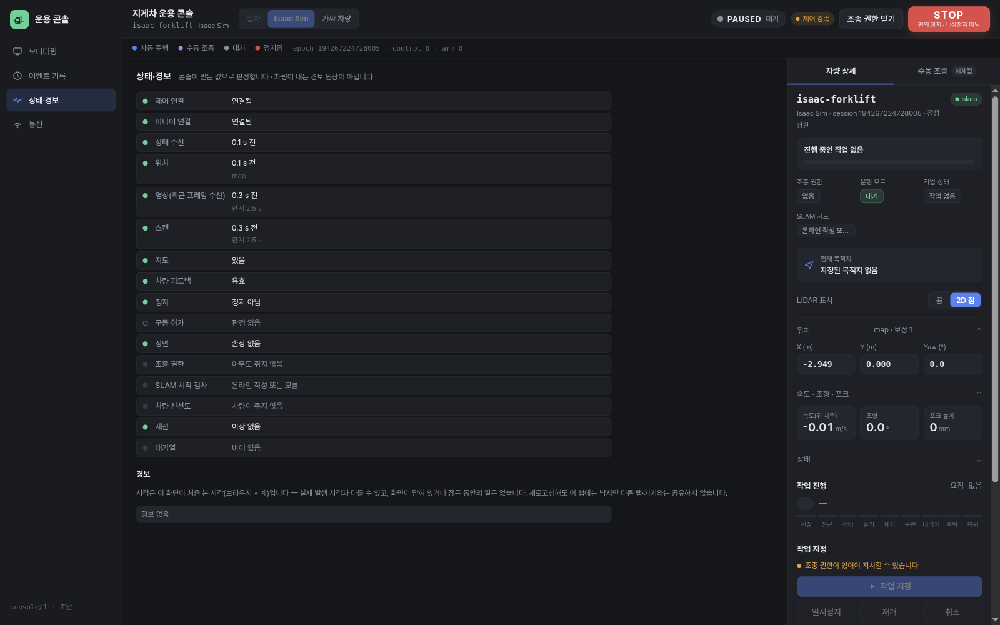
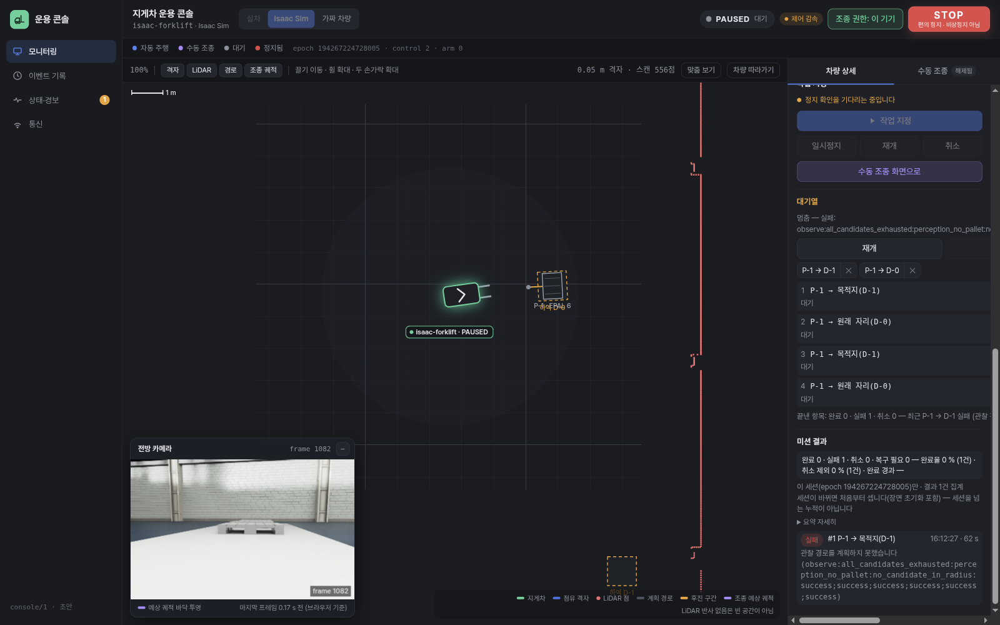
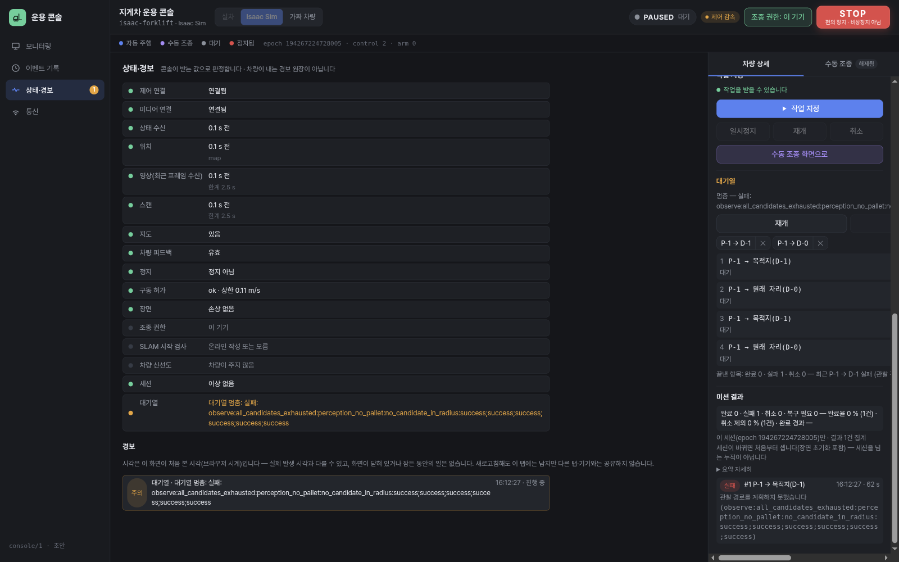
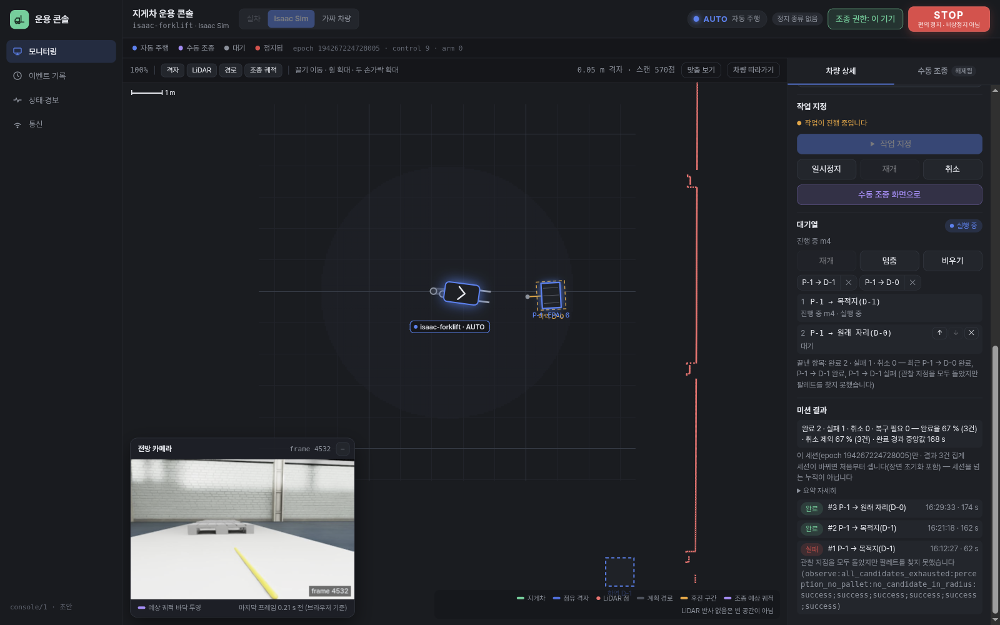
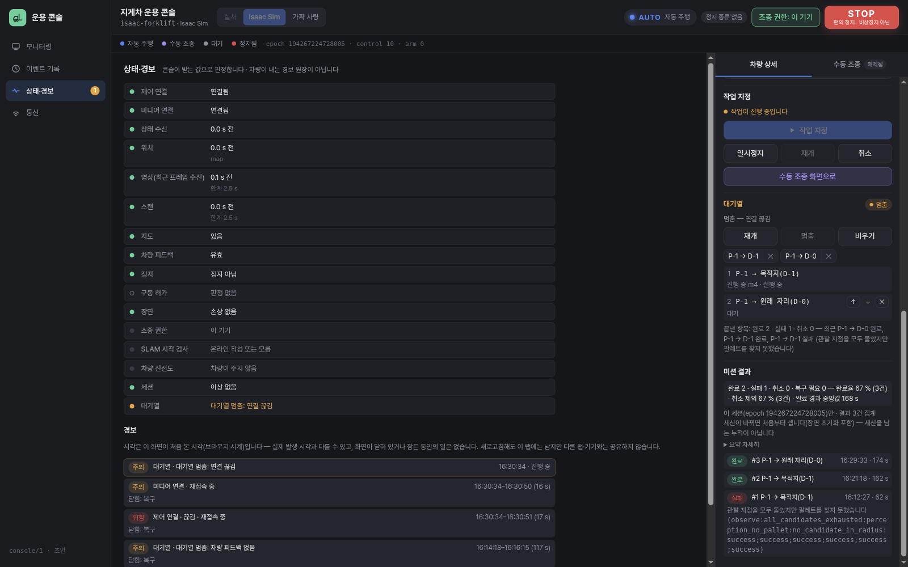
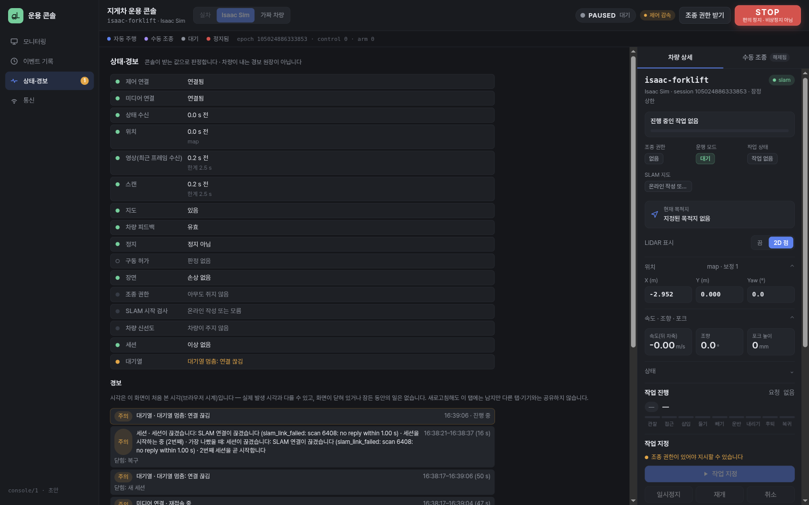
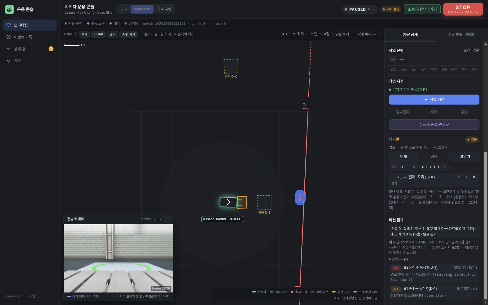

# 콘솔 미션 대기열·상태·경보·실적 요약 — Isaac 실시간 운용 확인 (2026-10-22)

대상: [미션 대기열](../plans/2026-10-22-console-mission-queue.md)(PR #90), [상태·경보](../plans/2026-10-22-console-status-panel.md)(PR #93), [실적 요약](../plans/2026-10-22-console-results-summary.md)(PR #95). 지금까지는 가짜 차량으로만 확인했다. 여기서는 웹 콘솔을 **Isaac 실시간 실행기**(`deploy/console/isaac_live.sbatch`, 감독자 + SLAM 브리지 + `run_transport.py --live`)에 붙여 사람이 직접 운용했다. 연결은 노트북 Playwright Chromium → `ssh -N -L 8798:127.0.0.1:8823 ws1`.

| 항목 | 값 |
|---|---|
| 잡 | ws1 8503 (`--gres=shard:2`, 8 G, 44 분 23 초, MaxRSS 6.4 GB, 정상 종료) |
| 스냅숏 | `snapshots/console_ops_9b3cde7`(main `9b3cde7` — PR #90·#93·#95·#97·#98 포함). 운용 도중 웹 파일만 이 PR 의 수정본으로 바꿈(아래 2절; 실행기는 웹 파일을 요청마다 디스크에서 읽고, 페이지는 새로고침으로 바뀐다) |
| 실행 스크립트 | `test_runs/live/console_ops/console_ops.sbatch`(저장소 밖, `test_runs/live/ct1_far.sbatch` 에서 탐침을 뺀 것) |
| 장면 | `test_runs/riibotics/scenes_ct1_419efe6/line_1.json`(`--layout scene`), 팔레트 1 개 `P-1`, 하역 칸 `D-0`(원래 자리)·`D-1`(목적지) |
| 인식 | `--recognition far`(학습 제안 YOLO11s, CUDA), 근접 재작도 `always`, SLAM 온라인 작성 |
| 배속 | 목표 0.4, 실측 에폭 1 0.348(멈춤 7 회)·에폭 2 0.367 |
| 시험용 실패 | `--live-test-far-zone-offset-m 3.0` — 세션의 첫 미션만 팔레트에서 3 m 떨어진 곳을 보게 해 인식 실패로 끝냄 |
| 세션 | 에폭 1(16:08–16:38, 실행기 실패로 끝남), 에폭 2(16:39–16:52, 운용자가 세션 종료) |

## 1. 결과

시각은 노트북 시계, 실행기 시각은 `live_log.jsonl` 의 단조 시계를 포트 파일의 시작 시각으로 바꾼 것(같은 사건이 콘솔과 1 초 안에서 맞는다).

| 확인 항목 | 콘솔 | 실행기 기록 | 판정 |
|---|---|---|---|
| ① 연속 제출 | 대기열 5 건(D-1·D-1·D-0·D-1·D-0)을 저장된 운반 버튼으로 넣고 재개. m3(P-1 → D-0) `done` 16:29:33 → **1 초 뒤 m4(P-1 → D-1) 자동 제출**. 끝낸 수 '완료 2 · 실패 1', 실적 요약 '완료 2 · 실패 1 — 완료율 67 % (3건) · 완료 경과 중앙값 168 s'(m2 162 s·m3 174 s) | m3 `mission_end done` 16:29:33, `PAUSED→AUTO (mission)` 16:29:34; `started_s`→`ended_s` m2 112.3→274.2, m3 276.6→451.1 | 통과 |
| ② 실패 시 멈춤 | m1(시험용 3 m 어긋남) 실패 16:12:27 → 대기열 멈춤, 그 뒤 60 초 동안 제출 없음, 상태·경보에 '대기열 멈춤' 주의 경보. 에폭 2 의 m2 가 운반 추적 시간 초과로 실패했을 때(16:51:12)도 같은 멈춤 | m1 `failed observe:all_candidates_exhausted:perception_no_pallet:…`, 그 뒤 운용자 재개(16:13:48) 전 AUTO 진입 없음; m2 `failed Tracking timeout in transport` | 통과 |
| ③ 연결 끊김 | m4 진행 중 터널을 16:30:34 에 끊고 16:30:50 에 다시 엶 → 대기열 '연결 끊김'으로 멈춤, 재접속 뒤 조종 권한은 돌아왔고 대기열은 멈춘 채. 진행률은 끊김 동안 0 % → 11 % | 16:30:30–16:30:55 의 제어 틱 1095 개 모두 `AUTO`(모드 사건 없음), 16:30:50 `lease` 회수 | 통과 |
| ④ STOP | m5 진행 중 STOP 16:37:37 → 대기열 즉시 'STOP'으로 멈춤. 재무장(16:37:51)·미션 재개 뒤에도 멈춘 채 | `AUTO→STOPPED stop:console` 16:37:37, `STOPPED→PAUSED rearm` 16:37:51, `PAUSED→AUTO` 16:37:54 | 통과 |
| ④ 운용자 취소 | 대기열이 실행 중일 때 취소 16:41:01 → 즉시 '운용자 취소'로 멈춤, 결과 '취소 #1 · 운용자가 취소했습니다', 60 초 동안 제출 없음 | `mission_end cancelled operator` 16:41:01(제출 수락부터 5.2 s) | 통과 |
| ⑤ 상태·경보 | 처음 연결: 16 행 정상·해당 없음(구동 허가는 실행기가 상한을 비워 보내 '모름'). 끊김: 제어 연결 위험·미디어 연결 주의 경보 → 재접속 뒤 '복구'(16–17 s). STOP: 정지 위험 경보 → 재무장 뒤 '복구'(15 s). 실행기 실패: 세션 주의 경보(대기 서버의 'SLAM 연결이 끊겼습니다') → 새 세션에서 제어 연결 경보는 '새 세션'으로 닫힘. 세션 종료: 연결·상태 행 모두 '해당 없음(세션 종료됨)'. 실시간 신선도: 상태·위치 0.0–0.1 s, 영상 0.1–0.2 s(배속 보정 한계 2.5 s), 스캔 0.0–0.2 s 로 모두 정상 분류, AUTO 중 피드백 순간 거짓은 경보를 열지 않음(0.5 s 미만) | — | 통과(표시 수정 2 건, 2절) |
| 새로고침 | m2·m4 진행 중 새로고침 → 대기열 멈춘 채 열림, 그 항목은 '불확실 — 미션 m2 · 차량 진행 중'; 결과가 오자 끝낸 항목으로 정리, 재개는 운용자가 | 같은 세션의 `mission_end` 로 정리 | 통과 |
| 거부 | 이미 D-0 에 있는 팔레트를 D-0 으로 → '거부: 그 팔레트는 이미 그 목적지에 있습니다'로 멈춤, 항목은 맨 앞 | AUTO 진입 없음 | 통과 |
| 새 세션 | 실행기 실패로 에폭 2 → 대기열은 '연결 끊김'으로 멈춘 채, 진행 중이던 m5 항목은 '불확실'(결과는 옛 세션 것이라 오지 않음), 결과 목록·실적 요약은 새 세션 기준으로 비움, 권한은 넘어오지 않음 | 감독자 `exit 1 slam_link_failed` → `start epoch 2` | 통과 |

## 2. 운용에서 드러나 고친 것 (콘솔)

- **피드백 순간 거짓에 대기열이 멈춤(결함).** 실행기는 0.1 s 마다 상태를 보내고 피드백 나이 한계도 0.1 s 인데(`live/link.py` `state_period_s`, `safety/arbiter.py` `feedback_max_age_s`), AUTO 중 제어 틱 간격이 0.1 s 를 넘는 순간이 분당 5.7–5.9 번 있었다(에폭 1 AUTO 1609 s 동안 157 번, 에폭 2 541 s 동안 51 번, 대부분 0.10–0.24 s). 그 순간의 상태 하나가 `feedback_ok=false` 이면 대기열이 '차량 피드백 없음'으로 멈췄다 — m2 진행 중 16:14:18 에 실제로 멈췄고, 상태·경보의 피드백 경보(0.5 s)는 열리지 않았다. 수정: 거짓이 **0.5 s 이상 이어질 때만** 상실로 본다(경보와 같은 값). 상실이 0.5 s 를 넘긴 뒤 회복된 상태가 먼저 와도, 타이머가 먼저 돌아도 멈춘다(Codex 1회차 P2). 제출 직전에는 여전히 그 순간 피드백이 유효하고 정지가 확인돼야 한다. 수정 뒤 m3·m4(에폭 1, 약 16 분)와 에폭 2 의 m2(약 9 분) 동안 피드백으로 인한 멈춤은 없었다.
- **멈춘 이유가 사유 코드 원문.** '실패: observe:all_candidates_exhausted:perception_no_pallet:no_candidate_in_radius:success;…' 가 그대로 나옴 → 결과 설명표·거부 설명표로 바꿔 보이고 코드는 상태 행 설명란과 재개 버튼 툴팁에 둔다.
- **관찰 후보 소진 실패가 '관찰 경로를 계획하지 못했습니다'로 설명됨.** 이 코드는 인식이 팔레트를 확정하지 못해 관찰 후보를 다 쓴 경우다(`core.py`; 마지막 후보는 계획 실패·시간 초과일 수도 있다 — Codex 1회차 P3) → 설명표에 '팔레트를 찾지 못해 관찰 후보를 다 썼습니다'·'인식이 팔레트를 확정하지 못해 관찰 후보를 다 썼습니다'.
- **연결이 끊기고 대기 서버 응답도 없을 때 세션 행이 정상.** 실행기가 쓰러진 뒤 다음 실행기가 포트를 잡고 welcome 을 보내기 전, 대기 서버 응답이 사라지자 세션 경보가 '복구'로 닫혔다 → 연결이 끊겼거나 소켓만 열리고 welcome 이 아직 없을 때는 '모름'(Codex 3회차).
- **끊긴 뒤 조종 권한 행이 '다른 기기가 쥠'.** 마지막 상태의 소유자가 이 탭이면 '이 기기 · 연결이 끊겨 다시 받아야 함'.

## 3. 차량·실행기 쪽 관찰 (고치지 않음 — 원인·재현만)

- **SLAM 링크 실패로 에폭 1 종료.** 16:38:17 실행기 `exit 1`, 감독자 기록 `slam_link_failed: scan 6408: no reply within 1.00 s`. 잡을 낼 때(16:05) ws1 에는 다른 Isaac 잡 3 개와 배열 잡이 돌고 있었다(CPU 20/20 할당; 실패 시각의 부하는 확인하지 않음). 감독자는 13 s 뒤 에폭 2 를 띄웠다. 재현: 같은 스크립트로 장시간 운용(이번엔 30 분째). CT-1 의 `ct1_reject` 실행(잡 8334)에서도 에폭 1 이 학습 작업자 종료로 끝난 적이 있다 — 부하 속 보조 프로세스 응답 지연 쪽으로 보이나 확인하지 않았다.
- **하역 정밀도 실패.** m4(P-1 → D-1) `failed Pallet missed the green destination center`(16:37:02). 열린 하역 구역 정밀도 작업(PR #99) 소관.
- **운반 구간 끝에서 멈춤 → 추적 시간 초과.** 에폭 2 m2 가 운반 구간 249(진행 14.529 m)에서 속도 명령 −0.002 m/s, 위치 오차 0.16 m 로 약 7 분 머문 뒤 `Tracking timeout in transport`. CT-1 메모리의 '구간 끝 크리프·운반 추적 시간 초과'와 같은 모양(연속 이송 세션 소관).
- **배속 미달.** 목표 0.4 에 실측 0.348(에폭 1, 멈춤 7 회)·0.367(에폭 2). 위 틱 간격의 바탕.

## 4. 시험·검토

- 웹 시험 `node --test "console/web/test/*.test.mjs"` 192 통과. ws1 `forklift-ws1-pytest tests/unit/console tests/integration/console` 156 통과·1 건너뜀(설명표 시험 포함).
- Codex: 수정 1차(피드백 상실 0.5 s, 문구) — P2 1·P3 1 → 반영 → 2회차 수렴. 표시 수정(세션 unknown, 권한 값) 3회차 — P2 1(소켓만 열리고 welcome 전에도 세션 경보가 복구로 닫힘) → 반영 → **4회차 수렴(새 P1/P2 없음)**.
- 시험용으로, 수정 전 '차량 피드백 없음' 멈춤을 3 초 뒤 대신 재개하는 페이지 스크립트를 16:15–16:17 에만 걸었다(빈도 확인용 — 그 동안 멈춤 1 회). 나머지 재개·STOP·취소·끊김은 화면 버튼과 터널로 직접 했다.

## 5. 화면

| | |
|---|---|
| 처음 연결 — 상태 행 |  |
| 시험용 실패 뒤 멈춘 대기열(수정 전 문구) |  |
| 대기열 멈춤 경보 |  |
| m3 완료 뒤 m4 자동 제출 |  |
| 끊김 뒤 경보 — 복구로 닫힘 |  |
| 실행기 실패 → 새 세션 |  |
| 에폭 2 — 취소·거부·추적 실패 뒤 |  |

산출물: ws1 `/home/projects/forklift/test_runs/live/console_ops/run1/`(감독자·실행기 기록, 미션 폴더), 요약 스크립트 `ops_events.py`·`ops_evidence.py`·`gap_scan.py`(같은 폴더).
