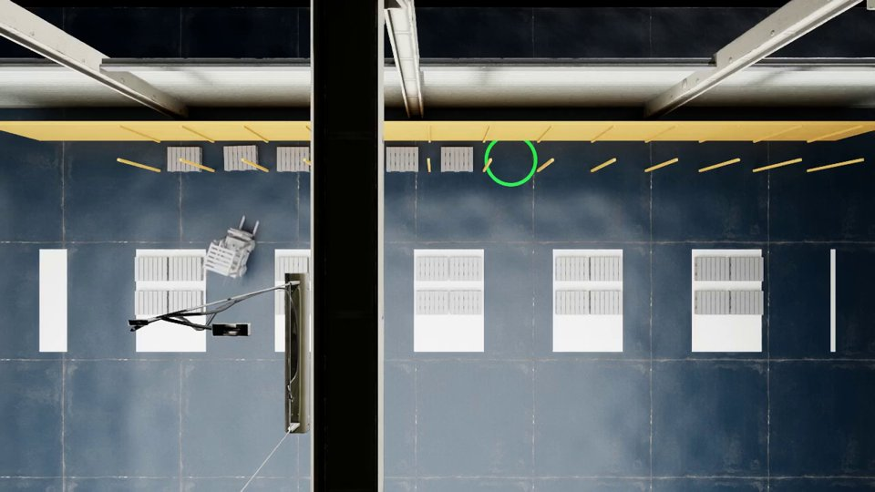
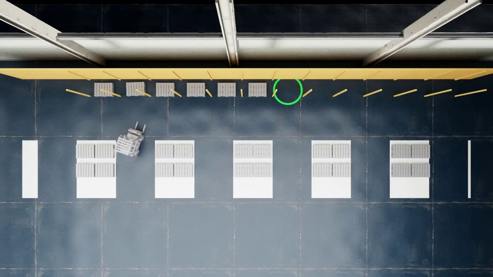

# 탑뷰 영상에서 천장 구조물 숨기기 (2026-11-11, 사용자 요청 · 총괄 배정)

- 요청(사용자, 총괄 경유): Isaac 탑뷰 영상에 찍히는 공장 천장 조명이 바닥 장애물처럼 보이니 "그거 안 보이게 해 줘". 조건은 영상에서만 숨기는 것이다. 시뮬레이션 결과, 인식 카메라(D435i RGB-D), LiDAR, 조명, 물리는 바뀌지 않아야 한다.
- 결정(사용자): 확인을 통과하면 기본값으로 켠다. 러너 기본값을 바꾸고, 런처마다 따로 켜지 않는다.

## 무엇이 찍혔나(장면 USD, usd-core 로 읽음)

`Simple_Warehouse/full_warehouse.usd`(ws1 미러). 측정 스크립트: `2026-11-11-overview-clip/ceil_heights.py`.
- `scene.hide_overhead` 는 3 m 위에 통째로 있는 창고 부품을 이미 숨긴다. 다만 조명을 담은 프림은 장면이 어두워지지 않도록 남긴다. 그래서 천장 조명 기구 `SM_LampCeilingA` 37 개(각각 RectLight 포함)가 남는다. 높이는 5.82–9.01 m(RectLight 의 크기 포함)다.
- 기둥-보 조립체 `SM_PillarPartA_9M` 18 개는 바닥에서 9 m 까지 한 프림이라 숨겨지지 않는다.
  - 기둥은 벽 쪽 바닥에 서 있다(동쪽 x 5.16–5.56 등).
  - 그 위의 지붕 보가 탑뷰를 가로지르는 검은 띠로 보였다. 보 아래면은 끝에서 떨어진 곳에서 7.88 m, 가새는 6.01 m 부터다.

## 방법

- 탑뷰 카메라(`run_transport` 의 GlobalCamera, `run_slam_drive` 의 SurveyCamera)는 수직 아래를 본다. 그래서 높이 z 인 평면까지의 거리는 `눈높이 − z` 다.
- 근거리 클리핑을 `눈높이 − z_clip` 으로 두면 그 카메라의 그림에서만 z_clip 위가 잘린다. 다른 카메라, 조명의 빛, LiDAR, 물리는 그대로다(`sim/isaac/overhead_clip.py`).
- z_clip 은 실행마다 장면에서 읽는다. 3 m 위에 통째로 있는 조명 프림의 최저 높이 − 0.3 m 이고, 3 m 아래로는 내려가지 않는다. 이 창고에서는 5.518 m 다.
- 인자는 `--overview-clip auto|off` 이고 기본은 auto 다(2026-11-11 사용자 결정). off 로 되돌릴 수 있다. 근접 추적 계약에서는 영상 전용 인자라 비교에서 뺀다(`RUN_SPECIFIC_ARGUMENTS`, `video_preset` 과 같은 자리).

## 확인

- 잡 17665(스냅숏 `ovc_03371487`, 기본 off 트리). riib aisle_rack seed 0, `--deterministic`, VIDEO=on, 시뮬 90 s 로 잘랐다(끝은 예상된 "시간 예산 초과"). off·off·auto 3 회를 순차로 돌렸다.
- auto 실행의 기록: 눈높이 11.72 m, z_clip 5.518 m, near 6.21 m.

| 기준(결과 뒤 예외로 바꾼 것, 아래) | 결과 |
|---|---|
| ① 깊이 캡처 바이트 동일 | off·off·auto 세 실행의 캡처 2 장 모두 md5 가 같다 |
| ② 인식 RGB 차이가 off·off 잡음 안 | off·off: 같은 화소 43 %, 평균 절대차 0.72–0.75, p99 7. off·auto: 평균 0.56–0.70, p99 6–7 |
| ③ 판정 기록 차이가 off·off 와 같은 항목 + `camera.overhead_clip` 뿐 | 맞다. off·off 차이는 벽시계·렌더 횟수·객체 id·경로·탐지 소요 시간뿐이고, 관측·인식·계획 결과는 같다 |
| 탑뷰에서 천장만 사라짐 | 아래 그림. 지붕 보(검은 띠)와 매달린 조명 기구가 사라졌다 |

- 결과 뒤 예외(총괄 결정 2026-11-11):
  - 원래 기준 "인식 RGB 바이트 동일"은 끈 실행끼리도 성립하지 않았다(결정 모드가 RGB 렌더 잡음까지 고정하지 못함; 같은 화소 43 %, 평균 차 0.72–0.75, p99 7). 그래서 어떤 변경으로도 충족할 수 없는 기준이었다.
  - 결과를 본 뒤 위 ①–③ 으로 바꿨다.

전(off, 30 s):

후(auto, 30 s):

## 한계

- 남는 노란 사선 막대와 띠는 aisle_rack 장면의 실제 랙이다(기둥 26 개·뒷벽, 높이 1.5 m). 바닥 장애물이라 남긴다.
- 근거리 면은 그 위의 모든 모양을 자른다. 랙(3–6 m)·벽·벽 기둥은 탑뷰에서 5.52 m 아래 부분만 남는다.
- auto 프레임 위쪽의 회색 띠와 사선·세로 막대는 동쪽 벽(SM_WallA_InnerCorner)과 벽 기둥(SM_PillarPartA_9M; x 5.16–5.56, y −2.4/−8.4/−14.4)의 5.52 m 아래 부분이다. 높은 구조물이 원근으로 바깥쪽으로 누워 보인다. 직교 투영으로 바꾸는 안은 낮은 우선순위 백로그다(총괄 2026-11-11).
- 사선·전방 카메라(quarter, chase, 로봇의 영상 카메라)는 수평 근거리 면이 없어 이 방식이 맞지 않는다. 바꾸지 않았다.
- 3 m 위의 조명이 없는 장면에서는 자르지 않는다(지붕 보도 남음).
- 인식 RGB 의 동일성은 잡음 범위로만 보였다. 깊이·판정 기록은 같다.
